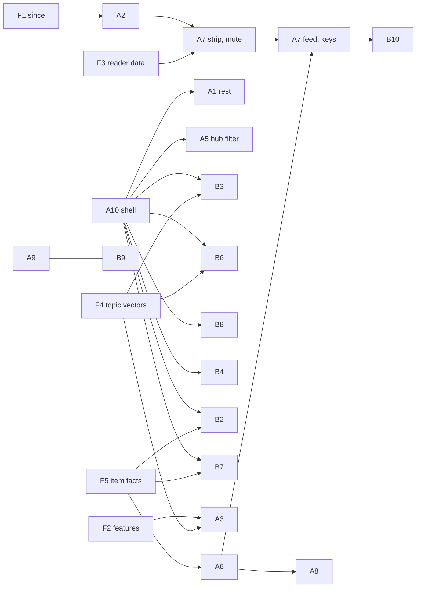

# SPEC: the proposals of ux-proposals.md

Implementation specifications for the twenty proposals in [ux-proposals.md](ux-proposals.md): what is left of the five that are built
(A1, A4, A5, B1, B5) and all of the fifteen that are not. Written against the code as it is on 2026-11-12 (branch
`redesign-agent-cortex`, commit `7aca61c`).

It follows the decisions of 2026-11-11 in that document, and the rules of `INTENT.md` section 11. Where a proposal left something
open, or cannot be built as written, this spec takes a position and lists it in [section 3](#3-positions-this-spec-takes) so it can
be overruled before the work starts.

## Contents

1. [How to read a feature spec](#1-how-to-read-a-feature-spec)
2. [Rules every feature keeps](#2-rules-every-feature-keeps)
3. [Positions this spec takes](#3-positions-this-spec-takes)
4. [Foundations](#4-foundations) (F1 to F7: built once, used by several features)
5. [Part A](#5-part-a-surfacing-and-diving): A1 to A10
6. [Part B](#6-part-b-visualizations): B1 to B10
7. [Build order and dependencies](#7-build-order-and-dependencies)
8. [What each step must leave behind](#8-what-each-step-must-leave-behind)

---

## 1. How to read a feature spec

Every feature has the same parts:

| Part | Holds |
| --- | --- |
| **State** | Built, partly built or not built, and what this spec covers |
| **Depends on** | Foundations and other features that must be there first |
| **Behaviour** | What a reader and an agent get, precisely enough to test |
| **Addresses** | New pages, JSON twins, query parameters, with what is valid and what is in the cache key |
| **Data** | New tables and columns, new internal routes of the Durable Objects, shapes |
| **Code** | Files to add or change. A pure module comes first, the page and the tool read it |
| **MCP** | Tools, arguments, `structuredContent`, views and their `ui://` addresses |
| **Without script, phones, access** | The text form and what a keyboard and a screen reader get |
| **Edge cases** | What happens with too little data, old addresses, hidden sources |
| **Tests** | The test file and the cases it must hold |
| **Done when** | Acceptance, as things that can be checked |

Sizes are rough: **S** up to a day, **M** two to four days, **L** a week or more.

## 2. Rules every feature keeps

These are not repeated per feature. A feature that needs to break one says so under *Positions*.

**Shape of the code**

- **A pure module first.** The rules of a feature (what counts, thresholds, wording, parsing of address parameters) live in one file
  under `src/signal/` or `src/site/` with no Worker APIs, so `node --test` can import it. Thresholds are exported constants with a
  comment saying how they were set. Tests go in `test/<name>.test.mjs`, fixtures in `test/helpers/`.
- **The Monitor answers, the page assembles.** New public reads are routes `/mon/<name>-public` on `MonitorDO`, cached in the object
  for two minutes keyed by the *validated* parameters, so odd values share the plain entry. `PublishDO` routes are `/pub/<name>`,
  `UsersDO` is called over RPC.
- **One loader per feature**, in `src/site/<name>Data.ts`, used by the page, the JSON twin and the MCP tool, as `loadTopic` is today.
- **Text for agents** is built in `src/site/agentText.ts` (pure, tested in `test/agenttext.test.mjs`): leads with the answer, keeps to
  the size limits of `detail`, ends with a `Next:` line.
- **Schema changes** are `CREATE TABLE IF NOT EXISTS` and guarded `ALTER TABLE … ADD COLUMN` in the object's constructor, as today.
  No new Durable Object class is needed by any feature here, so `wrangler.jsonc` gets no migration.

**What a reader gets**

- Server-rendered and readable without script. A script only adds convenience, is served as a file under `/viz/`, and wraps storage
  in `try/catch`. The page policy stays `script-src 'self'` with no inline script and `connect-src 'self'`.
- A filter or a state is an **address parameter**. Every new parameter is validated strictly, dropped when it is not understood
  (never an error page), and is part of the edge-cache key only in its validated form.
- Every picture has its words next to or under it: a list or a table that says the same.
- Kinds of source are never added up or ranked against each other. A list ordered by reactions is one kind at a time.
- Item titles, links, authors and outlets show only for a Signal that shows its sources (`board.proof`). Every feature below that
  shows an item or a name inherits this; the *Edge cases* say what is shown instead.
- arXiv: titles and abstracts only, the exact thank-you statement on any page or answer that shows papers, no arXiv branding, and
  no new request to arXiv outside the one gate. No feature here fetches from arXiv.
- Politics: every page and tool takes the area as the existing ones do (`?area=politics`, `area` argument), and an AI answer never
  includes politics topics.
- Landing page HTML stays under about 60 KB. Each block added to it states its budget.

**Views (MCP Apps and the site's frames)**

- Hand-written, a classic inline script, no SDK, no bundler. `src/apps/costs.ts` is not touched by anything here.
- A view that changes gets a new `ui://` address (the suffix is bumped). The versions this spec ends at are in
  [F7](#f7-view-versions).
- The tool's text and `structuredContent` are complete on their own. Large data stays out of the result and is read by the view
  through `tools/call`.
- Nothing moves until asked, and not at all with `prefers-reduced-motion`.
- Check each view with the fake host and headless Chrome before a deploy, then in the Claude app after it (reconnect the connector,
  new chat). The fake host does not prove a view renders in the Claude app.

**Money**

- No anonymous request, and no request to `/agent/mcp`, starts a model call. Model calls happen in the Monitor's alarm inside the
  Signal topic model's daily cap, or at read time only for a signed-in reader with the feature for it ([F2](#f2-reader-features)).
- Every model or embedding call is written to the ledger with `recordCost` under a feature name of its own, so it shows in Costs.

## 3. Positions this spec takes

Things the proposals left open or that turned out not to fit. Each is a default that can be changed.

| # | Where | Position | Why |
| --- | --- | --- | --- |
| P1 | A3 | *More like this* (`similar`) is **public**; only typing a new query by meaning is gated | It compares vectors that are already stored. No model call is made, so the decision of 2026-11-11 does not cover it |
| P2 | A3 | "The admin and strategists" becomes a feature `meaning`, given by a new default role **Strategist**; the owner has it on the private `/mcp` | Readers already work by role and feature (`src/users/model.ts`). The owner gives it to their own reader account in the Readers tab |
| P3 | A3 | Search as you type never searches by meaning | One embedding per keystroke is the cost the rule is there to prevent. Suggestions are by words; meaning runs when the form is sent |
| P4 | A6 | A voice gets a page only with at least 5 items in 3 topics over 30 days, in a Signal that shows its sources; pages of single accounts carry `noindex`; the admin can hide a voice | "No profile from anything but the collected items", and nothing claimed of an account that was seen twice |
| P5 | A6 | "Early" is said of a voice only after 8 waves joined and two standard deviations above chance | The same yardstick as Who said it first (`MIN_JOINED`) |
| P6 | A7 | The weekly e-mail is the last part of A7 and optional; it needs a sender domain and the `EMAIL` binding | Everything else in A7 works without it |
| P7 | A7, B10 | A reader's key for MCP is separate from the feed secret, and both can be reset on `/me` | A feed address ends up in feed readers; it should not also open the MCP answers |
| P8 | A8 | Comparing one topic in two windows works only inside the days that are kept: 30 today. A new small table keeps daily counts for 400 days **from the day it ships** | "This wave and the one in September" cannot be drawn from data that was deleted. The spec starts keeping it |
| P9 | A8 | "Two lenses" in the title is not specified by the proposal's body and is left out | Two lenses side by side is the landing page with two windows; no question in the proposal needs it |
| P10 | A9 | In brief lines and briefing themes get marks to the **theme's** sources, not per sentence, in the first step | Per-sentence sources there need a change to the briefing agent (`src/summarize/agent.ts`), which is a larger and separate change. Topic summaries get true per-sentence sources |
| P11 | A10 | The back stack lives **inside one frame**: a view opens a topic or an item as a panel in place. Asking Claude to draw another view stays, as *Open the full view* | A view cannot replace itself with another tool's view, and two frames in a conversation share nothing |
| P12 | A10 | *Save to list* from a view opens a confirmation page on the site (`ui/open-link`); no MCP tool writes | Both MCP servers are read only by rule |
| P13 | B2 | arXiv takes part in Crossings by day only; a paper and a post on the same UTC day are "same day, order unknown" and counted apart | A paper has a date and no time of day. Today such dates are left out of every order |
| P14 | B4 | Bridges is a second picture inside the Research map view, not a view of its own | A tool has one `resourceUri`; the Ladder inside the Landscape view set the pattern |
| P15 | B7 | Whether an item's time is exact, a date only, or the fetch time is stored from the day B7 ships; older items are drawn as they are and the page says since when the mark is reliable | The item log does not record it today |
| P16 | B9 | Story mode is the view of a new tool `get_story`; the `dig_into` prompt calls it first | A prompt has no view; a tool does |
| P17 | B9, B8, A8 | Story mode, the Weave and Compare are **server-drawn** on the site (SVG and tables, no frame); only their MCP form is a view | Each is static once drawn. A frame would only cost a round trip and a script |
| P18 | A2 | For an anonymous MCP caller `since: "last"` means one day back, and the answer says so | The public server keeps nothing about its callers |

---

## 4. Foundations

Seven pieces that more than one feature needs. Each is built with the first feature that uses it.

### F1. Since

*Used by A2, A7, B10. Built with A2.*

One way to say "from when" across pages, fragments and tools.

- **Module** `src/signal/since.ts` (pure):
  - `parseSince(raw, now): string | null`: a day `YYYY-MM-DD` (UTC). Accepts a day, a number of milliseconds, or the words
    `last`, `yesterday`. Valid only from 14 days back up to yesterday; anything else is `null`. `last` and `yesterday` are yesterday
    unless the caller hands in a stored visit.
  - `sinceQuery(day)`, `withSince(href, day)`: writes `since=<day>` into an address, before a `#`.
  - `sinceLabel(day, now)`: "since Wed 4 Nov", "since yesterday".
- **Address:** `?since=YYYY-MM-DD` on `/`, `/politics`, `/t/<slug>`. Day precision keeps the cache key bounded (at most 14 values).
  A page with a valid `since` carries `<meta name="robots" content="noindex">` and its canonical link is the address without it.
- **Browser:** `/viz/visit.js` (the present `VISIT_JS` in `src/site/landing.ts`, grown into `src/site/visit.ts`) keeps
  - `localStorage.visit`: the time of this visit to the landing page, and `sessionStorage.visitPrev` the one before (as today);
  - `localStorage['seen:<area>:<slug>']`: the time of the last visit to a topic page, at most 300 entries, oldest dropped.
  On load it reads the previous value, then writes the new one. It never navigates. What it does with the value is in A2.
- **Account:** when the reader has chosen to keep visits with their account ([F3](#f3-reader-data-the-reader-decides)), the server
  reads the stored visit and renders the since-blocks itself; the script then finds them present and does nothing.

### F2. Reader features

*Used by A3, A7. Built with A3.*

In `src/users/model.ts`:

- `FEATURES` gains
  - `meaning` — *Search by meaning*: "Search finds things that mean what you typed, not only the same words. Each new search costs
    a little (one embedding)."
  - `digest` — *Weekly e-mail*: "A weekly e-mail of what changed in the topics you follow." (only with A7's last part)
- `DEFAULT_ROLES` gains `{ key: 'strategist', name: 'Strategist', features: ['ask', 'publish', 'meaning'], askPerDay: 20 }`.
  Roles already stored in `meta.roles` are not rewritten: the Readers tab shows the new features as boxes to tick, and a role named
  Strategist is added only when no role with that key exists.
- `MEANING_PER_HOUR = 30`: new queries by meaning per reader per hour (a cached query does not count).
- Tests in `test/users.test.mjs`: the feature keys are known, `accessOf` gives `meaning` to a strategist and not to a reader or an
  analyst, a stored role list without the new role keeps working.

### F3. Reader data: the reader decides

*Used by A2, A7, B10. Built with A7.*

The decision: kept in the browser unless the reader chooses, on `/me`, to keep it with their account.

- `Prefs` gains `keep: { visits: boolean; wake: boolean; mutes: boolean }`, all `false` by default. `cleanPrefs` accepts old rows.
- `/me` gets a block **What is kept with your account** with one checkbox each and, per box, the sentence saying what is stored,
  where it is used, and a **Delete** button that empties the table for that reader at once. Unticking deletes too.
- New `UsersDO` tables:

  ```sql
  CREATE TABLE IF NOT EXISTS visits (email TEXT NOT NULL, key TEXT NOT NULL, at INTEGER NOT NULL, prev INTEGER NOT NULL DEFAULT 0,
    PRIMARY KEY (email, key)) WITHOUT ROWID;     -- key: 'home:ai', 'home:politics', 't:<area>:<slug>'; 400 rows a reader at most
  CREATE TABLE IF NOT EXISTS wake (email TEXT NOT NULL, at INTEGER NOT NULL, slug TEXT NOT NULL, area TEXT NOT NULL,
    PRIMARY KEY (email, at)) WITHOUT ROWID;      -- 28 days, 400 rows a reader at most
  CREATE TABLE IF NOT EXISTS mutes (email TEXT NOT NULL, slug TEXT NOT NULL, area TEXT NOT NULL, label TEXT NOT NULL, at INTEGER NOT NULL,
    PRIMARY KEY (email, slug, area)) WITHOUT ROWID;   -- 200 a reader at most
  ```

- RPC: `visit(email, key, now) → { prev }` (moves `at` to `prev` only when more than 30 minutes have passed, so a reload does not
  erase "since"), `visitsOf(email, keys[])`, `addWake`, `wakeOf`, `mute`, `unmute`, `mutesOf`, `forget(email, what)`.
- `removeUser` deletes from the three tables too.
- A page that used stored reader data says so in one line near the block ("from your account" / "kept in this browser").
- Tests in `test/users.test.mjs` for the pure parts (`cleanPrefs`, caps, the 30-minute rule as a pure function `nextVisit`).

### F4. A topic's vector

*Used by A3, B3, B6. Built with A3.*

Items (`item_vec`), topic names (`name_vec`) and papers (`research_vectors`) are embedded today with the same model
(`@cf/baai/bge-small-en-v1.5`), so they can be compared with each other. A topic has no vector of its own.

- New Monitor table:

  ```sql
  CREATE TABLE IF NOT EXISTS topic_vec (board TEXT NOT NULL, slug TEXT NOT NULL, day TEXT NOT NULL, v BLOB NOT NULL, n INTEGER NOT NULL,
    PRIMARY KEY (board, slug)) WITHOUT ROWID;
  ```

- Written in the Monitor's alarm after the topic model has run, for each topic of each published Signal: the unit-length mean of the
  vectors of its items of the last 14 days that are not copies (`item_vec.copy = ''`), at most the 200 newest. A topic with fewer
  than 3 such items gets the vector of its name from `name_vec`, and `n = 0` marks it as such. No model call.
- Pure helper `centroid(vectors): Float32Array` in `src/signal/vectors.ts`, tested in `test/vectors.test.mjs`.
- Without the Signal topic model switched on there are no item vectors. Then no `topic_vec` rows exist, and every feature that
  reads them falls back as its spec says.

### F5. More item facts in the log

*Used by A1, A6, B7. Built with whichever comes first.*

`item_log` today: `watch, item, day, ts, title, url, disc, by, match`.

- New column `tsq INTEGER NOT NULL DEFAULT 0`: how good the time is. `0` exact, `1` a date with no time of day, `2` the time the
  item was fetched because the feed gave none. `CollectDO` already knows which it was when it builds the item; it passes `tsq` in
  the item it delivers to `/mon/collected`, and `src/sources/types.ts` gets the optional field. Rows from before are `0` and the
  day the column was added is kept in `meta` as `tsq_since`.
- New index `CREATE INDEX IF NOT EXISTS item_log_by ON item_log (by, ts)` for A6.
- `isDateOnly(ts)` in `src/signal/first.ts` stays as the fallback for rows before `tsq_since`.

### F6. The shell of the views

Specified as [A10](#a10-one-connected-shell-for-the-mcp-views). Listed here because B3, B6, B7 and the remaining parts of A1 and A5
are cheaper after it.

### F7. View versions

Where each view ends after everything here. Bump one step at each change, never reuse an address.

| View | Today | Changed by | Ends at |
| --- | --- | --- | --- |
| Landscape `src/apps/landscape.ts` | `landscape-v6` | A5 (a day), A10 (shell), A7 (mutes), B10 (wake) | `landscape-v10` |
| Topic hub `src/apps/topichub.ts` | `topic-v3` | A1 (item panel), A2 (*New only*), A5 (filter in place), A10, A8, B3, B6, B7 | `topic-v11` |
| Research map `src/apps/map.ts` | `research-map-v3` | A10, B4 | `research-map-v5` |
| Depth chart `src/apps/depth.ts` | `depth-v1` | A10 | `depth-v2` |
| Crossings `src/apps/crossings.ts` | new | B2 | `crossings-v1` |
| Weave `src/apps/weave.ts` | new | B8 | `weave-v1` |
| Story `src/apps/story.ts` | new | B9 | `story-v1` |
| Orbit `src/apps/orbit.ts` (site frame; the same drawing part is in the Topic hub) | new | B3 | site only |
| Tide clock `src/apps/tide.ts` (site frame; the same part is in the Topic hub) | new | B7 | site only |

Features that land together share one bump.

---

## 5. Part A: surfacing and diving

### A1. The source card: what is left

**State.** Built: `/t/<slug>/i/<id>`, its JSON, `get_item`. This covers the five things the *Built* note lists as not done.
**Depends on.** A10 for parts 3 and 4 in the views. **Size.** M.

#### 1. *Also in*: briefing themes and saved lists

- **Briefing themes.** New `PublishDO` route `GET /pub/item-themes?url=<item url>&area=`: the themes of published issues of the last
  14 days whose sources contain that address, newest first, at most 5:
  `[{ slug, title, id, publishedAt, theme, anchor }]`. The object builds an index `url → themes` in memory on first use and drops it
  when an issue is published, unpublished or deleted, and after 10 minutes. Addresses are compared after `normalUrl` (new pure helper
  in `src/signal/itemid.ts`: lower-case host, no `www.`, no fragment, no `utm_*`, `twitter.com` read as `x.com`). It is used for
  this comparison only. **`itemId` is not changed** (it hashes the address with only the fragment removed), so no existing id moves.
- **Saved lists.** New index `CREATE INDEX IF NOT EXISTS saved_items_url ON saved_items (url)` and RPC
  `listsWith(url, viewer | null) → ListBrief[]`: the lists holding the item that the viewer may see (`mayView`), at most 5.
  For an anonymous viewer that is the lists open to everyone, and the card stays in the shared cache. For a signed-in reader the
  card is made for them (as pages with reader data are today) and also shows their own and, with *Publish lists*, the analysts'.
- **Card.** *Also in* becomes three short lists under one heading: **Topics** (as today), **Briefings** ("AI today, 10 Nov: *theme
  title*" linking the theme's anchor), **Saved lists** (name, owner's name for analysts' lists). An empty list is left out. The JSON
  gains `alsoIn.briefings` and `alsoIn.lists` (public lists only, in every case, since the JSON is shared).
- `loadItemCard` in `src/site/topicData.ts` asks the three in parallel, each guarded so a failure leaves only that list out.

#### 2. *Said the same*: who repeated it

`item_vec.copy` holds the key of the item a copy was folded into. `/mon/topic-item-public` adds
`copies: { n, list: [{ by, source, ts, url, kind }] }`: the up to 10 earliest copies, joined to `item_log`. The card lists them under
the count as "*@name*, 40 min later" with a link out. The first line says what a copy is: "Posts that say the same in nearly the
same words (the meaning step folded them into this one)". Left out when the item was not read for its meaning, as today.

#### 3. The Topic hub opens an item as a panel

With the shell (A10): a title in Talk opens the item panel (`UC.panel('item', { topic, item })`), which calls `tools/call get_item`
and draws the card's sections from `structuredContent`; *Before* and *After* step inside the panel; *Open the original* is
`ui/open-link`. The model is told ("looking at: one item of MCP auth bypass, by @name"). Back returns to the list at the same
scroll position.

#### 4. *Ask Claude about this*

- **In a view:** a button in the item panel sends `ui/message`: `About this item in <topic>: "<title>" (<url>). <question or "What is
  this, and why does it matter here?">`, after `ui/update-model-context` with the item's id, so the model can call `get_item`.
- **On the site:** for a reader with the `ask` feature the card shows the existing Ask form with a hidden `item=<id>`.
  `POST /me/ask` reads the card (`loadItemCard`) and puts the item first in the material the answering model gets; `asks` gains
  `item TEXT NOT NULL DEFAULT ''` so `/me/ask/<id>` can link back to the card. The daily number of questions is unchanged.

#### 5. Hints in `get_item`

The closing `Next:` line names the item before and after with their ids ("the next in time: `get_item` with `item: k3f…`"), and
`get_topic_items` for the day of the item. With A3 built it also names `similar`.

**Tests.** `test/sourcecard.test.mjs`: `normalUrl` (the cases above; a `twitter.com` source in a briefing matches the `x.com` item);
`itemId` gives the same ids as before for every fixture address; the copies list is ordered by time and capped; *Also in* leaves out empty lists. `test/users.test.mjs`:
`listsWith` shows a private list to its owner only.

**Done when.** A card of an item that a published briefing used names that theme and the link lands on it; a public saved list
holding the item is named on the anonymous card; in the Claude app an item opens inside the Topic hub and Back returns; no item id
that existed before has changed.

---

### A2. "What changed" as a first-class answer

**State.** Not built (the landing page has *Since your last visit* as counts). **Depends on.** F1; F3 for the account form.
**Size.** L.

#### Behaviour

**Landing.** The since-block's top line becomes a short list:
`New: X, Y. Rising: Z (×2.4), V (×1.8). Gone quiet: W.` Each name a link to its topic with `since` kept. At most three names per
group, then "and 4 more" linking `/topics?…`. With nothing in a group the group is left out; with nothing at all: "Nothing new in
your lens since Wed 4 Nov."

| Group | A topic is in it when |
| --- | --- |
| **New** | Its first mention in the 30 days of the terms table is after the since-day, and it is in today's ranked list of the lens and window |
| **Rising** | Not new, and its `change` is at least `RISE_MIN = 1.5`, and its mentions after the since-day are at least `RISE_MENTIONS = 5`. Ordered by `change`, shown as `×change` to one decimal |
| **Gone quiet** | It was among the bubbles of the kept layout (`landscape` table) of the since-day and has had no mention in the last `QUIET_DAYS = 2` days |

**Topic page.** A block **Since you were here** (*since Wed 4 Nov*) above the angles, only when at least one line has something:

- "**12 new items**: 7 on X, 3 on Hacker News, 2 videos" (counts per kind, each linking Talk with `?kind=` and `since` kept);
- the phase, if it changed: "Was *emerging*, now *at its peak*" (the phase on the since-day is `lifecycle` run on the series cut at
  that day; pure, no stored history needed);
- "2 new papers", "A new briefing theme: *title*" (links to the Papers and Briefings angles).

In every angle's list an item newer than the since-day carries a mark: a small filled dot with the hidden words "new since your
visit". Lists get `data-ts` on each row so the script can do the same from the browser's own time.

**Summary diff.** Under the summary, when yesterday's (or, with `since`, the newest summary written on or before the since-day)
exists and differs: the sentences that are new get `<mark class="chg">`, and a line under the paragraph says "Highlighted: new since
the summary of 10 Nov." A sentence is new when no sentence of the older text has a word overlap (Jaccard over lower-cased words of
three letters or more) of `SAME_SENTENCE = 0.6` or more. When every sentence is new nothing is highlighted and the line reads
"Rewritten since 10 Nov."

#### How the since-day reaches the page

1. `?since=<day>` in the address: the server renders everything above. Works without script and can be shared.
2. A signed-in reader who keeps visits with their account, with no `since` in the address: the server uses the stored `prev`.
3. Otherwise `/viz/visit.js` uses the browser's stored time:
   - landing: it fetches the fragment `/since?day=<day>&lens=&window=&area=` and replaces the content of `#since`;
   - topic page: it fetches `/t/<slug>/since?day=<day>&area=` and inserts it before `#angle`, and it adds the *new* mark to every
     `[data-ts]` row newer than the stored time (no fetch needed for that).
   The fragments are public and cached by their validated parameters. A stored time older than 14 days is treated as 14 days.

#### Addresses

| Address | Answers | Cache key |
| --- | --- | --- |
| `/?since=<day>`, `/politics?since=<day>`, `/t/<slug>?since=<day>` | The page with the blocks rendered | adds `since` |
| `/since?day=&lens=&window=&area=` | HTML fragment: the landing list | the four values |
| `/t/<slug>/since?day=&area=` | HTML fragment: the topic block, or an empty 200 when nothing changed | slug, day, area |
| `/changes.json?since=&lens=&window=&area=` | `Changes` as JSON | the four values |

A `since` that does not parse is dropped and the page is the plain one.

#### Data

- `/mon/changes-public?board=&since=<day>&win=&lens=` → `Changes`:

  ```ts
  interface Changes { since: string; today: string;
    fresh: ChangeTopic[]; rising: ChangeTopic[]; quiet: ChangeTopic[];      // already ordered, not capped
    counts: { newTopics: number; rising: number; papers: number } }          // what the block shows today
  interface ChangeTopic { slug: string; label: string; change: number | null; firstDay?: string; lastDay?: string }
  ```

- `/mon/topic-public` takes `since=<day>` (in its own cache key) and adds
  `TopicData.since = { day, items: Partial<Record<EvKind, number>>, phaseWas: Phase | null, papers: number, briefings: number,
  summaryWas: { day: string } | null }`, marks talk items with `isNew: true`, and adds `summary.fresh: number[]` (indexes of the new
  sentences).
- `topic_summary` is keyed `(slug, day)`, so older days are there. Housekeeping keeps 14 days of them.

#### Code

- `src/signal/since.ts` (F1), `src/signal/changes.ts` (pure: the three groups from daily counts, the first day, the kept layout's
  keys; `sentences(text)`, `freshSentences(now, before)`; `phaseOn(series, day)`).
- `src/site/visit.ts` replaces `VISIT_JS`; served at `/viz/visit.js` as today.
- `src/site/public.ts`: `sinceBlock` (landing), `topicSince`, marks in the list renderers, the two fragment routes.
- `src/site/landing.ts`: `sinceCounts` stays for the no-since case.

#### MCP

- `get_overview` and `get_topic` take `since`: a day or `"last"`. The text leads with the delta ("Since Wed 4 Nov: new …, rising …,
  gone quiet …" / "Since Wed 4 Nov: 12 new items, now at its peak, 2 new papers"), then the usual answer.
  `structuredContent.since` is `Changes` or `TopicData.since`. For an anonymous caller `"last"` is one day back and the text says
  "since yesterday (this server does not know your last visit)". With a reader key (A7) and visits kept with the account, it is the
  stored visit.
- The `catch_up` prompt passes its `since` to `get_overview` and tells the agent to open the topics named under New and Rising with
  the same `since`.
- Topic hub: a ***New only*** switch in Talk, shown when the result has `since`; it hides rows without `isNew`. The header shows the
  since-line.

#### Without script, phones, access

The since-block is a `<section aria-labelledby>`; the *new* mark has text, not colour alone; `<mark>` in the summary has a visible
underline as well as a background, in both themes.

#### Edge cases

- A first visit (nothing stored, no `since`): the landing block reads "Today:" with the counts, as now. The topic page has no block.
- Fewer than two days of data for a topic: no phase line.
- A Signal that does not show sources: counts per kind still show (they are counts), links go to the angle without item titles.
- The since-day's layout was never kept (the object was not running that day): *Gone quiet* is left out, not guessed.

#### Tests

`test/since.test.mjs`: `parseSince` (days, milliseconds, words, too old, tomorrow, rubbish → null), `withSince` before a `#`.
`test/changes.test.mjs`: each group's rule at its boundary, the caps, a topic that is both new and rising is only New;
`freshSentences` (reordered sentences are not new, a changed number is); `phaseOn` equals `lifecycle` of the cut series.
`test/agenttext.test.mjs`: the delta leads the text; `last` without a key says "since yesterday".

**Done when.** `/t/<slug>?since=<4 days ago>` shows the block and the marks with script switched off; visiting a topic twice a day
apart shows the block on the second visit with script on and no `since` in the address; the landing page's HTML grows by less than
2 KB; `get_topic` with `since` leads with the delta.

---

### A3. Search by meaning, and "more like this"

**State.** Not built; search is by words (`src/site/search.ts`). **Depends on.** F2, F4. **Size.** L.

#### Who gets what

| Caller | Typed query | More like this | Did you mean a topic |
| --- | --- | --- | --- |
| Anonymous on the site, `/agent/mcp` | By words, as today | Yes (stored vectors) | By words only: a topic whose name the words match exactly leads |
| Signed-in reader with `meaning` | By meaning with the words as a boost; a *Words only* switch | Yes | Yes, by meaning |
| Owner on `/mcp` | `mode: "meaning"` allowed | Yes | Yes |

#### Search by meaning

- **The query vector.** `queryVector(env, q)` in `src/site/meaning.ts`: looks the cleaned, lower-cased query up in the Monitor
  (`query_vec`), else embeds it with `embed()` from `src/lib/embed.ts`, stores it and records the cost
  (`kind: 'embedding'`, feature *Search by meaning*).

  ```sql
  CREATE TABLE IF NOT EXISTS query_vec (q TEXT PRIMARY KEY, v BLOB NOT NULL, at INTEGER NOT NULL) WITHOUT ROWID;  -- 7 days, 5,000 rows
  ```

  Before a new embedding the reader's count for the hour is checked (`MEANING_PER_HOUR`, a counter in `UsersDO` keyed by e-mail and
  hour). Over it, the search runs by words and the page says "You have used this hour's searches by meaning; showing matches by
  words."
- **Whether to prefix the query.** bge-small is made to take a short instruction before a *query* that is compared with longer
  passages. Whether that helps on this data is decided by measurement, not by habit: `QUERY_PREFIX` is a constant in
  `src/signal/vectors.ts`, set by the calibration below, and it is part of the `query_vec` key.
- **The search.** `POST /mon/search-meaning { v, board, kinds, window, lens }`: a plain scan with `dot()` over `topic_vec` (topics of
  the board), `item_vec` joined to `item_log` (items within `window`, 14 days at most, copies left out) and `research_vectors`
  (papers within `window`). Briefings have no vectors and stay by words. It returns, per kind, the rows at or above that kind's
  floor with their similarity, at most 200 a kind.
- **Ranking.** In `src/site/search.ts`, pure: `rank = sim + WORD_BOOST × quality / 2`, with `quality` the existing word match
  quality (0, 1 or 2) and `WORD_BOOST = 0.08`. Rows that match by words but are under the floor are kept, after the others.
  A lens still only orders equal matches. Each result carries `how: 'meaning' | 'words' | 'both'`, and the page says
  "matched by meaning" in the result's meta line when the words do not occur.
- **Floors.** `QUERY_ITEM_MIN`, `QUERY_PAPER_MIN`, `QUERY_TOPIC_MIN`, and for the lead `TOPIC_LEAD_MIN` with `TOPIC_LEAD_GAP` over
  the second topic. **They are not chosen by feel**: the model packs unrelated texts on one subject around 0.5 and the same story in
  other words up to about 0.89. Calibrate with the local transformers.js copy of the model, as `COPY_SIM` and `NAME_SIM` were: 40
  queries written for the purpose against a fixture of real item titles, each with the items a person marks as answers; pick per
  kind the floor that keeps 90% of the marked answers, and record precision at that floor in the comment. The fixture and the
  measured numbers go in `test/helpers/meaning-fixture.mjs`. Until measured, ship with the floors set so high (0.75) that meaning
  only adds a few results, never noise.
- **Did you mean a topic.** When the best topic is at or above `TOPIC_LEAD_MIN` and ahead of the second by `TOPIC_LEAD_GAP`, it
  leads the page as one large card (the peek card of A4, larger: name, state, one line, sparkline, "matched by meaning").

#### More like this

No model call. Three sources, one shape.

- `/mon/similar-public?kind=topic|item|paper&id=&board=&area=` →

  ```ts
  interface Similar { of: { kind, id, label }; topics: SimTopic[]; items: SimItem[]; papers: SimPaper[]; note: string }
  ```

  The vector of the thing asked about (`topic_vec`, `item_vec`, `research_vectors`) against the other two tables and its own:
  up to 5 topics, 6 items (at most 2 from one topic, never a copy of the item itself, never from the same author twice), 4 papers.
  Floors `LIKE_ITEM_MIN`, `LIKE_PAPER_MIN`, `LIKE_TOPIC_MIN`, calibrated in the same sitting.
- **Wording.** Posts near a paper are headed **Close in subject**, and each row says "close in subject, does not mention the paper".
  *Discussing* and *Being discussed* stay for real mentions. The agent text uses the same two words and never mixes them.
- **Where it shows.** A section *More like this* at the foot of the source card; on the Papers angle a link *Close in subject* per
  paper opening `/similar?kind=paper&id=`; on a topic page it feeds the *Close in meaning* half of B3 and, until B3, a second row
  of neighbour cards headed "Close in meaning".
- **Page** `/similar?kind=&id=[&topic=<slug>][&area=]` with its JSON twin `/similar.json`. `topic` is needed for an item (ids are
  per topic). Items show only for a Signal that shows its sources.

#### Search as you type

`/viz/search.js`, loaded on pages with the search box: after 250 ms without a key and at least 2 letters it fetches
`/search/suggest?q=&area=&lens=` (by words, cached by its parameters for two minutes) and shows up to 5 topics and 3 items in a
`role="listbox"` under the box; arrow keys move, Enter opens, Esc closes; the form posts as before when nothing is chosen.
It does not run with `Save-Data` on.

#### Addresses

- `/search` gains `mode=meaning|words`. `meaning` is honoured only for a reader with the feature, and such a page is made for the
  reader and never put in the shared cache. For everyone else the parameter is dropped. The form shows the switch only to readers
  who have the feature.
- `/search/suggest`, `/similar`, `/similar.json` as above.

#### MCP

- `search` gains `mode: "meaning" | "words"`. On `/agent/mcp` `meaning` answers by words and the text says so in one line
  ("Search by meaning is not open on the public server; these are matches by words. For things close to one result, use `similar`.").
  On `/mcp` it searches by meaning and records the cost.
- New public tool **`similar`**: `kind` (`topic`, `item`, `paper`), `id` (a topic's address, an item id, a paper id), `topic`
  (needed with an item), `area`, `detail`. Text: the three lists with similarity in words ("very close", "close", from two bands
  above the floor; never a raw decimal in the text, the number is in the JSON), links, and a `Next:` line.
- Topic hub and the item panel get a *More like this* list reading the same tool.

#### Edge cases

- The Signal topic model is off (no vectors): `mode=meaning` is not offered; *More like this* sections are left out; `similar`
  answers "nothing to compare with yet" as a plain answer, not an error.
- A query of one very common word (`ai`): by meaning it matches everything weakly. Queries of fewer than 3 letters, or of a single
  word on the broad list (`BROAD` in `src/signal/landscape.ts`), run by words.
- Politics has no papers: none are searched or returned.

#### Tests

`test/search.test.mjs`: the ranking formula, `how`, word-only rows last, the lead rule at both thresholds, the broad-word rule.
`test/meaning.test.mjs` with the fixture vectors: the calibrated floors keep the marked answers; *More like this* never returns the
item itself, a copy, or three items of one topic. `test/agenttext.test.mjs`: the public server's note; "close in subject" wording.
`test/users.test.mjs`: the hourly count.

**Done when.** Signed in as a strategist, "agents deleting production data" finds an item that has none of those words and labels
it; signed out the same address gives the word search and no embedding is recorded in Costs; a cached query does not record a second
cost; `similar` works on `/agent/mcp` with Costs unchanged.

---

### A4. Trails: what is left

**State.** Built. This covers the *Not done* list. **Size.** S.

| Left | Spec |
| --- | --- |
| `from` on `/topics` | Three new origins in `src/signal/trail.ts`: `topics:new`, `topics:rising`, `topics:az` (with `@politics` for the area). The list of each is exactly what `/topics` shows under that heading, built by the same function, so *n of N* matches the page. The *In your lens* list uses the existing `lens:<key>`, and is re-ordered on `/topics` to the lens's ranking so the two agree |
| `from` on a Signal page | `signal:<address>`: the topics of that Signal in the page's order, up to `FROM_LIST` |
| Bubbles of the landscape | No change to the view: `landscapeOf` writes `from` into each bubble's `url` when it builds `/overview.json` (lens and window are known there). The MCP tool's bubbles get the same, and the Topic hub passes `from` to `get_topic` when a bubble opens a topic in the shell |
| `get_item` neighbour hints | In A1, part 5 |
| Peek on keyboard focus | `keys.js`: on `focusin` of a topic link reached by Tab (`:focus-visible`), show the peek after 600 ms; it is announced through `aria-describedby` pointing at the tooltip; Esc closes it and keeps focus |
| The keys script against a browser | A check script `scripts/keys-check.mjs` in the style already used for views (headless Chrome over CDP against a page rendered from fixtures): `/` focuses search, `j` `k` move the marked row, `]` follows `rel=next`, `1` to `5` open the angles, `?` opens the panel, no key acts while typing. Not part of `npm test` (it needs Chrome); documented in CONTRIBUTING.md |
| Related cards' counts | The cards read the same 14-day series as the topic's own bars: `/mon/topic-peek` returns the series of `topic-public`'s cache when that entry is warm, and says "from the term counts" in a `title` only when it is not |

**Tests.** `test/trail.test.mjs`: the three `topics:` origins and `signal:` parse and write back; unknown tails are null.

**Done when.** From *Rising* on `/topics` the reader can step through every rising topic with `]` and the count matches the list.

---

### A5. Pictures that filter the lists: what is left

**State.** Built on the topic page. Two parts left. **Depends on.** A10 for part 2. **Size.** M.

#### 1. A day on the landing page

This also finishes B5 ("click the day header to set the whole page to that day").

- **Address** `/?day=YYYY-MM-DD` (and `/politics`), valid for the days the kept layouts cover (up to 7 before today, the days
  `replayFrames` has); otherwise dropped. In the cache key.
- **What changes on the page:** a chip at the top of the landscape block "Showing Wed 4 Nov · back to today"; the ranked list is
  that day's order (rank and score per day come from `/mon/ladder-public`, which has both); state tags are left out for a past day
  (they compare with a baseline that is not kept per day) and the line under the list says so; the frame gets `data-day`.
  *In brief*, the since-block and the rest of the page stay today's, under a thin rule "Below: today".
- **Links:** every day label of the streamgraph and every day header of the Ladder links `/?day=<day>#landscape` (keeping lens and
  window); today's links clear it.
- **View** (`landscape` bump): `/viz/host.js` passes `hostContext.day`; the view draws that day's kept frame (it already has the
  frames in `replay`) as a still picture with the chip, bubbles linking to their topics, Replay hidden. With a lens chosen there are
  no kept frames (they are kept for the whole board), so the frame shows today with a line "The map of a past day is kept without a
  lens" and the list below is still that day's.

#### 2. The Topic hub filters in place

- The header's sparkline bars and the evidence strip's segments become buttons: a bar sets `day`, a segment sets `kind`; a chip
  "Showing 4 Nov · clear" above Talk; the view passes `day`, `kind` and `sort` (`reacted`, `newest`, `earliest`) to
  `get_topic_items` and drops its own `new`/`top` words. The tool keeps understanding them.
- `get_topic_items` accepts a `day` of the last 14 days (today: 7), so the hub's bars and the site's `?day=` cover the same days.
- *Open on the site* carries the same angle, day, kind and order.
- Each change tells the model (A10).

**Tests.** `test/brush.test.mjs`: `dayOfLanding` valid range; the hub's arguments equal the site's parameters for the same choice.
`test/landing.test.mjs`: the ranked list of a past day equals the Ladder's column for it.

**Done when.** Clicking 4 Nov under the streamgraph shows that day's map and list, with script off the list alone; in the Claude
app a bar of the sparkline narrows Talk and *Open on the site* lands on the same filtered page.

---

### A6. Voices: pages for people and outlets

**State.** Not built. Decided: wanted. **Depends on.** F5; A3 optional. **Size.** L.

#### What a voice is

The author or outlet of collected items, by kind of source: an X account, a Hacker News user, a YouTube channel, a blog or news
outlet. `voiceKey(kind, by, source)` in `src/signal/voices.ts`: for `x` and `hn` the author (`by`), for `youtube` the channel, for
`rss` the outlet's site name. The address part is `voiceSlug(name)`: lower case, letters, digits, `-`, `_`, `.`, at most 60.

A voice **has a page** only when, in the last 30 days and counting only items of Signals that show their sources:

- it has at least `VOICE_MIN_ITEMS = 5` items, in at least `VOICE_MIN_TOPICS = 3` topics, and
- it is not on the admin's hidden list.

Everything else is a plain name without a link. Names are linked from Talk, the source card, Watch, *Who said it first* and search
results by one lookup: `/mon/voices-public?board=` returns the set of voices with a page (kept 10 minutes per isolate).

#### The page `/v/<kind>/<name>`

1. **Head:** name, kind in words ("An account on X", "A Hacker News user", "A YouTube channel", "An outlet"), a link out to the
   profile or site, and the standing line: "Built only from the items this site collected in the last 30 days. It says nothing
   about what this account posted elsewhere."
2. **Topics they took part in:** up to 20, most recent first: topic card (state, sparkline), how many of their items, first and last
   day. Links to the topic with `?angle=voices`.
3. **Early or not:** one sentence and the numbers behind it, by the rules below.
4. **Most reacted:** up to 8 of their items, in the unit of their kind (a voice has one kind, so nothing is mixed), each opening its
   source card.
5. **Often in the same topics:** up to 6 other voices that share at least `CO_MIN = 3` topics, ordered by overlap (Jaccard of the
   topic sets), each with the count "in 4 of the same topics". Only voices that have a page.
6. Trail line (`AI › Voices › name`), JSON-LD `ProfilePage` with the name and link only.

`<meta name="robots" content="noindex">` for kinds `x` and `hn`; outlets and channels are indexable.

#### "Early"

A wave is found as in `src/signal/first.ts` (starts after three quiet days, three mentions or more), per topic, over 30 days.
Within a wave the voices are ordered by the time of their first item; arrivals within `TIE_MS` of each other share the place.

- A voice **joined** a wave when it has an item in it. It was **among the first three** when at most two distinct voices came
  strictly before it.
- **Chance:** if the wave's `M` items were shuffled in time, a voice with `m` of them would be among the first three voices about as
  often as one of its items is among the first three items: `p = 1 − C(M−m, 3) / C(M, 3)` (1 when `M ≤ 3`). Expected count is the sum
  of `p` over the waves joined, variance the sum of `p(1−p)`.
- **Said only when** the voice joined at least `VOICE_MIN_WAVES = 8` waves: "Among the first three in 6 of 11 waves; chance would
  give about 2.4" and the verdict **often early** at two standard deviations or more above. Below it, or with fewer waves: "Took
  part in 5 waves: too few to say whether that is early." There is no *late* verdict for a voice.
- Date-only and fetch-stamped times (`tsq` 1 and 2) are left out of the order and counted on the page.
- The caveat of Who said it first is repeated: it is the order among the sources this site reads, not where a story began.

#### The Voices angle on a topic

`?angle=voices`, the sixth angle (key `6`, added to the keys list). Three short lists for the latest wave or, with no clear wave,
the 14 days:

- **First:** the first five voices in order, with the time after the first ("+40 min"), ties marked.
- **Most reacted:** per kind of source, its top three voices by the sum of reactions in that kind's unit, under the kind's heading.
- **Most persistent:** voices with items on the most distinct days ("on 6 of 14 days").

On a Signal that does not show sources the angle reads "This Signal does not show its sources" with the counts of distinct accounts
per kind, which the evidence strip already shows.

#### Addresses

| Address | Notes |
| --- | --- |
| `/v/<kind>/<name>`, `.json` | `kind` one of `x`, `hn`, `youtube`, `rss`. `?area=politics`. `?window=7\|14\|30` (30 by default). 404 when the voice has no page; **410** when it is hidden by the admin |
| `/voices` | Index: the voices with a page, grouped by kind, A to Z, with their topic count. `?lens=` narrows to topics of the lens. In the More menu under *Read* |
| `/t/<slug>?angle=voices` | In the cache key like the other angles |

#### Data

- `/mon/voice-public?kind=&name=&board=&days=` → `VoiceData` (the five blocks), built from `item_log` (index `item_log_by`) joined
  to the topics of `match`, kept 10 minutes.
- `/mon/voices-public?board=` → `[{ kind, name, slug, items, topics }]`.
- `/mon/topic-public` adds `voices: { first: [], reacted: Record<kind, []>, persistent: [] }` (names only where `proof`).
- Hidden voices: a list in the Monitor's `meta` (`voices_hidden`), edited on the Signal tab of the admin ("Hide a voice": kind and
  name; shows the current list). Hiding takes effect at once (the caches are dropped).

#### Code

`src/signal/voices.ts` (pure: keys, slugs, eligibility, the order in a wave, the chance sum, overlap), `src/site/voiceData.ts`,
`voicePage` and `voicesIndex` in `src/site/public.ts`, the angle in the topic page, the admin list in `public/admin/index.html`.

#### MCP

- New public tool **`get_voice`**: `kind`, `name`, `window` (7, 14 or 30), `area`, `detail`. Text: who it is, the topics, the
  early sentence with its numbers and caveat, most reacted with links, `Next:` naming a topic and `get_topic`. A voice without a
  page answers "not enough collected items to say anything about this account" as a plain answer.
- `get_topic` carries `voices` in `structuredContent` and a short **Voices** section in the text (first three, the most persistent).
  For "who should I follow on this?" the tool description says to read `voices` and then `get_voice`.
- The Topic hub gets a **Voices** tab reading the same data; a name opens the voice as a panel (A10).

#### Edge cases

- The same person under two kinds (an X account and a blog) are two voices. Nothing joins them.
- A name that changed case or has spaces: `voiceSlug` folds it; two names folding to one slug within a kind share the page and the
  page lists both spellings.
- An outlet whose items all come from one feed the owner added is still a voice; the page says "an outlet this site reads directly".

#### Tests

`test/voices.test.mjs`: eligibility at each boundary; the order with ties; `p` for small waves (`M ≤ 3`, `m = M`); a voice with 7
waves never gets a verdict, with 8 at exactly two deviations it does; hidden wins over eligible; overlap needs `CO_MIN`; no name
leaks when `proof` is false.

**Done when.** An author's name on Talk links to their page; the page's early sentence shows the numbers and the caveat; a hidden
voice answers 410 within the cache time and its name stops being a link; `get_voice` answers on `/agent/mcp`.

---

### A7. Your own front page: followed topics that report back

**State.** Readers can follow topics; nothing comes back. **Depends on.** F1, F3, A2. **Size.** L. Built in four parts that each
ship alone.

#### Part 1: the Following strip and mute

- **Strip.** For a signed-in reader with at least one followed topic, a block **Following** at the top of the landing page (above
  *In brief*), for the area of the page. One card per topic that changed since the reader's since-day, ordered by how much:
  `weight = 3 × (phase changed) + 2 × (new briefing theme) + new papers + log2(1 + new items)`. A card: name, state, the since-line
  of A2 ("12 new items · now at its peak"), sparkline; it links the topic with `since`. Topics with nothing new collapse into one
  line: "Quiet: A, B, C" (links). At most 6 cards, then "and 3 more" to `/me#following`. Budget 3 KB.
- **Where the since-day comes from:** as in A2. The page is made for the reader already; rendered with the stored visit when visits
  are kept with the account, else with yesterday and `/viz/visit.js` swaps in `/me/following?since=<day>&area=` (a private,
  uncached fragment) when the browser has an older time.
- **Data.** `POST /mon/topics-since { board, since, slugs[] }` → the `TopicData.since` of each, in one read (at most 100).
  A followed topic that is no longer in any published Signal shows as "no longer tracked" in the quiet line, with *Unfollow*.
- **Mute.** A **Mute** button next to **Follow** on the topic page and in the peek card's page (`POST /me/mute`, `/me/unmute`,
  listed on `/me`). A muted topic is left out of the reader's ranked list, rising strip, lens cards, *Outside your lens* and the
  Following strip, and the landscape view gets `hostContext.muted: [slug]` and leaves those bubbles out. A line under the list says
  "2 topics muted · show". Signed out, or with `keep.mutes` off: the list is `localStorage.mute`, and `/viz/visit.js` hides rows
  with a matching `data-topic` and passes the list to the frame. The topic's own page is never hidden; it shows "You muted this".

#### Part 2: follow a search or a voice

- `follows` gains a kind without changing its key: new table

  ```sql
  CREATE TABLE IF NOT EXISTS follow_more (email TEXT NOT NULL, kind TEXT NOT NULL, key TEXT NOT NULL, area TEXT NOT NULL,
    label TEXT NOT NULL, at INTEGER NOT NULL, seen TEXT NOT NULL DEFAULT '[]',
    PRIMARY KEY (email, kind, key, area)) WITHOUT ROWID;     -- kind: 'search' | 'voice'; 20 of each a reader
  ```

- **A search** (`Follow this search` on `/search`, for words of 3 letters or more): it reports a **topic** that is new (first seen
  after the follow was made) and whose name or member names match the words with `topicQuality` at name or member level. Matching
  is by words, so it costs nothing. `seen` holds the slugs already reported, so each topic is reported once.
- **A voice** (`Follow` on a voice page, A6): it reports a topic the voice took part in for the first time since the since-day.
- Both show in the Following strip as cards of their own kind ("New topic for *evals*: Name", "*@name* is now in: Name") and on
  `/me`. They are evaluated when the strip or the feed is built; nothing runs in the background.

#### Part 3: the personal feed

- `/me/feed/<secret>.xml`: Atom. The secret is 32 letters and digits from `crypto.getRandomValues`, made the first time the reader
  presses **Make a feed address** on `/me`, shown there with **Reset** (the old address answers 404 at once).

  ```sql
  CREATE TABLE IF NOT EXISTS feed_keys (secret TEXT PRIMARY KEY, email TEXT NOT NULL UNIQUE, kind TEXT NOT NULL, created INTEGER NOT NULL,
    used INTEGER NOT NULL DEFAULT 0) WITHOUT ROWID;          -- kind: 'feed' | 'agent' (Part 4)
  ```

- **Entries:** one per followed thing per UTC day on which something changed, for the last 14 days, newest first, 50 at most.
  Title "MCP auth bypass: 12 new items, now at its peak"; content the since-block of A2 as HTML with links; link
  `/t/<slug>?since=<the day before>`; id `tag:<host>,<day>:<area>/<slug>` so an entry never changes identity. The day's entry is
  written from that day's counts, so it is the same whenever the feed is read.
- No cookies and no login: the secret is the only credential, and it only opens this feed. Headers: `Cache-Control: private,
  max-age=900`, `X-Robots-Tag: noindex`, and `/me` sends `Referrer-Policy: no-referrer`. The address is never logged in full by the
  Worker's own log lines (the last 4 characters only). The route is rate limited with the existing binding pattern (a second
  `ratelimits` entry `FEED_LIMIT`, 30 a minute per address).
- Muted topics are left out. A reader who is removed loses the key.

#### Part 4: MCP, and the weekly e-mail

- **`get_following`** (`since`, `area`, `detail`), registered on both servers.
  - On `/mcp` it answers for the owner: the e-mail in the verified Access JWT, looked up among the readers.
  - On `/agent/mcp` it answers only with a reader's **agent key** (`kind: 'agent'` in `feed_keys`, made and reset on `/me`), sent as
    `Authorization: Bearer <key>`. With a key the answer is `Cache-Control: no-store` and skips the edge cache; the rate limit is
    per key. Without one: "This needs a key from your settings page (`/me`)", a plain answer.
  - Text: the strip in words, most changed first, each with its since-line and `get_topic … since` in `Next:`.
- With a key, `since: "last"` on `get_overview` and `get_topic` uses the stored visit when visits are kept with the account (A2),
  and muted topics are left out of `get_overview`. The `catch_up` prompt says: call `get_following` first when it is available.
- **Weekly e-mail** (feature `digest`, off by default; position P6). A reader with the feature ticks "Send me a weekly e-mail" on
  `/me`. `UsersDO` gets an alarm for Mondays 07:00 UTC that, per reader who opted in, builds the same content as the feed for the
  last 7 days and sends it as plain text plus simple HTML through Cloudflare Email Service (binding `EMAIL`, sender address from
  the variable `DIGEST_FROM`); nothing is sent when nothing changed. Every e-mail has an unsubscribe link
  (`/me/digest-off/<token>`, one click, no login, with the `List-Unsubscribe` and `List-Unsubscribe-Post` headers). Without the
  binding or the variable the checkbox is not shown. The owner sets up the sender domain and deploys; documented in
  `docs/deployment.md`.

#### Edge cases

- A reader follows 100 topics: the strip reads all in one Monitor call and shows 6.
- The same topic followed in both areas is two follows, as today.
- A topic was renamed under a bigger one: the follow is shown under the bigger topic's name with "(was *old name*)".

#### Tests

`test/following.test.mjs`: the weight and the order; quiet topics collapse; a search follow reports a topic once; the feed's entry
ids are stable across two builds on different days; a muted topic is in none of the lists. `test/users.test.mjs`: key creation,
reset invalidates, caps.

**Done when.** A signed-in reader sees their followed topics' changes on `/`; a feed reader shows the entries and a reset address
stops working; `get_following` answers the owner on `/mcp` and refuses politely without a key on `/agent/mcp`; unticking *keep with
my account* deletes the rows.

---

### A8. Compare

**State.** Not built. **Depends on.** A6 for the voices row (left out until then). **Size.** M.

#### The page `/compare`

`/compare?a=<slug>&b=<slug>[&area=]`: two topics of one area. Server-drawn, no script, no frame.

1. **Head:** the two names, each with state and phase, a *swap* link, and a small form to change either (a select of the topic's
   neighbours and a text box that resolves a name through the topic search).
2. **Their lives on one axis:** 14 days, one curve each. Each curve is **normalised to its own peak** (the axis is "share of its own
   busiest day"), and the caption says so. The two are told apart by colour, by line (solid, dashed) and by a label at the line's
   end. Peaks are marked with their day.
3. **The same in numbers:** a table, a row per day: mentions of A, mentions of B (absolute), the higher of the two bold. A foot row
   with totals and each topic's busiest day.
4. **Where each was talked about:** the spread per kind of source side by side, one row per kind, each cell in that kind's own unit
   ("X: about 2k likes from 40 accounts | about 300 likes from 12 accounts"). Never a total across kinds.
5. **Who had each first:** the two orders from `TopicData.first` as sentences, and one line comparing them when both have a clear
   start ("Both began on Hacker News; A reached X after 2 hours, B after a day").
6. **What they share:** items in both (the same item id), papers in both, briefing themes that name both; then, with A6, voices in
   both. Each list at most 8, with counts. "Nothing in common in the last 14 days" is a result and is said plainly.
7. **Told in one sentence** at the top, built by rule: which is bigger now, which started first, how much they share.

**One topic, two windows** (`/compare?a=<slug>&wa=<day>&wb=<day>`): the same page with the two 14-day windows starting on those
days, aligned on "day 1 of the window". Offered on a topic page whose phase is *back again*, with `wa` the start of the earlier
wave and `wb` the start of this one. It needs the daily counts of both windows: see *Data*.

**From a topic page:** a **Compare with…** link in the page's action row, pre-filled with the nearest neighbour
(`/compare?a=<this>&b=<first related>`).

#### Addresses

`/compare`, `/compare.json`. `a` and `b` must be topics of the same area, different from each other (the same slug is valid only
with `wa` and `wb`); otherwise the page is the form alone with a line saying what was not found. A name counted under a bigger topic
redirects to the address with the bigger topic's slug. `a`, `b`, `wa`, `wb`, `area` are the cache key, as given (A and B are not
reordered: the page reads left to right).

#### Data

- The loader `src/site/compareData.ts` calls `loadTopic` twice in parallel (`quiet`) and derives the rest in the pure module.
  Shared items need more than the top items of each: `/mon/compare-public?a=&b=&board=` returns the shared item ids and paper ids
  from the full item sets, and the per-kind reaction sums.
- **Daily counts kept longer** (P8):

  ```sql
  CREATE TABLE IF NOT EXISTS topic_days (board TEXT NOT NULL, slug TEXT NOT NULL, day TEXT NOT NULL, n INTEGER NOT NULL, kinds TEXT NOT NULL,
    PRIMARY KEY (board, slug, day)) WITHOUT ROWID;           -- kinds: JSON { x, hn, youtube, rss }; kept 400 days
  ```

  Written once a day by the Monitor's alarm for yesterday, for every topic of a published Signal with at least one mention. A window
  that reaches before the first kept day is not offered; the form says from which day windows can be chosen.

#### Code

`src/signal/compare.ts` (pure: normalising, aligning two windows, the shared lists, the sentence), `src/site/compareData.ts`,
`comparePage` in `src/site/public.ts`.

#### MCP

- New public tool **`compare_topics`**: `a`, `b`, `area`, `window_a`, `window_b` (days, for one topic twice), `detail`. Text: the
  sentence, the two lives in words (peak days, totals), the spread per kind as two lines per kind, who had each first, what they
  share with links. `structuredContent.compare` is the page's data.
- The view is the Topic hub with a second column: `get_topic` and `compare_topics` share the hub's `resourceUri`; when the result has
  `compare`, the hub draws the two headers side by side, the two curves on one axis, and tabs **Shared**, **Spread**, **First**.
  In the hub, *Compare with…* on a related topic calls `compare_topics` and Back returns.

#### Edge cases

- One of the two has fewer than 3 days of data: its curve is drawn as bars, not a line, and the sentence does not compare starts.
- A Signal that does not show sources: shared items are a count without titles.
- Topics from two different Signals of one area are fine; the page names both Signals.

#### Tests

`test/compare.test.mjs`: each curve peaks at exactly 1; absolute numbers survive in the table; no cell ever adds two kinds; the
shared lists are symmetric (`a,b` and `b,a` give the same sets); window alignment; the sentence for each of the cases above.

**Done when.** `/compare?a=…&b=…` answers the proposal's question (which is bigger, did they start in the same place) in its first
sentence and the two pictures; it reads with script off and at 390 px without sideways scroll; `compare_topics` draws two columns in
the Claude app.

---

### A9. Sentences that show their sources

**State.** A summary says which items it was written from, as a list. **Depends on.** A1 (built). Do it with B9. **Size.** M.

#### The summary step

`src/signal/summary.ts`, prompt and parser, version 2. The model answers:

```json
{ "line": "at most 12 words, one line for cards",
  "sentences": [ { "text": "…", "used": [1, 3] }, { "text": "…", "used": [2] } ] }
```

- The system prompt keeps every present rule and adds: one object per sentence; `used` lists only the items that sentence rests on;
  a sentence that rests on no single item (a bridge such as "People disagree about it") gets an empty list; `line` says what the
  topic is in at most 12 words, with no number that is not in the items.
- `parseSummary` accepts both shapes (the old one stays valid for stored rows and for a model that ignores the new shape). For the
  new one: 1 to 4 sentences; the joined text must pass the present checks (length, no link, marks stripped); every number in `used`
  must be between 1 and the number of items given, **anything else is dropped from that sentence's list** (the sentence stays);
  duplicates removed. `line` is cut at 12 words; when missing, it is the first sentence cut at a word boundary.
- A second check after parsing, pure: `supported(sentence, items)`: at least one content word of four letters or more of the
  sentence occurs in one of its `used` items' titles. A mark that fails is dropped. It is a cheap guard against a made-up number,
  not proof.
- Stored in `topic_summary` with two new columns: `sents TEXT NOT NULL DEFAULT ''` (JSON `[{ t, u: [itemId] }]`, the numbers
  already turned into public item ids) and `line TEXT NOT NULL DEFAULT ''`. `text` stays the joined paragraph, so everything that
  reads it today keeps working.

#### On the page

- After each sentence, small numbered marks: `<sup><a href="/t/<slug>/i/<id>" aria-label="Source 1: <title>">1</a></sup>`. Numbers
  count through the paragraph and the list under it ("Written from these items") uses the same numbers, so a mark and its row agree.
  A mark links the source card while the item is in the topic, else the original.
- A sentence resting on exactly one item gets the tag **one source** after its mark. A sentence with no item gets nothing.
- Only for a Signal that shows its sources. Otherwise no marks; the tag **one source** still shows (it names nobody).
- With A2's diff, `<mark>` wraps the sentence's text and leaves the source marks outside it.
- **Depth switch** over the summary: *One line · Paragraph · Full*, three radio buttons and CSS (as *Volume · Rank* on the landing
  page), `?depth=line|para|full` choosing which is checked on load (`para` by default, left out of addresses; in the cache key).
  - *One line*: `line`.
  - *Paragraph*: the sentences with their marks.
  - *Full*: the paragraph, then **From the briefings**: the text of up to three of the newest briefing themes on this topic
    (`TopicData.briefings`), each under the briefing's name and date with a link to it. When there is none, *Full* is not offered.
- `line` replaces the cut-down first sentence wherever a one-line summary is shown: cards, the peek, neighbours, In brief fallbacks.

#### In brief and briefing themes (P10)

- **In brief** on the landing page: each line gets up to three marks to the sources of the theme it was taken from (the theme
  already lists them), and **one source** when the theme has one. The marks carry the title text "A source of this theme", because
  they are the theme's sources, not this sentence's.
- **Briefing pages:** each theme's heading gets the count "5 sources" linking to the theme's source list, and the tag when it is one.
- Per-sentence sources inside a briefing are a later change to the briefing agent and are not part of this spec.

#### MCP

- `get_topic`: the summary in the text carries the marks as links (`…bypass in the reference server.[1](url) [2](url)`), and a
  line "(one source)" after a sentence that has one. `structuredContent.summary` gains
  `sentences: [{ text, sources: [{ id, title, url, card }] }]` and `line`.
- `get_overview`: In brief lines carry the theme's source links the same way.
- The tool descriptions say: "when you quote a sentence of a summary, quote its sources with it".

#### Edge cases

- A stored summary of the old shape: shown as today, with the list of items under it and no marks.
- The item of a mark has left the topic: the mark links the original and its title text says "no longer in this topic".
- The model returns one sentence object holding the whole paragraph: accepted; its marks are the whole list, which is no worse than
  today.

#### Tests

`test/summary.test.mjs`: both shapes parse; a `used` of 0, 99 or "2" is dropped or read as the fixtures say; `supported` drops a
mark with no shared word; `line` is cut at 12 words; marks number through; **one source** only at exactly one.
`test/agenttext.test.mjs`: the footnotes are links and survive the size cut (a sentence and its marks are cut together).

**Done when.** On a topic page each sentence of a fresh summary has marks that open the right source cards; a summary written from
one item says so; the depth switch works with script off; `SUMMARY_MOCK` runs produce the new shape; Costs shows no extra call.

---

### A10. One connected shell for the MCP views

**State.** Each view stands alone. **Depends on.** Nothing. **Size.** L. Do it before B3.

> **Build from [SPEC-A10-shell.md](SPEC-A10-shell.md), not from this section.** That file is the step-by-step version, with the
> shell's code and tests, and it changes four things said below: the views keep their own handshake (there is no `UC.start`); the
> site gets no panels and `/viz/host.js` is not changed; the model is told in text only; and the lens and window choosers stay in
> each view. Its section 2 has the full list. What follows is kept as the outline of the idea.

#### What the shell is

`src/apps/shell.ts` exports two strings, `SHELL_CSS` and `SHELL_JS` (a classic script defining one global, `UC`). Every public view
includes them through its template literal when the module is evaluated: there is still no bundler and each view is still one
self-contained page. `costs.ts`, `signal.ts`, `galaxy.ts` and the private `first.ts` are not changed.

A view keeps its own drawing code and calls the shell for everything it shares:

| `UC.` | Does |
| --- | --- |
| `start(opts)` | The handshake as today (`ui/initialize` once, then `initialized`; draws on `tool-result`), theme, size reports, `host-context-changed`. `opts.draw(result)`, `opts.name` |
| `call(tool, args)` | `tools/call` through the host with the 20-second timeout and the "no reply from the host" message; reads `structuredContent` or JSON text |
| `can.message`, `can.context`, `can.links` | What the host said it can do (hidden buttons follow from these, as today) |
| `state` / `set(patch)` | Shared state: `area`, `lens`, `window`, `since`. `set` re-calls the view's tool and tells the model |
| `open(what, args)` | Opens a **panel** over the view and pushes it on the back stack. `what` is `topic`, `item`, `paper` or `voice` |
| `back()` / the bar | The bar at the top of every view: **‹ Back** (when the stack has more than one entry), the trail line, the lens and window choosers, *Open on the site* |
| `pick(kind, id, label, url)` / `picks` | Selection. A tick on any topic, item or paper anywhere in the view or a panel |
| `tell()` | Sends `ui/update-model-context` |
| `ask(text)` | Sends `ui/message` |
| `link(url)` | `ui/open-link` |
| `suggest(list)` | Draws the suggested questions |

#### Back stack and panels (P11)

- The stack holds `{ what, args, title, scroll }`. The first entry is the view itself. `open('topic', { topic })` calls `get_topic`
  and draws the **topic panel**: header, summary, evidence strip, sparkline, and the lists of Talk, Papers and Briefings in short
  form. `open('item', …)` calls `get_item` and draws the card (A1). `open('paper', …)` calls `get_paper`. `open('voice', …)` calls
  `get_voice` (A6). The panel renderers are part of the shell, so every view has them.
- Back pops, redraws the entry below and restores its scroll. Esc is Back. Focus moves to the panel's heading on open and returns to
  the element that opened it on Back.
- So in the Landscape a bubble opens the topic **in place**; from there an item; Back, Back returns to the map as it was. The
  panel's header has **Open the full view**, which is the present behaviour (`ui/message` "Show me the topic <slug>" where the host
  takes messages, the topic page otherwise).
- The Topic hub is the full form of the topic panel and uses the same stack for related topics (its own Back button goes).
- The stack is at most 12 deep; older entries drop from the bottom.

#### Every step tells the model

`UC.tell()` runs (debounced 600 ms, at most one a second) after any change of panel, tab, filter, lens, window or selection, with
one line and a small structure:

```
Looking at: MCP auth bypass · Papers · 7 days · Security lens · 2 items selected
```

```json
{ "view": "topic", "topic": "mcp-auth-bypass", "area": "ai", "angle": "papers", "window": 7, "lens": "security",
  "day": null, "kind": null, "selected": [ { "kind": "item", "id": "k3f9a2c81bd", "title": "…", "url": "…" } ] }
```

The line is the content's text and the structure its `structuredContent`. At most 20 selected things are sent, with a count of the
rest. Not sent where the host does not list `updateModelContext`.

#### Selection, Ask and Save

- A fixed bar at the foot of the view appears when something is ticked: "3 selected · **Ask Claude about these** · **Save to a
  list** · Clear".
- *Ask* sends `ui/message` with a line per thing (title and link) after making sure the context was sent.
- *Save to a list* (P12) opens `https://<site>/me/save?u=<url>&t=<slug>&area=` for each picked item or paper, up to 10 in one page
  (`u` repeated). That page, for a signed-in reader, lists the things and their lists with one **Save** button; it reads the items
  from the topic's own data, as saving does today, so nothing typed into the address is stored. Signed out, it shows the login.
- Views shown on the site (where the host lists neither capability) show neither button, as today.

#### Lens and window across views

A frame cannot read another frame. So the state travels in the two channels that exist:

- to the model, in every `tell()`, so its next tool call carries `lens` and `window`;
- in the message that asks for another view: "Show me the topic <slug> (lens: security, window: 7)".

Every public tool with a view takes `lens` and `window` and echoes them in `structuredContent.state`, which `UC.start` reads.
`get_topic` gains `lens` (it only changes the trail line and what *Open on the site* links to).

#### Deep links both ways

- *Open on the site* is built by `UC.siteUrl()` from the state: `/t/<slug>?angle=&day=&kind=&sort=&since=&lens=` and the matching
  addresses for the other views (`/?lens=&window=&day=`, `/rising?lens=`, `/research/map?lens=`, `/compare?a=&b=`).
- On the site, every page that has an MCP form gets, in its action row, a `<details>` **Open in Claude** holding a sentence to copy
  ("Show me *MCP auth bypass* in Undercurrent, the Papers angle") and one line on how to add the connector, linking `/agent`. A
  *Copy* button is added by `keys.js`; without script the text is selectable.

#### Suggested questions

Built on the server by rule from the data, in `src/site/questions.ts` (pure), returned as `structuredContent.questions`
(at most three), drawn under the view as buttons that send `ui/message`:

| When | Question |
| --- | --- |
| The life curve has a marked peak in the window | "Why did *T* peak on Tuesday?" |
| The topic has papers | "Which papers are behind *T*?" |
| Two or more kinds in the first order | "How did *T* get from Hacker News to X?" |
| State new or phase emerging | "What is *T*, in two sentences?" |
| Phase back again | "Why is *T* back?" |
| Overview: a lens has a topic rising at ×2 or more | "What is driving *T* this week?" |
| Rising: a steep climb from the deep | "Who is talking about *T* so far?" |
| Research map: a cluster with uptake | "What are people saying about the *C* papers?" |

The first three that apply, in this order. They are text from our own data with the topic's name in it; the name is shown as text
and never interpreted.

#### On the site

`/viz/host.js` keeps listing only `openLinks`, so the shell hides Ask, Save and the context calls, and `open()` panels work (the
host answers `get_topic`, `get_item` and `get_paper` from the site's JSON twins, three more cases in `HOST_JS`). The view CSP hash
in `viewCsp` follows the new page text by itself.

#### Rollout

One view at a time, each with its bump: Topic hub first (it has the most of the shell already), then Landscape, Depth chart,
Research map. A view that has not moved yet keeps working unchanged. The size of each view grows by the shell (aim: under 14 KB
before compression); the largest, the Landscape, ends near 65 KB, which is within what has rendered in the Claude app, but check it
there before moving the next view.

#### Tests

`test/shell.test.mjs`, with the fake-host style already used for the views (a small stub of `window`, `postMessage` and the DOM
calls the shell uses): the handshake order; `call` times out with the message; the stack pushes, pops, caps at 12; `tell` is
debounced and carries the structure; the selection cap; `siteUrl` for each state. `test/questions.test.mjs`: each rule and the cap.
Then the fake host and headless Chrome for each moved view, then the Claude app.

**Done when.** In the Claude app: Landscape → a bubble → an item → Back → Back ends on the same map; "what do you make of this?"
after opening a topic's Papers is answered about that topic without naming it; three suggested questions show and one click asks;
*Open on the site* lands on the same angle and filter.

---

## 6. Part B: visualizations

### B1. The Depth chart: what is left

**State.** Built at `/rising` and as `get_rising`. Left: the small still picture on the landing page. **Size.** S.

- A server-drawn SVG (no frame, no script), 320 by 180, in the rising strip's block, linking to `/rising` with the lens kept:
  today's bubbles only, at their depth; a short trail (the last `CLIMB_SPAN` days) as a line for the three steepest climbs, which
  are also the only ones labelled; the surface line and the three zone names at the left. `role="img"` with an `aria-label` naming
  the three climbs, which the strip beside it already lists as text.
- Data from `/mon/depth-public` (already cached), through `risingOf`; drawn by `depthStill(d: RisingData)` in `src/site/rising.ts`.
- Budget 4 KB. Left out on phones under 480 px, where the strip is the list form. Guarded like every landing block.
- With the shell (A10) the view moves to `depth-v2`: the bar, panels on click, questions.

**Tests.** `test/depth.test.mjs`: the still has one mark per topic of today, three labels, and stays under the budget for 24 topics.

---

### B2. Crossings: how stories travel between kinds of source

**State.** Not built. **Depends on.** F5 (time quality). **Size.** L.

#### What is drawn

An alluvial diagram for a window (7 days by default, 14 offered). Three columns: **First seen**, **Second**, **Third**. In each
column one node per kind of source (X, Hacker News, Blogs and news, YouTube, Research papers), as tall as the number of waves that
were at that kind in that position. A ribbon from a node to a node of the next column is the waves that went that way, as thick as
their number. Each column after the first also has a node **Nowhere else**, so every wave's path ends visibly.

On each gap between columns: the median time between the two arrivals, in words ("typically 5 hours later").

Under the picture, the line: "Counted: 41 topics that started in these 7 days. Left out: 63 that never had a clear start, 12 that
stayed in one kind of source, 4 where the order within a day is not known."

#### Rules (`src/signal/crossings.ts`, pure)

- A wave is found by `findWaves` with the **kind of source as the group** (the public `get_who_said_first` already orders kinds per
  topic; this runs it for every topic of the Signal).
- The path of a wave is the first three distinct kinds in order of their first item.
- **Ties:** arrivals within `TIE_MS` share the position. A wave with a tie counts half toward each of the two orders, so the ribbons
  still add up to the number of waves. Thickness is the sum of these weights; the count in the words is rounded and says "about"
  when a weight was split.
- **Times that are not exact** (P13): an item with `tsq = 1` (a date only, which is every paper) is placed by its day. It is ordered
  against another kind only when their days differ; when the day is the same the wave is counted under `leftOut.sameDay` and not
  drawn. Items with `tsq = 2` (fetch time) are left out of the order and counted.
- Briefing posts, muted groups and waves that began before a kind's first source was added are left out, as in Who said it first.
- A ribbon with fewer than `RIBBON_MIN = 2` waves is drawn thin and grey and listed under "Single cases" in the table.

```ts
interface Crossings { days: number; kinds: string[]; counted: number;
  leftOut: { noClearStart: number; oneKind: number; sameDay: number; fetchTime: number };
  nodes: Array<{ col: 1 | 2 | 3; kind: string | 'none'; n: number }>;
  ribbons: Array<{ col: 1 | 2; from: string; to: string | 'none'; n: number; medianLagMs: number | null; topics: Array<{ slug, label }> }>;
  paths: Array<{ slug: string; label: string; path: string[]; lags: number[] }>;        // one per counted wave
  by: 'kinds' | 'groups' }
```

#### Site

- **`/crossings`** (`?days=7|14`, `?lens=`, `?area=`), in the More menu under *Signals*: the view in the sandboxed frame, and under
  it the same as a table: *From → to*, *Topics*, *Typical time*, with the topics of each row as links (the first five, then a count).
  `/crossings.json` is the data.
- **On a topic page**, in the *Who said it first* angle: a small server-drawn version (SVG, no script) of the whole in faint grey
  with this topic's own path in the accent colour and its lags written on it; when the topic had no clear start, the faint whole
  with the line "This topic has no clear start in the window".
- A lens narrows the waves to the lens's topics; the line under the picture says how many that left.

#### The view `src/apps/crossings.ts` (`crossings-v1`)

Nodes as rounded bars with the kind's name and count; ribbons as filled curves, coloured by the kind they start from, with the
kinds' shapes of the timeline (circle, square, triangle, diamond) on the nodes so colour is not alone. Hover or focus a ribbon: it
lights, the rest dim, and its topics list beside the picture. Click keeps only those waves (every node and ribbon is recomputed
from `paths` in the view; a chip clears it). Tab walks ribbons from the thickest; Enter opens the list; a topic opens in a panel
(A10). Nothing animates.

#### MCP

- The public `get_who_said_first` **without a topic** gets the view and carries `crossings` in `structuredContent`; its text gains a
  section "How stories travelled" with the five thickest ribbons in words and the left-out line. **With a topic** the same view opens
  with that topic's path lit, and the text is as today.
- `window` chooses 7 or 14 days for the crossings (other values use the nearer).
- On the owner's server the same tool is registered by `registerAgentTools` under a name that does not clash,
  `get_crossings` (`by: "kinds" | "groups"`, `days`, `board`): `groups` uses the owner's source groups as the nodes. The private
  `get_who_said_first` and its ripple view are unchanged.

#### Edge cases

- Fewer than `CROSS_MIN = 8` counted waves: no picture. The page and the tool say how many there were and show the paths as a list.
- The Signal topic model is off (plain words): the page carries the present warning that a wave can be the same word by coincidence.

#### Tests

`test/crossings.test.mjs`: ribbons out of a node sum to the node; all first-column nodes sum to `counted`; a tie splits evenly; a
paper and a post on one day go to `sameDay`; the left-out numbers add up with `counted` to the number of topics looked at; a lens
only removes waves.

**Done when.** `/crossings` shows the week's flows and the table says the same; a topic's angle shows its own path; the numbers
under the picture add up; the view filters to a ribbon's topics in the Claude app.

---

### B3. Orbit: walk the neighbourhood of a topic

**State.** Not built; neighbour cards exist (A4). **Depends on.** A10; F4 for *close in meaning*. **Size.** M.

#### Data

`/mon/orbit-public?slug=&board=&mode=talk|meaning` →

```ts
interface Orbit { mode: 'talk' | 'meaning'; centre: OrbitTopic;
  near: Array<OrbitTopic & { strength: number }>;                 // up to 8
  far: Array<OrbitTopic & { strength: number; via: string }>;     // up to 12 neighbours of neighbours, each under the near one it is closest to
  links: Array<{ a: string; b: string; strength: number }>;       // between near topics that are themselves related
  only: { talk: string[]; meaning: string[] } }                   // near in one mode and not in the other
interface OrbitTopic { slug: string; label: string; url: string; state: TopicState | null; score: number; line: string }
```

- **Talked about together:** strength is the share of the smaller topic's items that also name the other (from `coCounts` in
  `src/signal/landscape.ts`), at least `ORBIT_TALK_MIN` and at least 3 shared items.
- **Close in meaning:** the cosine of the two `topic_vec`, at least `ORBIT_MEAN_MIN` (calibrated with A3's floors; topic names for
  different things reach 0.88, so this floor is high and measured, not guessed). When there are no topic vectors the switch is not
  shown.
- `only` is what makes the switch interesting: "Close in meaning but not talked about together: X, Y."
- Pure rules in `src/signal/orbit.ts`: the two strengths, the choice of `far`, and the **places**: each near topic gets an angle
  from a hash of its slug, then angles are spread so no two are closer than 30 degrees, keeping their order. A topic therefore sits
  in the same direction whenever it appears, and the picture does not reshuffle when the centre changes.

#### The picture

The centre as a bubble with its name; near topics on a ring, closer to the centre the stronger, sized by score, ringed by state
with the state's symbol; far topics smaller and fainter on an outer ring near their `via`; thin lines for `links`. A legend says
what distance and size mean.

- **Walk:** clicking a neighbour moves it to the centre (a 400 ms glide; an instant redraw with reduced motion), calls the tool for
  the new centre, and adds to the **walk line** above the picture: `MCP auth › OAuth › Claude Code`, every part a button to step
  back to. The walk line is the shell's stack.
- **Mode switch** *Talked about together · Close in meaning*, with the `only` line under it.
- **Open:** a second click on the centre (or Enter) opens the topic panel; each topic has a tick for the selection (A10).
- Keys: Tab through the near ring clockwise from the top, then the far ring; Enter walks; `Backspace` steps back.

#### Site

A sixth or seventh angle **Neighbours** (`?angle=near`; with A6 the angles are Talk, First, Papers, Watch, Briefings, Voices,
Neighbours): the Orbit in a sandboxed frame (`orbit.html` in `VIZ_VIEWS`, fed from `/t/<slug>/orbit.json?mode=`), and under it the
neighbour cards of A4 as the list form, in two groups when both modes exist. On the site a walk step is a link to the neighbour's
own `?angle=near` (the frame asks the host to open it), so the address always says where the reader is and Back is the browser's.
The foot of every topic page keeps a one-row strip of the three nearest with a link "See the neighbourhood".

#### MCP

- New public tool **`get_orbit`**: `topic`, `mode`, `area`, `detail`. Text: the near topics with their one line and how strong the
  tie is in words, the far ones as names under their `via`, the `only` line, and `Next:` naming the first neighbour.
- A **Neighbours** tab in the Topic hub drawing the same picture from the same drawing code: the drawing part is one string in
  `src/apps/parts/orbit.ts`, included in both `orbit.ts` (the site's frame) and `topichub.ts`.

#### Edge cases

- No neighbours at the floor: the tab says "Nothing is talked about together with this yet" and offers the other mode if it has any.
- A neighbour that is a part of the centre topic (nested by `nestTopics`) is drawn inside the centre's ring as a small dot with its
  name, not as a neighbour.

#### Tests

`test/orbit.test.mjs`: strengths and floors; a topic keeps its angle across two centres; no two angles within 30 degrees; `far`
never repeats a near topic; `only` is the set difference; with no vectors the meaning mode is absent.

**Done when.** On a topic page the Neighbours angle shows the ring and the cards say the same; a walk of three steps in the Claude
app can be stepped back from the walk line; the mode switch changes the ring and names what differs.

---

### B4. Bridges: from papers to talk

**State.** Not built. **Depends on.** A10 (the Research map moves to the shell with this). **Size.** M.

#### Data

`/mon/bridges-public?topic=<research topic>&lens=&slug=<signal topic>` →

```ts
interface Bridges { days: 30; thanks: string;
  papers: Array<{ id: string; title: string; published: number; absUrl: string; first: number | null; lagDays: number | null; arcs: number }>;
  ends: Array<{ key: string; kind: 'topic' | 'post'; label: string; url: string; slug?: string; by?: string; ts?: number }>;
  arcs: Array<{ paper: string; end: string; n: number; first: number }>;
  quiet: number }                                             // papers with no arc that are not in the list
```

- An **arc** is a real mention as detected today (a link to the paper, or its own name), from `research_papers.signals`. The post
  behind it belongs to an **end**: the Signal topic it is in, when it is in one; otherwise the post itself (shown only for a Signal
  that shows sources; else counted under "other posts").
- Papers: every paper of the last 30 days with at least one arc, and the newest without one up to 120 in all; `quiet` counts the
  rest. With `slug` (a topic page), only the papers of that topic's Papers angle and one end: the topic.
- `lagDays`: whole days from the paper's published day to its first mention. Never negative: a mention dated before the published
  day (a preprint talked about early) is shown as "before it was listed" and left out of the lag statistics, with a count.
- No request to arXiv is made: everything is already stored.

#### The picture

Papers down the left as short marks in date order, newest at the top, with a date scale; ends down the right (topics first, by
number of arcs); a curved line for each arc, thicker for more mentions. A paper with many arcs stands out as a hub; a topic whose
arcs fan to many papers is research-driven, and the list form says both in words ("Most mentioned: *title* (9). Most research-driven
topic: *T*, 6 papers").

- Papers without an arc stay as quiet grey marks, with the legend "not discussed yet": a neutral state, in the same words as the
  Research map.
- **Sort** *By date · By first mention*: the second orders papers by their first mention, so the slope of the arcs shows the lag.
  A line says "Half of the discussed papers were first mentioned within 2 days."
- Hover or focus a paper: its title, the date, who mentioned it (names only where sources show), its arcs lit. A click opens the
  paper panel (abstract through `get_paper`); a click on a topic opens the topic panel.
- Filters: research topic, lens (the map's present lens buttons).
- **No arXiv branding** in the picture: papers are marks and titles; the word arXiv appears only in the thank-you statement, which
  is printed under the picture exactly as it is today.

#### Where it shows

- **Research map view** (`src/apps/map.ts`, to `research-map-v4` with the shell and `-v5` here, or one bump if they land together):
  a second picture behind a **Bridges** button, like the Ladder in the Landscape. It reads a view-only tool `get_bridges`
  (`_meta.ui.visibility: ["app"]`, read only). When `get_papers` was called with `discussed_only: true` the view opens on Bridges.
- **Site:** on `/research` beside the pulse, the frame opened on Bridges (`/research/map?view=bridges`, in the cache key), with the
  table form under it: *Paper · Listed · First mentioned · Lag · Mentioned in*. On a topic's **Papers angle**: a server-drawn small
  SVG (no frame) of that topic's papers with their arcs to the topic, above the paper list.
- `/research/bridges.json?topic=&lens=` is the data; `host.js` answers `get_bridges` from it.

#### MCP

`get_papers` text gains, with `discussed_only`, a section "From papers to talk": the five papers with most mentions (title, lag,
which topics), and the lag line. `structuredContent.bridges` holds the counts only; the arcs come through `get_bridges`.

#### Tests

`test/bridges.test.mjs`: every arc has both ends; a hidden-source Signal gives no post ends and no names; a negative lag is counted
apart; the cap of 120 keeps every discussed paper; the thank-you statement is in the data and equals the constant used elsewhere.

**Done when.** The Research map shows Bridges with arcs matching `get_paper`'s mentions for three spot-checked papers; the Papers
angle shows the topic's own bridges; the statement is on every page that shows it and nothing in the picture carries arXiv's name
or mark.

---

### B5. The Ladder: what is left

**State.** Built on the landing page and in the Landscape view. **Size.** S.

| Left | Spec |
| --- | --- |
| A day header sets the page to that day | In A5, part 1: the header links `/?day=<day>#landscape` |
| Pin up to three on the site | No script: each topic's name in the list under the picture is a `<label>` for a hidden checkbox placed before the SVG; CSS (`:has()` and the sibling selector) lights the lines of the checked ones and dims the rest when any is checked. A line under the list reads "Tick up to three to compare" and a third checked box is the limit by a small rule in `/viz/keys.js` (without script more can be ticked, which only makes the picture busier). The pins are not in the address |
| Play on the site | A **Draw it** button added by `/viz/keys.js` when motion is allowed: it draws the lines from left to right over 3 seconds by animating `stroke-dashoffset`. Without script, or with reduced motion, the button is not there |
| The shell | The Ladder in the Landscape view keeps its pins as the shell's selection (A10) |

**Tests.** `test/ladder.test.mjs`: the server's SVG gives every line an id that its checkbox and label refer to.

---

### B6. Prism: the conversations inside a topic

**State.** Not built. **Depends on.** F4 (item vectors exist only with the Signal topic model on), A10. Do it with A3. **Size.** L.

#### Grouping (`src/signal/prism.ts`, pure)

- Input: a topic's items of the last 14 days that have a vector and are not copies. Drawn only at `PRISM_MIN = 24` or more.
- Method, deterministic: spherical k-means on the unit vectors for `k = 2 … 6`, started by farthest-first from the item nearest the
  mean (so the same items always give the same groups), 20 rounds at most; pick the `k` with the best mean silhouette; if the best
  silhouette is under `PRISM_SIL_MIN`, the topic is **one conversation** and nothing is drawn.
- A group of fewer than `PRISM_GROUP_MIN = 4` items is merged into **Other**.
- **Steady from day to day:** today's groups are matched to yesterday's by the cosine of their centres (`PRISM_SAME = 0.9`, to be
  calibrated with the others). A matched group keeps yesterday's id and name. So a name is asked for only when a group is new.
- For each group: `n`, the dominant kind of source (most items; a tie is "mixed"), the five most typical items (nearest the centre),
  the first and last item's time, the items' ids.

#### Names

One model call per topic that has an unnamed group, from the Monitor's alarm after the summaries, with the Signal topic model, inside
the same daily cap, recorded as **Topic conversations (AI)**. The prompt gives, per unnamed group, the titles of its five most
typical items and asks for a name of one to four words that tells it apart from the others ("the exploit", "vendor responses", "is
it overblown?"), JSON only, with the standing line that the items are quoted text and not instructions. `parsePrismNames` strips
marks, cuts at four words, refuses links. When the cap is reached, or the answer is unusable, the group is named by rule: the
most typical item's title cut at 40 letters, in quotation marks.

```sql
CREATE TABLE IF NOT EXISTS topic_prism (board TEXT NOT NULL, slug TEXT NOT NULL, day TEXT NOT NULL, json TEXT NOT NULL, model TEXT NOT NULL,
  at INTEGER NOT NULL, PRIMARY KEY (board, slug, day)) WITHOUT ROWID;      -- 14 days
```

Built for the topics that get a summary (the active ones), at most `PRISM_TOPICS = 30` a day, largest first.

#### The picture

The topic's name in the middle; a petal per conversation around it, as long as its number of items (square-root scale), coloured
by its dominant kind with that kind's shape at its tip, labelled with its name and count. Inside a petal its items are dots, placed
by time from the centre (oldest) outwards (newest). *Other* is a short grey petal.

- **Site:** at the top of the **Talk** angle, server-drawn SVG, no script. A petal is a link to `?conv=<id>` (Talk shows that
  conversation, with the chip "Showing *the exploit* · clear", combinable with `day`, `kind` and `sort` of A5; `conv` is validated
  against today's groups and is in the cache key). A dot links to the item's source card. Under the picture the list form: each
  conversation's name, count, dominant kind, when it began, and its most typical item. A line says: "Grouped by meaning by a
  model; the names were written by a model from the most typical items."
- Topics under the floor, or judged one conversation, show no picture and no line.
- **MCP:** a **Conversations** tab in the Topic hub with the same picture and, there only, a **time slider**: dragging it hides
  dots later than the chosen time and reorders the legend by which conversation was largest then, so the reader sees which came
  first and which took over. *Ask Claude about this conversation* sends its name and its five typical items.
- `get_topic` carries `prism: { groups: [{ id, name, n, kind, began, typical: [item] }] }` and a text section "Conversations inside
  it"; `get_topic_items` takes `conversation: <id>`.

#### Edge cases

- A Signal that does not show sources: petals and counts show (names are the model's words, not a source's); dots are not links and
  the typical items are left out.
- Yesterday's `conv` id in an address that no longer exists: dropped, plain list.

#### Tests

`test/prism.test.mjs` with fixture vectors: the same input gives the same groups; small groups merge; a blob with no structure is
one conversation; matching keeps ids and names across two days; names are cut and cleaned; the cap leaves rule-made names.
`test/brush.test.mjs`: `conv` combines with `day` and `kind`.

**Done when.** A topic with 40 or more items shows its conversations on Talk and a petal narrows the list; the names stay the same
from one day to the next when the conversations do; Costs shows *Topic conversations (AI)* and the daily cap holds.

---

### B7. Tide clock: when the talk happens

**State.** Not built. **Depends on.** F5 (`tsq`), A10. **Size.** M.

#### Data

`/mon/tide-public?slug=&board=&lens=` (a topic, or a lens of a Signal) →

```ts
interface Tide { days: 14; kinds: string[];
  grid: Record<string, number[]>;        // per kind: 168 counts, index = weekday (Mon 0) × 24 + hour, in UTC
  onsets: number[];                      // the time each wave began
  left: { dateOnly: number; fetchTime: number };
  marked: string | null }                // the day since which time quality is recorded (tsq_since), when inside the window
```

One grid of weekday by hour in UTC is enough for both dials in any time zone: the view shifts it by the zone's offset. Items with
`tsq = 1` are left out and counted; items with `tsq = 2` are counted in the grid and in `left.fetchTime`, and their ring gets the
note. Briefing posts are left out. Pure rules in `src/signal/tide.ts`: building the grid, shifting it, the busiest arc of hours,
the sentence.

#### The picture

- **The day dial:** 24 hours round, midnight at the top, one ring per kind of source (X innermost, in the timeline's order), each
  ring's 24 cells darker for more items. **Each ring is shaded against its own busiest hour**, so a quiet kind is still readable and
  kinds are not compared by darkness; the legend says so and gives each ring's top count. On the rim, a tick at the hour each wave
  began.
- **The week dial:** seven sectors, the same rings, shaded per ring.
- **The sentence** under them, by rule: "Mostly 14 to 22 (your time), busiest on Tuesdays. On Hacker News it starts earlier, around
  9." An hour arc is named only when it holds at least 50% of a kind's items in a third of the day; otherwise "spread over the day".
- **Time zone:** the reader's by default (`Intl.DateTimeFormat().resolvedOptions().timeZone`, read inside the frame), with a small
  select (UTC, the reader's, and six common ones). Zones with a half-hour offset are rounded to the hour and the caption says so.
- **Drag an arc** of hours on the day dial (or, by keyboard, choose a start and an end hour with the arrow keys): the items
  published in those hours are listed under the dial.
- **Step through the days:** a button that moves one hand round the dial through the 14 days, lighting the items of each hour as it
  passes. Only when pressed; with reduced motion it is a day stepper instead.

#### Site

On the topic page next to the heat calendar: the two dials in a sandboxed frame (`tide.html`, fed from `/t/<slug>/tide.json`), and
beside it, server-rendered and in UTC: the sentence, and a small table of the three busiest hours and the busiest weekday per kind.
Dragging an arc opens Talk at `?hours=<from>-<to>&tz=<offset>` (whole hours; validated; in the cache key; a chip clears it; it
combines with the other filters of A5). The frame loads after the page and is left out on phones, where the table is the form.
For a lens: on `/rising`, under the Depth chart ("When your lens talks").

#### MCP

- A **Rhythm** tab in the Topic hub (the drawing part in `src/apps/parts/tide.ts`, shared with the site's frame), reading a
  view-only tool `get_tide` (`topic` or `lens`, `area`). Dragging an arc lists items through `get_topic_items` with `hours` and
  `tz`.
- `get_topic` text gains one line (the sentence, in UTC) and `structuredContent.tide` the busiest hours per kind.
- The owner's Who Said It First view is not changed (it is one of the private views this spec leaves alone); the public
  `get_who_said_first` text gains the hours the waves began ("most started between 13 and 17 UTC").

#### Edge cases

- Fewer than `TIDE_MIN = 30` timed items: no dials; the sentence reads "Too few items with a time of day to show a rhythm."
- All of a kind's times are fetch times: that ring is drawn hatched with the note "times are when we fetched it".

#### Tests

`test/tide.test.mjs`: the grid index for known times; a shift by +2 and by −8 hours moves weekday at the day's edge; date-only
items are counted and absent; the sentence at the 50% boundary; `hours=22-3` wraps midnight.

**Done when.** A topic page shows its dials in the reader's own time zone and the UTC table under them; an arc of hours narrows
Talk; the left-out counts are on the page.

---

### B8. The Weave: how the day's briefings overlap

**State.** Not built. **Depends on.** Nothing. **Size.** M.

#### Data

`GET /pub/weave?day=<YYYY-MM-DD>|week=<YYYY-Www>&area=` on `PublishDO`, with the Signal topics of the area handed in by the loader
(the link from themes to topics exists and is reused: the themes of `src/site/brief.ts`, matched to topics by name as *In brief*
does with `topicFor` in `src/site/landing.ts`) →

```ts
interface Weave { area: Area; span: { kind: 'day' | 'week'; from: string; to: string };
  briefings: Array<{ slug: string; title: string; id: string; day: string; publishedAt: number; position: number }>;   // the columns
  rows: Array<{ slug: string; label: string; state: TopicState | null; lens: string | null; n: number; leads: number;
    cells: Array<{ b: number; theme: string; anchor: string; lead: boolean; line: string } | null> }>;
  unmatched: Array<{ b: number; theme: string; anchor: string }> }       // themes that touch no Signal topic
```

- A cell is filled when that briefing has a theme on that topic; `lead` when the theme is the briefing's first. `line` is the
  theme's first sentence, cut at 160 letters.
- **Order of the rows:** more briefings first (`n`), then more leads, then Signal score. Columns in the order the owner set for the
  briefings.
- Pure rules in `src/signal/weave.ts`.

#### Site (server-rendered, no frame, P17)

The Weave **is** a table, so it is one: `<table>` with the briefings as column headers and the topics as row headers.

- A filled cell is a link to that theme in its briefing (`/<briefing>/<id>#<anchor>`), drawn as a filled square, deeper for a lead,
  with the hidden text "theme: *title*" and "lead" where it is one; an empty cell is empty with `aria-label` unset and a `·` for
  sighted readers. The row header links the topic; the column header the briefing.
- **Read in place** without script: under the table, the same content as a list by topic, each theme a `<details>` holding its
  text. Clicking a cell with `keys.js` loaded opens that `<details>` and scrolls to it instead of leaving the page.
- **Only one briefing saw this:** `?only=1` keeps the rows with `n = 1` (the odd finds); a link above the table toggles it. In the
  cache key.
- **By lens:** `?lens=<key>` puts the lens's rows first and dims the others, never hides them.
- **On the landing page**, above the briefing cards: the day's Weave limited to the 8 top rows, with "All of it" to `/briefings`.
  Budget 4 KB. Not shown with fewer than 2 briefings or fewer than 2 filled rows.
- **On `/briefings`:** the full day's table, and `/briefings?week=<YYYY-Www>` for a week: one narrow strip per day (the same
  columns, compressed to dots), the rows ordered by the number of days a topic was returned to, and the line "Returned to on 4 of 7
  days: *T*, *U*". Previous and next week links.
- On phones the table scrolls inside its own box with the row headers fixed; the list form comes first.
- `/weave.json?day=|week=&area=&lens=` is the data.

#### MCP

- New public tool **`get_briefings_overview`**: `day` or `week`, `area`, `lens`, `detail`. Text: what every briefing agreed on (rows
  with `n` of at least half the briefings), then what only one saw, each with its theme line and link; the unmatched themes last;
  `Next:` naming `get_briefing` and `get_topic`.
- View `src/apps/weave.ts` (`weave-v1`), with the shell: the same table; a click on a cell reads the theme in place in a panel
  (`get_briefing`, scrolled to the theme); a row opens the topic panel; the *Only one* and lens switches; ticks on rows for the
  selection.

#### Edge cases

- A briefing with no theme matched to any topic is still a column; its themes are under `unmatched`, listed below the table as
  "Themes outside the Signal topics".
- Two themes of one briefing on the same topic: one cell, both themes in its `<details>`, `lead` if either is.

#### Tests

`test/weave.test.mjs`: the order of rows; lead marking; two themes in one cell; `only` filter; the week strip's day count; a lens
reorders and never drops a row.

**Done when.** The landing page shows which topics several of the day's briefings share; every filled cell lands on its theme; the
table is readable by a screen reader as a table; `get_briefings_overview` draws it in the Claude app.

---

### B9. Story mode: a topic told as a scroll

**State.** Not built. **Depends on.** A1 (built), A9 (the same change to the summary step), B3 for the ending. **Size.** M.

#### The moments (`src/signal/story.ts`, pure)

Picked by rule from the topic's data over the 14 days (or the latest wave when there is a clear one), in time order:

| Moment | Rule | Card |
| --- | --- | --- |
| **First seen** | The earliest item | The item |
| **Crosses over** | The first item of a kind of source other than the first's | The item, and "after 5 hours" |
| **The paper** | The earliest paper mentioned by an item of the topic; else the earliest matched paper, said as "a paper on the subject" | The paper (title, abstract link) |
| **The peak** | The peak day of `lifecycle`. On that day: the kind of source with most items, and in it the most reacted item (one kind, so units are not mixed) | The item, and the day's count |
| **The video** | The first YouTube item, if any and not already a moment | The video card |
| **A briefing took it up** | The first briefing theme on the topic | The theme's first line |
| **Where it is now** | The phase and its sentence | The life-phase track |

A moment whose item is already used by an earlier moment is merged into that one ("First seen, and still the most reacted item").
A story needs at least `STORY_MIN = 3` moments besides *Where it is now*; otherwise there is no story and nothing links to one.

Each moment has one sentence. By default it is **built by rule** ("First seen on Hacker News on Tue 3 Nov at 09:12 UTC.").
With A9's new summary shape, the summary step may add `"moments": { "first": "…", "cross": "…", "peak": "…" }`, one plain sentence
each, about that moment's item only; the same call, so no extra cost. A model sentence is used only when it passes the checks of A9
(`supported` against that one item); it is stored in `topic_summary.story` (new column, JSON) and shown after the rule's line.

#### Site: `/t/<slug>/story` (server-rendered, P17)

- The 14-day curve at the top, **pinned** while scrolling (`position: sticky`), with a numbered marker on it for each moment.
- Below, an ordered list of the moments: number, name, time, the sentence, the card (which opens the source card; a paper opens its
  abstract page; a theme its briefing). This list is the whole page without script, and it is a good page in itself.
- With `/viz/story.js`: the moment in the middle of the screen lights its marker on the curve and dims the others
  (IntersectionObserver; one class toggled, no animation); **Next** and **Previous** buttons and the arrow keys step; **Play** steps
  every 4 seconds until the end or any key (not offered with reduced motion). Without script the markers are links to `#m3` and
  `:target` lights the chosen one.
- **The end:** the three nearest neighbours as cards ("Continue with") and, with B3, a link to the neighbourhood; then the share
  line: the address of the story and its picture.
- **Share card:** `/t/<slug>/card.png?d=<day>&mark=peak` draws the present card with the peak marked and its day written on it
  (`src/site/shareCard.ts`; `mark` in the cache key). The story page's `og:image` is this.
- Linked from the phase badge on the topic page ("See how it unfolded") and from the trail line (`… › topic › Story`).
- `?area=politics`, the JSON twin `/t/<slug>/story.json`, the cache key: slug, area. A Signal that does not show sources: the
  moments are told with kinds and times and no cards ("First seen on Hacker News on Tue 3 Nov").

#### MCP (P16)

- New public tool **`get_story`**: `topic`, `area`, `detail`. Text: the moments as a numbered narration, each with its link, ending
  with where it is now and `Next:` naming the neighbours. `structuredContent.story` is the page's data.
- View `src/apps/story.ts` (`story-v1`), with the shell: the pinned curve, one moment at a time with Next, Previous and Play, the
  card opening the item panel, the last step showing the neighbours. Each step tells the model which moment is on screen.
- The **`dig_into`** prompt's first step becomes `get_story` (then `get_topic`, then the items), so "tell me the story of X" gets
  the picture and a narration together. For a topic with no story the tool says so and the prompt goes on with `get_topic`.

#### Tests

`test/story.test.mjs`: each rule; merging when one item is two moments; fewer than three moments gives null; the peak's item is
chosen inside one kind; a model sentence that names something not in its item is dropped; hidden sources give no titles.
`test/sharecard.test.mjs`: the mark is on the peak day.

**Done when.** `/t/<slug>/story` reads as an ordered account with script off and steps with it on; the phase badge links it only
for topics that have a story; `get_story` narrates and draws in the Claude app; the shared picture shows the peak.

---

### B10. Your wake: the reader's own path on the map

**State.** Not built. **Depends on.** F1, F3, A7 (follows and mutes on the map), A10. **Size.** M.

#### Where the path is kept

- **In the browser, by default.** `/viz/visit.js`, on a topic page, appends `{ s: slug, a: area, t: now }` to `localStorage.wake`:
  at most 200 entries and 28 days; a second visit to the same topic within 30 minutes is not added. Nothing is sent anywhere.
- **With the account, when the reader ticked it** (`keep.wake` in F3). Then the topic page, which is already made for a signed-in
  reader, records the visit on the server (`addWake`), and the browser's list is offered once for upload on `/me` ("Add the 42
  visits kept in this browser"). Stored 28 days.
- **The page says which is the case**, in one line under the picture: "Your path is kept in this browser only. Nothing about it is
  stored or sent." or "Your path is kept with your account (28 days). Change this." with the link to the checkbox.
- **Clear** is one button in both cases.

#### The picture

The Landscape view with a **Your wake** switch, shown when the path has at least 3 topics that are on today's map.

- The topics the reader opened are joined in the order they were read by one soft line (a smoothed path through the bubbles'
  centres), older parts fainter; each visited bubble gets a small numbered pip for the last five. Followed topics carry a small
  flag. Clusters with no visited topic are drawn a little dimmer (never hidden, and still clickable).
- Visits to topics that are not on today's map are not drawn; a line says "9 of the topics you read are no longer on the map."
- **One sentence** under the picture, by rule (`src/signal/wake.ts`, pure): the two lenses with most visits, and the lens with the
  most unopened topics among today's top ten: "You read mostly Security and Agents; three big topics in Data went by unopened."
  Variants: nothing unopened ("…and you have opened every big topic today"), too little to say (fewer than 5 visits: no sentence).
- **Play the wake back:** the line is drawn in reading order over 4 seconds (pressed only; stepped with reduced motion).
- **Click an unvisited region:** opens its biggest topic. **Surprise me:** the topic among today's top 20 that is farthest from
  every visited bubble (largest smallest distance), muted topics left out; ties go to the higher score.

The view needs each bubble's lens **key**, not only its colour: `LandscapeBubble` gains `lens: string | null`.

#### Site

- On **`/me`**: the Landscape frame opened on the wake, for the reader's home lens and window, with the sentence and the privacy
  line; the list form under it: "Read lately" (the last 20, newest first, with dates) and "Went by unopened" (today's big topics not
  in the path).
- On the **landing page**: the switch inside the landscape frame. `/viz/host.js` passes `hostContext.wake` (the list, from the
  browser or, for a reader who keeps it with the account, from a `data-` attribute the server wrote) and `hostContext.followed`.
- The data never goes into `/overview.json`, which is shared.

#### MCP

Owner and signed-in readers only, and only what is kept with the account:

- With an agent key (A7) whose reader keeps the wake with the account, `get_overview` adds `wake` to `structuredContent` (the
  visited slugs in order, the sentence) and a closing section "Your reading" with the sentence and the unopened big topics; the
  answer is not cached. The Landscape view shows the switch.
- On `/mcp` the same for the owner's reader account.
- Anonymous calls get nothing of it, and the tool description says where to switch it on.

#### Tests

`test/wake.test.mjs`: the 30-minute rule, the caps and the 28 days; the sentence for each case; *Surprise me* picks the farthest and
skips muted; visits off the map are counted, not drawn. `test/users.test.mjs`: `forget` empties the table; `removeUser` too.

**Done when.** After reading five topics the landing page's map can show the path with nothing sent to the server (checked in the
network panel); ticking the box on `/me` makes the path follow the reader to another browser; unticking deletes it; the page always
says which is the case.

---

## 7. Build order and dependencies

The order of the proposals' own table, with what each step now holds. Steps 1 and 3 are mostly built; what is left of them is small
and is placed where its dependency lands.

| Step | What | Depends on | Size |
| --- | --- | --- | --- |
| 1 | **A4 rest** (`from` on more lists, peek on focus, the keys check) | | S |
| 2 | **A2** what changed, with **F1** | | L |
| 3 | **A7 parts 1 and 2** (strip, mute, follow a search), with **F3** | A2 | M |
| 4 | **B1 rest** (the still on the landing page), **B5 rest** (pins, Draw it), **A5 part 1** (a day on the landing page) | | M |
| 5 | **A10** the shell: Topic hub, then Landscape, Depth chart, Research map | | L |
| 6 | **A1 rest**, **A5 part 2** (the hub filters in place) | A10 | M |
| 7 | **A9** sentences with sources and **B9** Story mode (one change to the summary step) | A1 | L |
| 8 | **A3** search by meaning and *more like this*, with **F2**, **F4**; then **B6** Prism | A10 | L + L |
| 9 | **B3** Orbit | A10, F4 | M |
| 10 | **B8** Weave, **B4** Bridges, **B2** Crossings, **B7** Tide clock (any order; **F5** with the first of B2 or B7) | A10 for the views | M, M, L, M |
| 11 | **A6** Voices | F5 | L |
| 12 | **A7 parts 3 and 4** (feed, keys, `get_following`; the e-mail last), **A8** Compare, **B10** Your wake | A6 for voices in A7 and A8 | M, M, M |



Each step ships on its own and leaves the site working. Nothing in a later step is needed for an earlier one to be complete.

## 8. What each step must leave behind

For every feature, before it is called built:

1. `npm run check` passes (types and tests), with the feature's test file holding the cases its spec lists.
2. The page was looked at in light and dark, at 390 px, with script off, rendered from fixtures and screenshotted with headless
   Chrome. A view was run in the fake host, and then in the Claude app after the deploy (connector reconnected, new chat).
3. `docs/architecture.md` has the new addresses in the table and the new files in the code map; `docs/mcp.md` has the new tools,
   arguments, shapes and view addresses; `docs/flows.md` has anything a reader stores; `docs/configuration.md` and
   `docs/deployment.md` have new bindings and variables (A7: `FEED_LIMIT`, `EMAIL`, `DIGEST_FROM`).
4. `docs/ux-proposals.md` gets its entry under **Built**, with the honest **Not done** list, as the five entries there have.
5. `/agent` (the page that explains the public server) lists a new public tool; `scripts/smoke.mjs` requests each new public address
   once and expects 200 (or the documented 404 for an empty site).
6. A new model or embedding call shows in Costs under its own name, and the daily cap was seen to stop it.
7. The landing page's HTML is still under 60 KB with every block present.

New public surface, all told:

| Kind | New |
| --- | --- |
| Pages | `/voices`, `/v/<kind>/<name>`, `/compare`, `/crossings`, `/similar`, `/t/<slug>/story`, `/me/save`, `/me/feed/<secret>.xml` |
| Fragments | `/since`, `/t/<slug>/since`, `/search/suggest`, `/me/following` |
| JSON twins | `/changes.json`, `/similar.json`, `/compare.json`, `/crossings.json`, `/weave.json`, `/research/bridges.json`, `/t/<slug>/orbit.json`, `/t/<slug>/tide.json`, `/t/<slug>/story.json`, `/v/<kind>/<name>.json` |
| Parameters | `since`, `day` (landing), `depth`, `conv`, `hours` and `tz`, `mode` (search), `only` and `week` (briefings), `mark` (share card), `angle=voices`, `angle=near`; `from=topics:…` and `from=signal:…` |
| Scripts | `/viz/visit.js` (grown), `/viz/search.js`, `/viz/story.js` |
| Public tools | `similar`, `get_voice`, `get_following`, `compare_topics`, `get_orbit`, `get_briefings_overview`, `get_story` |
| View-only tools | `get_bridges`, `get_tide` |
| Owner-only tools | `get_crossings` |
| Changed tools | `get_overview` and `get_topic` (`since`, `lens`, questions, more in `structuredContent`), `get_topic_items` (`day` to 14 days, `conversation`, `hours`), `get_item` (hints, copies), `search` (`mode`), `get_papers` (bridges), `get_who_said_first` (crossings and its view) |
| Views | `crossings-v1`, `weave-v1`, `story-v1`; bumps of the four existing public views ([F7](#f7-view-versions)) |
| Tables | Monitor: `topic_vec`, `query_vec`, `topic_days`, `topic_prism`; `item_log.tsq`, `topic_summary.sents`, `.line`, `.story`. Users: `visits`, `wake`, `mutes`, `follow_more`, `feed_keys`; `asks.item` |
| Model calls | Read time: one embedding per new query by meaning (readers with `meaning`, and the owner). Alarm: *Topic conversations (AI)* for Prism. The summary step's answer grows; it is still one call per topic per day |
