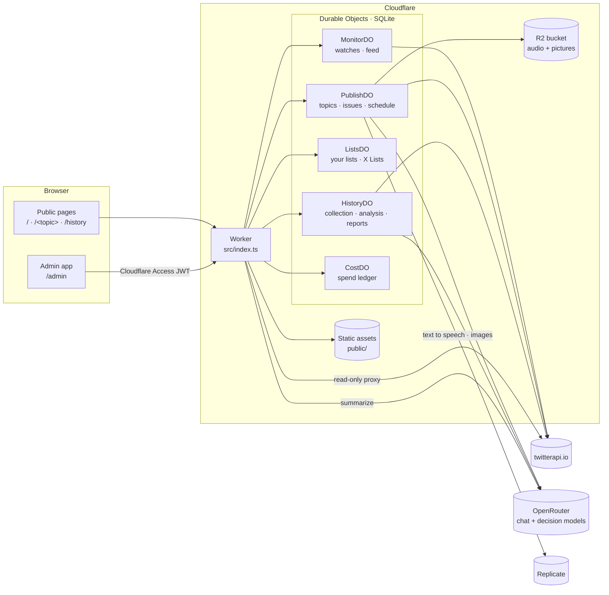

# Architecture



## Public and private

| Path | Who | What |
| --- | --- | --- |
| `/admin*` | You, behind **Cloudflare Access** | The whole app. The Worker verifies the Access JWT (`TEAM_DOMAIN`, `POLICY_AUD`) on every request, including static files. If either variable is empty every request is refused. |
| `/`, `/<topic>`, `/<topic>/<date>` | Anyone | Published briefings (server-rendered HTML, no client script). A topic with nothing published is a 404. |
| `/history`, `/history/<address>` | Anyone | Published History reports: statistics, then every tweet, 50 per page. |
| `/custom*` | | The old address of the app; redirects to `/admin`. |

Writes to private routes must be same-origin `application/json`, so a page on another site cannot post as you.
Model output is untrusted: the Markdown renderer escapes everything and only emits links to posts on x.com.

## Durable Objects

All state lives in SQLite inside five Durable Objects, one instance (`main`) each. Long jobs run from **alarms** in time-boxed slices, so they
survive eviction and deploys and carry on where they stopped.

| Object | Holds | Runs from alarms |
| --- | --- | --- |
| `HistoryDO` | History jobs, their tweets (sharded by time window and query), labels, analyses, saved reports | Collection slices (10 min) and analysis slices (8 min) |
| `PublishDO` | Briefing topics, issues (drafts and published), audio and image templates | The schedule: a topic's next run |
| `ListsDO` | Your curated lists of accounts, and X Lists kept by reference (with groups) | |
| `MonitorDO` | Watches (polling searches), their checkpoints and the feed | Polling |
| `CostDO` | The spend ledger behind the Costs tab | |

Audio (MP3) and briefing pictures are stored in the R2 bucket `AUDIO`.

## Code map

```
src/
  index.ts                 Routing, Access check, read-only twitterapi.io proxy; exports the Durable Objects
  access.ts                Verifies the Cloudflare Access JWT
  durable-objects/         history · publish · lists · monitor · cost  (one SQLite-backed object each)
  history/                 analysis.ts (prompts, parsing, estimates, aggregation) · stats.ts (statistics for a collection)
  llm/                     analysis.ts (chat models for History) · decisions.ts (decision-model client)
  summarize/               The Strands summarizer agent, model providers, screening, cost tables, Worker and Node hosts
  media/                   Replicate text to speech and images, audio script, serving audio and pictures from R2
  site/public.ts           The public HTML pages
  lib/                     twitterapi.ts (API client) · costs.ts (ledger writes) · pool.ts
server/                    The same app for running locally with Node (npm start): index.js, History, Lists, Monitor, Agent
public/admin/              The admin app (one HTML page, no build step)
test/                      Tests (node --test)
docs/                      Architecture, flows, configuration, deployment
```

## The models

Every language model call goes through OpenRouter and needs the `OPENROUTER_API_KEY` secret. There are three kinds:

| Kind | Used for | Notes |
| --- | --- | --- |
| **Writing models** (chat) | Summaries, briefings, History theme proposals, History summaries, and the "stronger" labelling pass | Default `anthropic/claude-haiku-5.5` (`SUMMARY_MODEL`). The list you can pick from, with prices, is in `src/summarize/openrouter.ts`. |
| **Cheap labelling models** (chat) | Labelling every tweet in a History analysis, 40 tweets per call | Default Mistral Small 3.2. |
| **Decision models** (classifiers) | Screening tweets before a summary; optionally the cheap labelling in History | Perplexity Decider Flash / Decider on OpenRouter (`~perplexity/pplx-decider-flash-latest`, `~perplexity/pplx-decider-latest`). They write no text: you send a tweet and typed questions, and get typed answers back (`/api/v1/systemone`, about $0.01 to $0.02 per million input tokens). |

Audio and pictures use Replicate (`REPLICATE_API_TOKEN`): Gemini 3.8 Flash TTS or Flash-Lite TTS for audio, and `google/nano-banana-pro`,
`google/imagen-4-fast` or `black-forest-labs/flux-schnell` for pictures.

---
