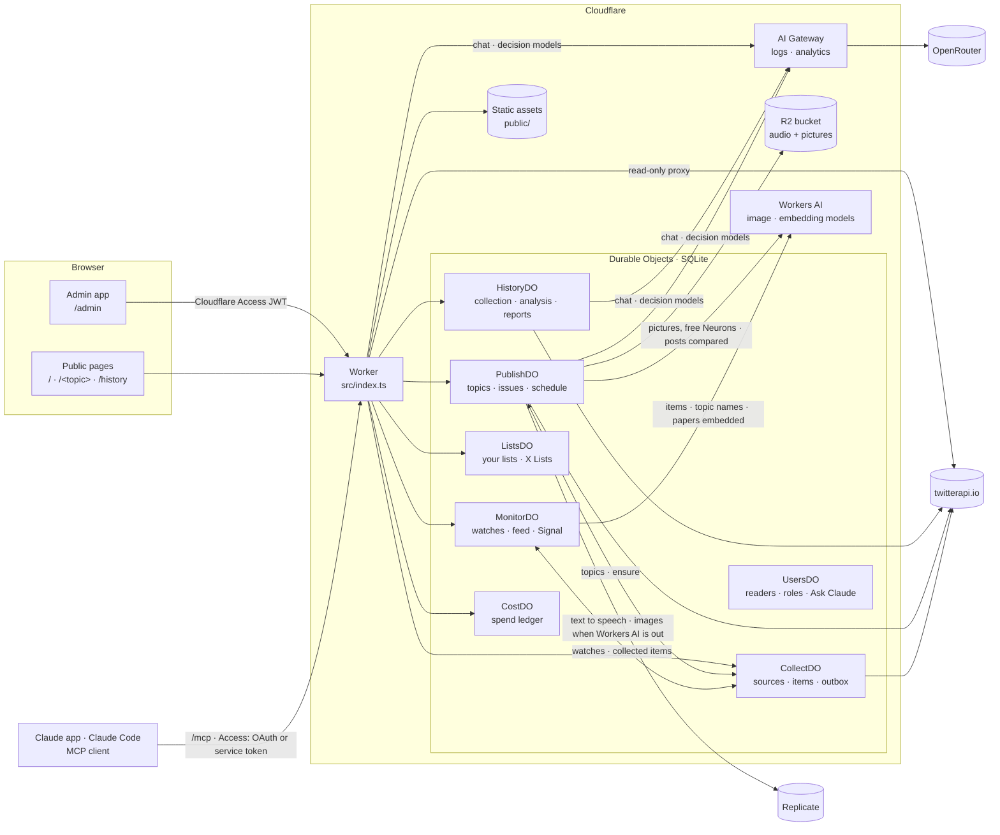

# Architecture



## Public and private

| Path | Who | What |
| --- | --- | --- |
| `/admin*` | You, behind **Cloudflare Access** | The whole app. The Worker verifies the Access JWT (`TEAM_DOMAIN`, `POLICY_AUD`) on every request, including static files. If either variable is empty every request is refused. |
| `/` | Anyone | The landing page (`?lens=<key>`, `?window=1\|3\|7`; both are in the cache key). A **top bar** (`topBar` in `src/site/public.ts`: name, lens chooser, time window, search box to `/search`, a "More" menu with the deep pages and the theme button) replaces the old long left menu on **every** public page: `bar(ctx, …)` builds it for the pages without a lens or window of their own (the lens chooser links to the landing page of the area, or keeps the page when it reads `?lens=`: Signal, Topics, Research map, Search), and the More menu lists everything the left menu reached in short groups (Read, Signals, Briefings, Watch and read, More, RSS feeds) with the current page marked `aria-current`; it is a `<details>`, so it works without script and, on phones, opens as a full-width panel. `render()` reads the lenses of the area once per request into `Ctx.lenses`. Blocks, each guarded so one failing source leaves only that block out: *Since your last visit* (counts for the window; `/viz/visit.js` may relabel it), *In brief* (about five lines from the day's briefings' themes, each linked to a topic page), *The landscape* (ranked list of Signal topics with bars, state, lens tag and source mix; above it, in the slot `#landscape-graphic`, the **landscape graphic** in a sandboxed frame that loads after the page has loaded and is left out on phones), a rising strip, lens cards (or top topics) with "Outside your lens", the research strip, and watch and read. The pure assembly is in `src/site/landing.ts`; the Monitor's `landing-public` supplies summaries, daily counts, recent papers and reads. |
| `/signal/<address>/t/<term>[/<days>]` | Anyone | The old address of a Signal topic: a 301 (cacheable for an hour) to `/t/<slug>`; addresses a Signal had before (`aliases`) also redirect, keeping the rest of the path. No page links to the old form any more. |
| `/politics`, `/politics/briefings` | Anyone | The politics area: the same landing page and briefings list for the politics Signals and briefings (its own lenses, landscape, In brief), without the Research and Watch blocks. 404 until something of the area is published. See flows.md, Areas. |
| `/briefings` | Anyone | The day's briefings, as the landing page was before: every briefing's headline and themes, a Signal strip, feed pages and reports. |
| `/<topic>`, `/<topic>/<date>`, `/<topic>/archive` | Anyone | The published briefings: TL;DR, "In brief", one section per theme (new or continuing, its Signal topics, its sources), earlier and later days. Server-rendered HTML; the only script is Cloudflare Web Analytics, when `CF_ANALYTICS_TOKEN` is set. A topic with nothing published is a 404. |
| `/history/<slug>/galaxy`, `/signal/<slug>/first` | Anyone | The two picture pages, in the More menu (opening the newest report and the first Signal with two or more groups) and linked from the top of each report and Signal page and from their cards, the only public pages with a script of their own (`src/site/viz.ts`). They show the MCP App views unchanged: `/viz/host.js` plays the host, running the view in a sandboxed frame with no network and a hash-pinned script, and reads public JSON for it. The Galaxy needs a published report, and shows themes and stance only if the analysis was published too. Who said it first needs a published Signal, and shows item titles, links and sources only if that Signal shows its sources. |
| `/<topic>/feed.xml` | Anyone | The topic's last 20 briefings as RSS. |
| `/search` | Anyone | Search across everything: `?q=` (2 to 80 letters), `kinds=topics,items,papers,briefings` (all by default), `lens=<key>`, `area=politics` (AI by default; the areas are searched apart), `window=1\|3\|7\|14\|30` (days back for items, papers and briefings; 14 by default, items go back 14 at most), `page=1..5`. Results are grouped by kind with topics first (state and lens tags, linking `/t/<slug>`), then items (title, source, date, reactions in the source's own unit, link to the original and to the topic page when one is named), papers (title and abstract, uptake, link to the original abstract page) and briefings (link to the theme). With several kinds each group shows 5 and links to the rest; with one kind the page shows 20 and pages. Every parameter is in the page cache key (`q` up to 80 letters). Server-rendered, no script. The top bar and the `/topics` search box send their words here. The same search is the public MCP tool `search`. |
| `/topics` | Anyone | Every topic Signal found in the published Signals over the last two weeks: new, rising, and A to Z, with a name filter (`?q=`, still working for old links; the search boxes now go to `/search`). Each links to its topic page at `/t/<slug>`. `?area=politics` lists the politics Signals' topics. |
| `/me`, `/me/ask/<id>`; `POST /me/prefs\|lens\|lens-delete\|follow\|unfollow\|ask\|save\|unsave\|note\|list\|list-delete` | The signed-in reader (`SITE_POLICY_AUD`) | Their settings page and their questions; the forms that change what they keep. Never cached (`private, no-store`); a write must come from a page of this site (`Origin`). Pages that show something of the reader's own (own lenses, followed topics, Ask Claude) are made for them and skip the shared page cache. See [flows](flows.md#readers). |
| `/overview.json?window=1\|3\|7&lens=<key>&area=politics` | Anyone | What `get_overview` answers (same data as `structuredContent`, including `landscape`), for the landscape frame on `/`; `/viz/host.js` answers the view's `tools/call get_overview` from it. Parameters are checked strictly (other values: 404); both are in the cache key like on the pages. |
| `/lenses.json?area=ai\|politics`, `/viz/lens.js` | Anyone | The lenses of an area (AI by default) as JSON (key, area, name, one line, colour, terms), and the small script that remembers the chosen lens in the browser. `?lens=<key>` on `/topics` and `/signal/<address>` puts that lens's topics first and highlights them (others dimmed below, never hidden, with an "Outside your lens, big today" line); a topic page lists the lenses it belongs to. The key is part of the page cache key. |
| `/t/<slug>`, `/t/<slug>.json` | Anyone | One topic, the hub the other pages link to (`?angle=talk\|first\|papers\|watch\|briefings`, Talk by default; `?area=politics` when the same name is a topic in both areas, else AI wins; the page shows the area of its Signal and a politics topic's links lead back to `/politics`). Top: a written summary (or, before the first one exists, a line built from the numbers), the state (new, rising, steady, falling) and **Its life so far**: the 14 days as bars with their three-day average as a curve, the peak marked, and the phase (emerging, at its peak, fading, back again, steady; `src/signal/lifecycle.ts`) as a badge, a sentence and a track. Under the evidence strip, **How it spread**: one band per kind of source over the 14 days (`src/signal/stream.ts`), the order of the latest wave numbered on it and spelled out under it, new papers as diamonds on a rail; then the item-by-item timeline. Then **The last 30 days**: a heat calendar of daily mentions (`src/signal/calendar.ts`; the 30 days the terms table keeps, `TopicData.heat`) with the busiest day and any weekday that stands out. Its `og:image` is `/t/<slug>/card.png?d=<day>` (below). Then the **evidence strip**: one segment per kind of source in its own unit (X: rough likes and distinct accounts; Hacker News: points and comments; YouTube: views from chosen channels; blogs and news: outlets; research papers: how many are named in posts) plus the Signal score with a link to [How Signal works](/signal/method). Then **Item by item**: a timeline of the last 14 days as inline SVG (a lane per kind of source, each with its own shape and name: circle X, square Hacker News, triangle YouTube, diamond blogs and news; one mark per time slot, bigger for more items; the words under it say the same). Angles are links, so there is no script: **Who said it first** (the order the kinds of source had it in, as a sentence and a list, with the caveat and a link to the full page), **Watch** (videos with `i.ytimg.com` thumbnails and links out, nothing plays) beside Talk, Papers and Briefings. At the foot, the topics it goes with. The slug comes from the Signal term (`topicSlug` in `src/signal/topicpage.ts`). A topic in several published Signals is shown from the one where its score is highest. Item titles, links and outlet names appear only when that Signal shows its sources. `/t/<slug>.json` is the same data as JSON. A name that is counted under a bigger topic redirects (301) to that topic's address. |
| `/t/<slug>/card.png?d=<day>&area=` | Anyone | The picture a shared topic link shows (1200×630 PNG): name, state, phase, mentions and the 14-day curve along the foot. Drawn as SVG by `src/site/shareCard.ts` and rasterised in the Worker by resvg (WebAssembly, `src/media/png.ts`) with the site's face bundled (Bricolage Grotesque, latin only, SIL OFL: `src/media/fonts/OFL.txt`; `*.ttf` is a `Data` rule in `wrangler.jsonc`). Kept at the edge per topic, area and day for six hours; a topic counted under a bigger one redirects to that one's card. |
| `/feeds/<address>` | Anyone | Feed pages: items from what is watched (for example the latest video of each channel in a list), defined in the admin. Videos play from YouTube's privacy-enhanced player (`youtube-nocookie.com`); pictures come from `i.ytimg.com`. |
| `/report/<topic>/<date>` | Anyone | "Report an error" in a briefing (one theme, or all of it); reports show on the admin Overview. |
| `/signal`, `/signal/<address>` | Anyone | Published Signals: top-level sets of source groups, combined into one score per topic (group names, counts and topics only, never source names). Nothing is public until you publish a Signal in the admin. Topics link to `/t/<slug>`; the old `/signal/<address>/t/<topic>` addresses redirect there (301). |
| `/history`, `/history/<address>` | Anyone | Published History reports: statistics, then every tweet, 50 per page. |
| `/saved`, `/saved/<id>` | Anyone, by what each list allows | Saved lists: posts, videos and papers readers kept with **☆ Save** beside an item on a topic page (Talk, Watch, Papers). A list is private to its owner unless a reader with the **Publish lists** feature (the Analyst role by default) opens it to the analysts (everyone with that feature, shown with the owner's name) or to everyone. `/saved` lists the lists open to the viewer; `/saved/<id>` (a random id) is one list, with the owner's forms on it. Never kept in the page cache, so a list made private is gone at once. See [flows](flows.md#readers). |
| `/agent`, `/agent/mcp` | Anyone | `/agent` explains the public MCP server and has the lines to copy. `/agent/mcp` is that server (POST only, no sign-in, read only, 60 requests a minute per address): the overview, topics, sources, briefings and papers of the public site, as text for an agent plus JSON. Handled in `src/index.ts` before `/mcp`. See [mcp.md](mcp.md). |
| `/mcp` | You, behind its **own** Access application | The read-only MCP server for Claude, with two interactive views (MCP Apps). The Worker verifies the Access JWT against `MCP_POLICY_AUD`. Sign-in by Managed OAuth (the Claude app) or a service token (Claude Code). See [mcp.md](mcp.md). |
| `/custom*` | | The old address of the app; redirects to `/admin`. |

Writes to private routes must be same-origin `application/json`, so a page on another site cannot post as you.
Model output is untrusted: the Markdown renderer escapes everything and only emits links to posts on x.com.

## Durable Objects

All state lives in SQLite inside seven Durable Objects, one instance (`main`) each. Long jobs run from **alarms** in time-boxed slices, so they
survive eviction and deploys and carry on where they stopped.

| Object | Holds | Runs from alarms |
| --- | --- | --- |
| `HistoryDO` | History jobs, their tweets (sharded by time window and query), labels, analyses, saved reports | Collection slices (10 min) and analysis slices (8 min) |
| `PublishDO` | Briefing topics, issues (drafts and published), audio and image templates | The schedule: a topic's next run |
| `ListsDO` | Your curated lists of accounts, X Lists kept by reference (with groups), and feed lists (RSS, YouTube, Hacker News) | |
| `MonitorDO` | Watches (your definition of what is watched), the Live feed, and Signal's daily term counts and a log of the items behind them (30 days). It no longer fetches: it sends its watches to `CollectDO` and receives the items back | Delivery and housekeeping |
| `CollectDO` | The collection layer: sources, items (one stored copy, kept 90 days), which source collected what, run records, uses (who reads what) and an outbox to the Monitor | Collection: polling free feeds, window reads before a briefing, X search watches |
| `CostDO` | The spend ledger behind the Costs tab | |
| `UsersDO` | Readers: everyone the site's login let in (by e-mail), their role and extra features, default front page, own lenses, followed topics, saved lists (with a copy of each item and the owner's notes), and their Ask Claude questions with answers and cost (90 days). Called over RPC. See [flows](flows.md#readers). | |

`MonitorDO` sends all its watches to `CollectDO` after any change (`/collect/sync-monitor`), the first time with their checkpoints. `CollectDO`
delivers new items and each watch's status to `/mon/collected`, at least once; the Monitor's seen ids make a repeat harmless. `PublishDO` tells
`CollectDO` about each topic on save, on delete and after each run, and asks `/collect/ensure` before it writes. How it works is in
[flows](flows.md#8-collection).

The local Node server in `server/` was deliberately not changed. It has no collection layer and keeps its own polling Monitor.

Audio (MP3) and briefing pictures are stored in the R2 bucket `AUDIO`.

## Code map

```
src/
  index.ts                 Routing, Access check, read-only twitterapi.io proxy; exports the Durable Objects
  access.ts                Verifies the Cloudflare Access JWT
  mcp.ts                   Read-only MCP server at /mcp (tools and MCP App resources; see mcp.md)
  agentMcp.ts              The public MCP server at /agent/mcp (also registered on the private one); rate limit, cache, tools, prompts
  site/agentText.ts        The Markdown and JSON of the public server's answers (pure, tested)
  site/overview.ts         `loadOverview`: what the landing page and `get_overview` both show, for an area
  signal/area.ts           (areas: which board or briefing belongs to AI or Politics, picking the board of an area, topic addresses with the area, which area a request is in; pure)
  apps/                    The MCP App views: costs.ts and signal.ts, hand-written HTML pages; landscape.ts (the bubbles of `get_overview` and the landing page) · topichub.ts (the view of `get_topic`) · map.ts (the Research map: `/research/map` and the view of `get_papers`, which reads `get_research_map`)
  durable-objects/         history · publish · lists · monitor · collect · cost  (one SQLite-backed object each)
  collect/                 plan.ts (pure decisions: what a briefing needs, reuse, polling pace, caps; tested in test/collect.test.mjs) · mock.ts (scripted X posts for SUMMARY_MOCK)
  history/                 analysis.ts (prompts, parsing, estimates, aggregation) · stats.ts (statistics for a collection)
  llm/                     analysis.ts (chat models for History) · decisions.ts (decision-model client) · gateway.ts (routes OpenRouter calls through AI Gateway)
  summarize/               The Strands summarizer agent, model providers, screening, cost tables, Worker and Node hosts
  media/                   replicate.ts (text to speech and images) · workersai.ts (images on Workers AI, Neuron tally) · audio script · serving audio and pictures from R2
  site/public.ts           The public HTML pages
  site/search.ts           Search across everything: the words, the match quality and ranking of each kind, paging and addresses (pure, tested); site/searchData.ts asks the Monitor (`search-public`) and Publish (`/pub/search`) objects and merges
  site/topicData.ts        `loadTopic`: assembles a topic (Monitor data plus the briefings that mention it) for the page, its JSON and later the MCP tool
  sources/                 Non-X sources: types.ts (the neutral item and its feed shape) · rss.ts (RSS/Atom) · youtube.ts (channel and playlist feeds) · hn.ts (Hacker News via Algolia) · read.ts (article and comment reading) · presets.ts (shorthand such as `r/rust` or `github:owner/repo`, expanded to the feed address it stands for) · feedlist.ts (curated feed lists) · transcript.ts (video transcripts)
  site/landing.ts            (the landing page: In brief, ranked landscape, rising strip, research and reads; the last-visit script)
  signal/                  lens.ts (lenses: colours, matching, ordering, the model's suggestions, the lens script) · topicview.ts (who had a topic first by kind of source, timeline dots, videos to watch) · topicpage.ts (a topic's address, state and evidence strip; the shape of `/t/<slug>.json`) · summary.ts (prompt and parsing for topic summaries) · terms.ts (words, phrases and hashtags of an item) · score.ts (weighted score per term across groups; shared / single / rising) · landscape.ts (clusters of topics talked about together and the steady bubble layout) · topics.ts (merging terms into topics, what goes with them) · ai.ts (optional: prompt and parsing for topics written by a model) · vectors.ts (meaning: copies, varied picks, names shown to the topic model, names suggested as one; the thresholds and how they were set)
  users/                   model.ts (readers: roles, features, settings, own lenses, follows, saved lists and who may see them, which links an answer keeps; pure, tested in test/users.test.mjs) · admin.ts (the Readers tab, /admin/users/*)
  site/me.ts               The signed-in reader on the site: who it is, the /me forms, Ask Claude, saving an item (taken from the topic's own data)
  lib/                     twitterapi.ts (API client) · costs.ts (ledger writes) · embed.ts (embeddings from Workers AI, in batches) · pool.ts
server/                    The same app for running locally with Node (npm start): index.js, History, Lists, Monitor, Agent (no collection layer)
public/admin/              The admin app (one HTML page, no build step), and health.js: why a briefing or Signal group does or does not reach readers
test/                      Tests (node --test)
docs/                      Architecture, flows, configuration, deployment, MCP
```

## The models

Every language model call goes to OpenRouter and needs the `OPENROUTER_API_KEY` secret. When `AI_GATEWAY` is set, the calls pass through
Cloudflare AI Gateway on the way (see [deployment](deployment.md#ai-gateway)). There are four kinds:

| Kind | Used for | Notes |
| --- | --- | --- |
| **Writing models** (chat) | Summaries, briefings, History theme proposals, History summaries, and the "stronger" labelling pass | Default `anthropic/claude-haiku-5.5` (`SUMMARY_MODEL`). The list you can pick from, with prices, is in `src/summarize/openrouter.ts`. |
| **Cheap labelling models** (chat) | Labelling every tweet in a History analysis, 40 tweets per call | Default Mistral Small 3.2. |
| **Signal topic model** (chat, optional) | Naming the topics of each new item for the Signal tab, 40 items per call | Off by default (Signal counts words, free). When on, it uses a cheap writing model you pick on the Signal tab, a daily spending cap, and shows in Costs as "Signal topics (AI)". |
| **Lens suggestions** (chat) | "Suggest topics" in the admin: which current Signal topics belong to which lens (one call per click, nothing applied automatically) | The Signal topic model, inside the same daily spending cap; recorded in Costs as "Lens suggestions (AI)". |
| **Topic summaries** (chat) | One paragraph per active Signal topic per day, for the top of `/t/<slug>` | The Signal topic model, written from the Monitor's alarm (never on a page request) inside the same daily spending cap, with the items it used stored beside it. Shows in Costs as "Topic summaries (AI)". Needs the Signal topic model to be on. |
| **Embedding model** | Turning text into numbers to compare by meaning: Research map papers, every item the Signal topic model reads (copies count once, the names in use shown by closeness), new topic names (suggested merges), and a briefing's posts (copies folded, picks for variety). See [flows](flows.md#meaning-embeddings). | `@cf/baai/bge-small-en-v1.5` on Workers AI (the `AI` binding), about $0.02 per million tokens before the free daily Neurons. Recorded in Costs under kind `embedding`. |
| **Decision models** (classifiers) | Screening tweets before a summary; optionally the cheap labelling in History | Perplexity Decider Flash / Decider on OpenRouter (`~perplexity/pplx-decider-flash-latest`, `~perplexity/pplx-decider-latest`). They write no text: you send a tweet and typed questions, and get typed answers back (`/api/v1/systemone`, about $0.01 to $0.02 per million input tokens). |

Audio uses Replicate (`REPLICATE_API_TOKEN`): Gemini 3.8 Flash TTS or Flash-Lite TTS. Pictures use either Replicate (`google/nano-banana-pro`,
`google/imagen-4-fast`, `black-forest-labs/flux-schnell`) or Cloudflare Workers AI (FLUX.2 klein 4B and 9B, Leonardo Phoenix) through the `AI`
binding. The Workers AI models stay inside the free 10,000 Neurons a day; past that, or when Workers AI fails, the picture is made with the
model's Replicate fallback (see [deployment](deployment.md#pictures-for-briefings)).

---
