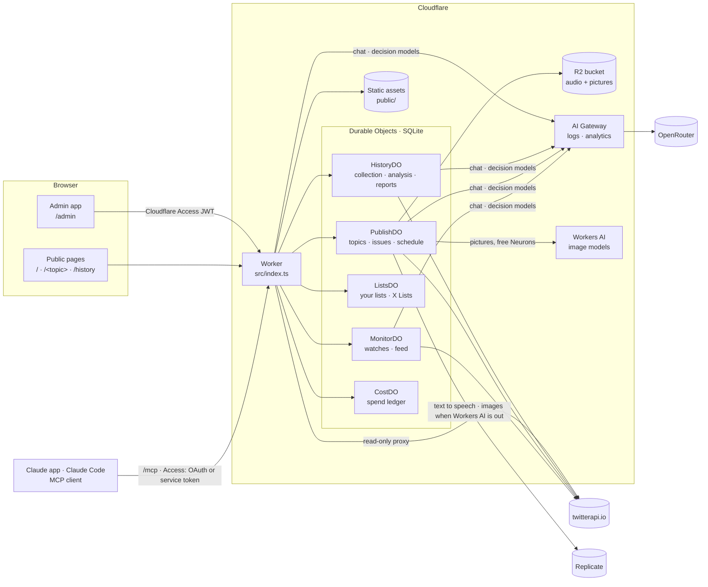

# Architecture



## Public and private

| Path | Who | What |
| --- | --- | --- |
| `/admin*` | You, behind **Cloudflare Access** | The whole app. The Worker verifies the Access JWT (`TEAM_DOMAIN`, `POLICY_AUD`) on every request, including static files. If either variable is empty every request is refused. |
| `/`, `/<topic>`, `/<topic>/<date>`, `/<topic>/archive` | Anyone | Today (every briefing's headline and themes), and the published briefings: TL;DR, "In brief", one section per theme (new or continuing, its Signal topics, its sources), earlier and later days. Server-rendered HTML; the only script is Cloudflare Web Analytics, when `CF_ANALYTICS_TOKEN` is set. A topic with nothing published is a 404. |
| `/<topic>/feed.xml` | Anyone | The topic's last 20 briefings as RSS. |
| `/topics` | Anyone | Every topic Signal found in the published Signals over the last two weeks: new, rising, and A to Z, with a search (`?q=`). Each links to its topic page in Signal. |
| `/feeds/<address>` | Anyone | Feed pages: items from what is watched (for example the latest video of each channel in a list), defined in the admin. Videos play from YouTube's privacy-enhanced player (`youtube-nocookie.com`); pictures come from `i.ytimg.com`. |
| `/report/<topic>/<date>` | Anyone | "Report an error" in a briefing (one theme, or all of it); reports show on the admin Overview. |
| `/signal`, `/signal/<address>` | Anyone | Published Signals: top-level sets of source groups, combined into one score per topic (group names, counts and topics only, never source names). Nothing is public until you publish a Signal in the admin. |
| `/history`, `/history/<address>` | Anyone | Published History reports: statistics, then every tweet, 50 per page. |
| `/mcp` | You, behind its **own** Access application | The read-only MCP server for Claude, with two interactive views (MCP Apps). The Worker verifies the Access JWT against `MCP_POLICY_AUD`. Sign-in by Managed OAuth (the Claude app) or a service token (Claude Code). See [mcp.md](mcp.md). |
| `/custom*` | | The old address of the app; redirects to `/admin`. |

Writes to private routes must be same-origin `application/json`, so a page on another site cannot post as you.
Model output is untrusted: the Markdown renderer escapes everything and only emits links to posts on x.com.

## Durable Objects

All state lives in SQLite inside five Durable Objects, one instance (`main`) each. Long jobs run from **alarms** in time-boxed slices, so they
survive eviction and deploys and carry on where they stopped.

| Object | Holds | Runs from alarms |
| --- | --- | --- |
| `HistoryDO` | History jobs, their tweets (sharded by time window and query), labels, analyses, saved reports | Collection slices (10 min) and analysis slices (8 min) |
| `PublishDO` | Briefing topics, issues (drafts and published), audio and image templates | The schedule: a topic's next run |
| `ListsDO` | Your curated lists of accounts, X Lists kept by reference (with groups), and feed lists (RSS, YouTube, Hacker News) | |
| `MonitorDO` | Watches (X searches and accounts, RSS feeds, Hacker News), their checkpoints, the combined feed, and Signal's daily term counts and a log of the items behind them (30 days) | Polling |
| `CostDO` | The spend ledger behind the Costs tab | |

Audio (MP3) and briefing pictures are stored in the R2 bucket `AUDIO`.

## Code map

```
src/
  index.ts                 Routing, Access check, read-only twitterapi.io proxy; exports the Durable Objects
  access.ts                Verifies the Cloudflare Access JWT
  mcp.ts                   Read-only MCP server at /mcp (tools and MCP App resources; see mcp.md)
  apps/                    The MCP App views: costs.ts and signal.ts, hand-written HTML pages
  durable-objects/         history · publish · lists · monitor · cost  (one SQLite-backed object each)
  history/                 analysis.ts (prompts, parsing, estimates, aggregation) · stats.ts (statistics for a collection)
  llm/                     analysis.ts (chat models for History) · decisions.ts (decision-model client) · gateway.ts (routes OpenRouter calls through AI Gateway)
  summarize/               The Strands summarizer agent, model providers, screening, cost tables, Worker and Node hosts
  media/                   replicate.ts (text to speech and images) · workersai.ts (images on Workers AI, Neuron tally) · audio script · serving audio and pictures from R2
  site/public.ts           The public HTML pages
  sources/                 Non-X sources: types.ts (the neutral item and its feed shape) · rss.ts (RSS/Atom) · youtube.ts (channel and playlist feeds) · hn.ts (Hacker News via Algolia) · read.ts (article and comment reading) · presets.ts (shorthand such as `r/rust` or `github:owner/repo`, expanded to the feed address it stands for) · feedlist.ts (curated feed lists) · transcript.ts (video transcripts)
  signal/                  terms.ts (words, phrases and hashtags of an item) · score.ts (weighted score per term across groups; shared / single / rising) · topics.ts (merging terms into topics, what goes with them) · ai.ts (optional: prompt and parsing for topics written by a model)
  lib/                     twitterapi.ts (API client) · costs.ts (ledger writes) · pool.ts
server/                    The same app for running locally with Node (npm start): index.js, History, Lists, Monitor, Agent
public/admin/              The admin app (one HTML page, no build step)
test/                      Tests (node --test)
docs/                      Architecture, flows, configuration, deployment, MCP
```

## The models

Every language model call goes to OpenRouter and needs the `OPENROUTER_API_KEY` secret. When `AI_GATEWAY` is set, the calls pass through
Cloudflare AI Gateway on the way (see [deployment](deployment.md#ai-gateway)). There are four kinds:

| Kind | Used for | Notes |
| --- | --- | --- |
| **Writing models** (chat) | Summaries, briefings, History theme proposals, History summaries, and the "stronger" labelling pass | Default `anthropic/claude-haiku-5.5` (`SUMMARY_MODEL`). The list you can pick from, with prices, is in `src/summarize/openrouter.ts`. |
| **Cheap labelling models** (chat) | Labelling every tweet in a History analysis, 40 tweets per call | Default Mistral Small 3.2. |
| **Signal topic model** (chat, optional) | Naming the topics of each new item for the Signal tab, 40 items per call | Off by default (Signal counts words, free). When on, it uses a cheap writing model you pick on the Signal tab, a daily spending cap, and shows in Costs as "Signal topics (AI)". |
| **Decision models** (classifiers) | Screening tweets before a summary; optionally the cheap labelling in History | Perplexity Decider Flash / Decider on OpenRouter (`~perplexity/pplx-decider-flash-latest`, `~perplexity/pplx-decider-latest`). They write no text: you send a tweet and typed questions, and get typed answers back (`/api/v1/systemone`, about $0.01 to $0.02 per million input tokens). |

Audio uses Replicate (`REPLICATE_API_TOKEN`): Gemini 3.8 Flash TTS or Flash-Lite TTS. Pictures use either Replicate (`google/nano-banana-pro`,
`google/imagen-4-fast`, `black-forest-labs/flux-schnell`) or Cloudflare Workers AI (FLUX.2 klein 4B and 9B, Leonardo Phoenix) through the `AI`
binding. The Workers AI models stay inside the free 10,000 Neurons a day; past that, or when Workers AI fails, the picture is made with the
model's Replicate fallback (see [deployment](deployment.md#pictures-for-briefings)).

---
