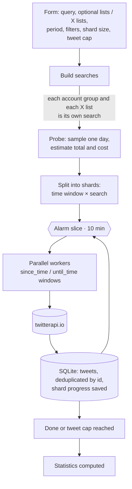
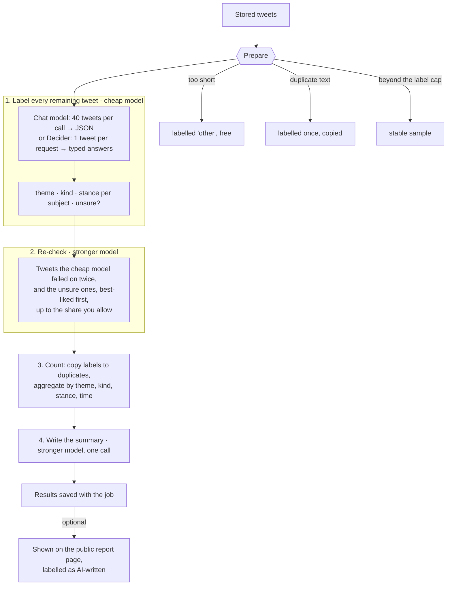
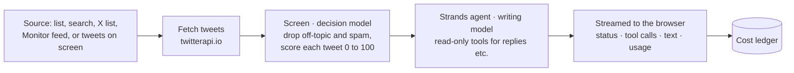
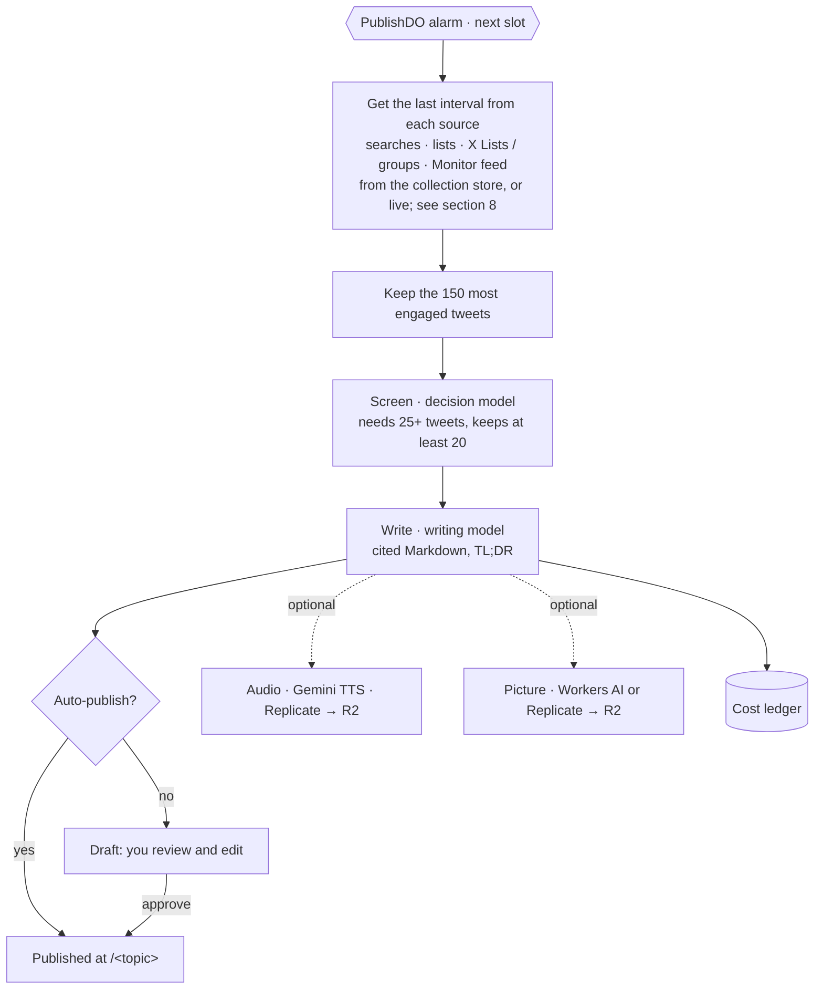
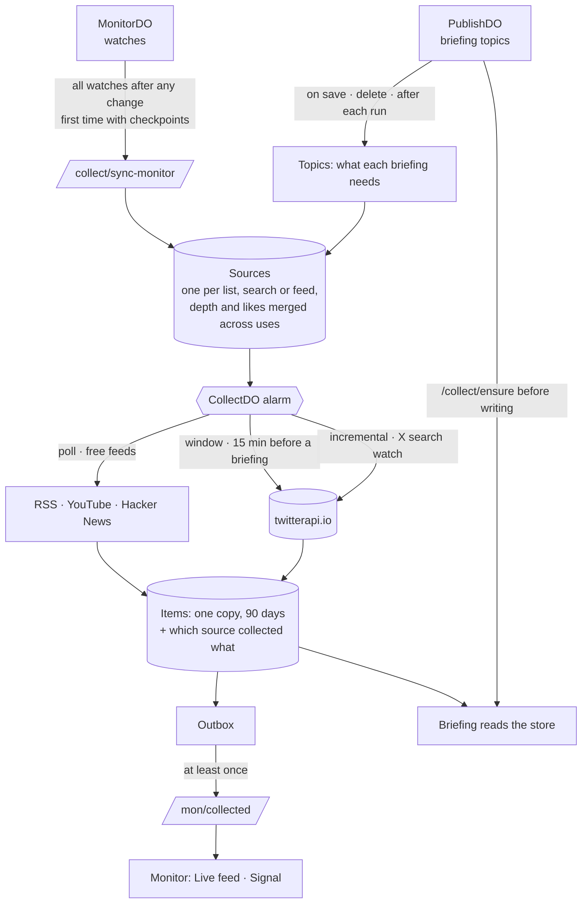

# Flows

How each feature turns tweets into a result, and which models do which step. See [architecture](architecture.md) for the pieces they run on.

## 1. Collecting History

A History job collects every tweet matching a search over a period. It is built to be cheap to resume and never buy a tweet twice.

- **Only these lists** limits the search to the accounts in your own lists (as `from:` groups). **Only these X lists** limits it to X Lists
  (each ticked list is a `list:ID` search). Groups and lists are separate searches whose results are merged; one collection can run at most 40.
- Shard progress is saved after every page, so a restart or deploy resumes without re-buying tweets. **Stop after ≈ tweets** bounds the cost.

## 2. AI analysis of a History job

Starts from a finished job. It uses the cheapest tool for each step and only calls a stronger model for what needs judgement.

- **Themes and subjects are yours** (`Name: description` lines), or press *Suggest themes and subjects with AI*: the stronger model reads about
  150 tweets (most liked plus random) and proposes them.
- **Cost control**: *Estimate cost* before running; the run stops at your **budget** (default $2, resumable) and labels at most N tweets.
  If the cheap model fails on more than 30% of the tweets the run stops with a message instead of paying the strong model to redo everything.
- **Decision model as the cheap model**: one request per tweet, so a slice stops after 700 requests (a Worker invocation may only make about 1000)
  and the next alarm carries on. It cannot be the stronger model, because it writes no text.
- It keeps running on the server if you close the page. Resuming a collection marks the analysis out of date; only new tweets are labelled next time.

## 3. History reports

*Save as report* on a finished job gives it a title and an address. *Publish* serves it at `/history/<address>`: the statistics and every
collected tweet (no profile pictures; the public pages load nothing from other sites), plus the AI analysis if you ticked it. Cost, API calls and tuning
settings are never shown. While a report is published, its job cannot be resumed or deleted.

## 4. Summarize tab

The tweets are fetched **before** the model runs, so a weak model cannot skip the fetch and invent tweets. The agent's tools are read-only and
are only for extra context (replies, another search). Every claim must link to its tweet.

## 5. Scheduled briefings

- A topic has an address, one or more **sources**, an **instruction**, a **length** (brief, standard, detailed), an optional **model**, a
  **schedule** (every 6, 12, 24 or 48 hours, or weekly, from a UTC hour) and an optional **data budget** that is shared out between the lists.
- Failures (no tweets, a model out of credit) are shown under the topic as *Last run*, and on Overview with **Run again**; they still record
  what the data cost. **Re-run and replace** writes an issue again at the same address (for example after changing the settings).
- The writer is asked for a bold TL;DR and one `## heading` per theme. The page builds "In brief" from the headings, gives each theme an anchor,
  marks it new or continuing (against the themes of the issue before), and lists the Signal topics and the accounts it cites. Older issues, written
  with a bold lead-in per theme instead of a heading, are shown the same way.
- With **Signal** ticked, the posts a run read are also counted in Signal (free), in one `brief:<slug>` feed per briefing, so scores do not depend on
  how many lists the briefing reads. In *Collected data* mode the posts are handed over when the briefing runs; in the other modes the briefing hands over what it fetched.
- Where the posts come from depends on the collection mode (section 8). In *Collected data* the briefing reads the store, and fetches live only if
  the layer does not answer. A briefing stopped by the daily cap is written from what it has and marked partial.
- Screening never fails a briefing: if it cannot run, the tweets go on unscreened.

## 6. Screening (decision models)

Before a summary or briefing is written, a decision model answers three yes/no questions per tweet: *is it relevant to the briefing?*, *does it
carry real information?* and *is it spam?*. Off-topic and spam tweets are dropped, and every tweet that stays gets a `signal` (0 to 100). The
writing model is told to prefer high-signal tweets for the themes and the *Notable posts*, and not to feature a tweet only because it has many
likes. Screening 150 tweets costs a few hundredths of a cent.

## 7. Explore, Lists and Monitor

- **Search, User, Trends** go through a read-only allowlisted proxy to twitterapi.io; the API key stays on the server and each call's cost is estimated into the ledger.
- **Lists** are groups of accounts you curate. **X Lists** are lists on x.com kept by reference (id, name, groups); they can be read as the
  period's top posts or their latest timeline, summarized, used in History, or made public as links.
- **Monitor** keeps your watches, the Live feed and Signal's counts. It does not fetch: `CollectDO` collects for it (section 8) and hands the items back, and the Monitor keeps its seen-id set. The daily spend cap (default $2) now covers all recurring X collection. A watch has a source: X (billed per tweet), or RSS/Atom and Hacker News (free, so they keep running when the cap is reached). Every source writes into one feed, tagged with its `source`; `/mon/feed?source=rss|hn|x` reads one source, no filter reads them combined. Non-X items are stored in the tweet shape (author, text, counts) plus `source`, `title` and `discussionUrl`. A new RSS or Hacker News watch shows the latest 10 items on its first check.

## 8. Collection

One layer fetches and stores everything that is read on a schedule, so the same source is bought once and used by every briefing, watch and Signal that needs it. It lives in `CollectDO`; the decisions are in `src/collect/plan.ts`.

**Three strategies**
- **Poll** (free: RSS, YouTube, Hacker News). Backs off when a feed is quiet or failing, to at most 6 hours. An interval you pinned does not stretch when quiet, but it does back off on failure. A feed only a briefing reads is checked every 6 hours.
- **Window** (paid: X lists, account lists and searches that briefings read). Read once per period, 15 minutes before the briefing, because a likes filter only means something once posts have had time to collect them.
- **Incremental** (an X search watch). Read from its checkpoint.

**Reuse.** A window read is used again instead of bought again if it is at most a quarter of the period old (never more than 6 hours), and covers the period, the pages and the likes the briefing needs. A re-run or a retry the same morning therefore costs no X data and reads the same posts. A read cut short by the daily cap does not count as covering the period. *Collect now* on the Collection tab forces a fresh read.

**One cap.** One daily cap covers all recurring X collection. Briefing collection comes first: an X search watch waits when the cap, minus what briefings still need today, is used up. A briefing stopped by the cap is written from what it has and marked partial. History, Explore and Summarize are not under this cap.

**Sources and membership.**
- Two uses of the same list, search or feed share one source. A shared source is fetched with the most pages and the fewest likes of its uses.
- Sources nothing uses stop being collected and are listed as unused. They are never deleted by themselves.
- Group and list membership is followed at each run and once a day. Feed list members with no watch are shown with a one-click button to add them. They are not added automatically, so a watch you removed on purpose stays removed.

**Modes** (Collection tab)

| Mode | What happens |
| --- | --- |
| Comparing (`shadow`, the default after a deploy) | Briefings fetch live as before. Each run is also compared with the store. X data costs about double while this is on. |
| Collected data (`store`) | Briefings read the store, with a live fallback if the layer does not answer. |
| Live only (`off`) | The layer is bypassed. |

**Costs.** The ledger has a kind `collect`, per source. Issue costs and topic stats include the briefing's allocated share: a shared source's cost is split evenly between the briefings that read it. The share is not counted twice in the ledger totals.

**Trying it locally.** `SUMMARY_MOCK=1` also gives scripted X posts for briefings and collection, so the whole flow runs without spending anything.

**Local Node server.** `server/` has no collection layer. It keeps its own polling Monitor.

---

**Briefings and Summarize with RSS and Hacker News.** The "Monitor feed" source can be limited to one source (X, RSS or Hacker News) or read combined. Items that are not tweets reach the writer with `source` and, for Hacker News, a `discussion` link, and are cited by site or author name. An issue stores the article and discussion addresses it was given (`links`), and the public page links only those and x.com: a link the model made up is shown as plain text.

**arXiv.** A source of its own (`src/sources/arxiv.ts`): a watch's `query` is categories (`cs.CL, cs.LG`), words, or a fielded search (`au:"Hinton" AND cat:cs.LG`), turned into an `export.arxiv.org/api/query` request. A poll asks only for papers submitted after the last check (`submittedDate`), requests are paced three seconds apart as the API terms ask, and items carry the authors, categories and abstract, with `arxiv:<id>` ids and a PDF link. Free, polled like the other feeds. `arxiv:` lines in a feed list and pasted API addresses become arXiv members; the writer gets `get_arxiv_paper` for a paper's full abstract, and never its full text: arXiv's terms cover abstracts for public use, but full text only for personal or research use.

**Research pulse** (`src/signal/pulse.ts`, public at `/research`). arXiv papers have no reactions, so this measures volume: papers per topic in a 7-day window ending two days ago (the newest days are not all listed yet), as a share of all papers in `cs.AI`, `cs.CL`, `cs.LG` and `cs.MA`, compared with the 8 windows before it. The share matters: in raw counts, a week when the whole field doubled made every topic spike. The Monitor reads the counts in its alarm, with `max_results=1` (arXiv answers 500 to 0), a few at a time, and keeps them in its `pulse` table. It needs no watches. Topics are edited in Signal → Setup and publishing; changing a search starts its history again.

**Research topic pages** (`/research/<slug>`). The Monitor reads each topic's new papers every 6 hours (`research_papers`, kept 60 days; title, abstract, authors and categories only). These pages need no watches and do not touch the Live feed. *Getting attention* lifts the few papers with signals (`src/signal/attention.ts`): upvotes on Hugging Face Daily Papers, points on Hacker News, and posts in the collection store that link to the paper by exact address (`/collect/paper-mentions`). One account counts once, an author's own post and accounts that post papers for a living do not count, and everything else stays in date order. Each signal source is read on its own, so one that fails leaves what was known from it.

**arXiv's terms.** Its limit (one request every 3 seconds, one connection) covers everything you run together, so every request goes through one place: `CollectDO`'s `/collect/arxiv-get`, set up with `useArxivGate`. After a 429 or 503 it stops asking for five minutes. The statement arXiv asks for ("Thank you to arXiv for use of its open access interoperability.") is on every public page and in the admin. The project must not be branded with arXiv's name or look endorsed by it, which is why the page is called Research pulse. PDFs are linked to, never stored or served, and summaries are written from abstracts only.

**Why something is not showing.** The admin answers this itself, from data its tabs already load (`public/admin/health.js`, tested in `test/admin-health.test.mjs`). Every briefing has one panel at the top of both *Issues* and *Settings*: its sources, last run, newest issue, what is public and its Signal group, one sentence on why readers do or do not see it, and the button that fixes it (publish the draft, run again, open the settings). The list of briefings shows the same state as a pill. Each Signal group says whether it is on a published Signal, with an *Add to* button; a card under Sources says which Signal groups and briefings its watches reach. Overview lists the same problems with the same buttons. A run uses what is saved, so *Run now* saves unsaved changes first, and an empty X search cannot be saved. A briefing can be linked to directly: `#publish/<slug>` and `#pubsetup/<slug>`. In the sidebar, Briefings and Signal are one entry each, with their settings as tabs on the page.

**Feed lists.** In Lists → *Feed lists* you curate named sets of feeds: YouTube channels and playlists, RSS/Atom feeds and Hacker News searches, in any mix. Paste links one per line; `/lists/f-resolve` works out what each is (a YouTube handle or link becomes the channel's feed address) and loads it once to check it and name it. A list is read on demand: `feedList` fetches every member now and keeps what was published in the period, de-duplicated by address (one story carried by two feeds counts once), so a summary does not depend on what Monitor captured. It is a source in the Summarize tab and in briefings (`{type:'flist'}`), is offered to the agent as `get_feed_list_items`, and *Watch in Monitor* turns each member into a watch. Lists live in `ListsDO` (`flists`); members are validated again on save. Code: `src/sources/feedlist.ts`.

**Feed lists in the other tabs.** *Search* has an "In feed lists" mode: pick one or more lists and a period, optionally words that must all appear in the title or text; `/lists/f-items` reads the feeds now and nothing is stored. *Lists* can show a list's latest items. *Monitor* can create the watches for a whole list (they remember the list, so the feed can be filtered per list, and a feed already watched is just tagged). *User*, *Trends* and *History* are about X data and have no feed equivalent.

**Sources of a summary.** A summary of RSS, YouTube or Hacker News items ends with a Sources card: each feed it read (linked to its site or channel, with its address and how many items it saw), how many of its items the text cited, and the cited items themselves. It is worked out from the links in the text, so it lists what was cited, not what the model claims (`sourceRefs` in `src/summarize/agent.ts`, the `sources` event). Tables in the text are rendered; the writer is asked for a bulleted list of notable items instead of a table.

**YouTube.** A YouTube channel or playlist is watched through its public Atom feed (free, no API key): paste a channel address, an @handle or a playlist and the Monitor resolves the feed address. New videos arrive as items with their description and view count. For what is said in a video the agent has `get_video_transcript` (see `docs/configuration.md` for the three ways to get it).

**Reading tools.** The Summarize agent also has `read_article` (the text of the page behind an RSS item or Hacker News story) and `get_hn_comments` (the top comments, two levels deep). They only accept addresses and ids from RSS or Hacker News items the agent was given or a tool returned, never one it makes up or finds inside a page; local, numeric and credentialed hosts are refused, every redirect is checked again, pages are cut at 2 MB and 20,000 characters, and a run can make at most 5 reads. They are free (no API), and the text they return is treated as untrusted. Code: `src/sources/read.ts`, wiring in `buildTools` (`src/summarize/agent.ts`).

## Research map

`/research/map` shows what the papers of the research topics are about, grouped by subject, with sliders for the dates, the level of detail and the smallest cluster, plus topic, attention and search filters.

1. `MonitorDO.backfillStep` reads the last 31 days of each topic from arXiv in pages of 500, through the same gate as every other arXiv request, over as many wake-ups as it takes. Changing a topic's search reads its month again.
2. `mapStep` embeds titles and abstracts with Workers AI (`@cf/baai/bge-small-en-v1.5`), 50 at a time, into the `research_vectors` table. Full text is never read.
3. Once a day `buildMap` groups the papers (`src/signal/paperClusters.ts`: spherical k-means, up to 40 groups, then Ward joins for less detail) and asks a language model for each group's name and one-line description. If that fails, the group's telling words are its name, and the admin says so.
4. The view (`src/apps/map.ts`, in the sandboxed frame of `src/site/viz.ts`) does all its filtering and counting in the browser from one read of `/research/map.json`. An abstract is read when a reader opens it, from `/research/map/paper/<id>.json`.

Progress and errors show under **Signal setup → Research pulse** in the admin, and on the page itself while it is being built.

**Papers named without a link.** Besides links, attention counts collected posts that use a paper's own made-up name: one mixed-case word before the colon of its title, such as `nanoMuse` (`coinedName` in `src/signal/attention.ts`). A name is dropped if it was in use more than a day before its paper appeared, if more than 25 accounts use it, or if two papers share it, and an author naming their own paper does not count. This uses no embeddings: on 1,124 real posts they found papers on the same subject rather than the same paper, while all 5 mixed-case name matches were right. Papers without such a name, at least two thirds of them, can only be found by a link.

**Topics inside bigger topics.** In the Signal lists, a topic whose name holds all the words of a bigger topic's name sits straight under it, such as `trump lawsuit` under `trump` (`nestTopics` in `src/signal/topics.ts`). It keeps its own score and its own page, and its numbers are not added to the bigger topic. Nesting goes by names only, so topics that are related but named differently, such as `us election` and `voting id`, stay apart.
