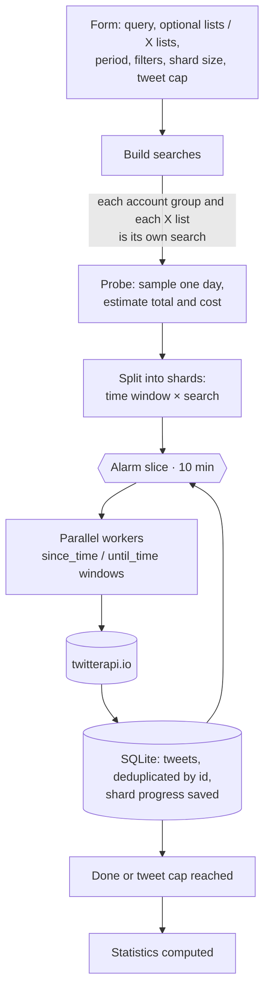
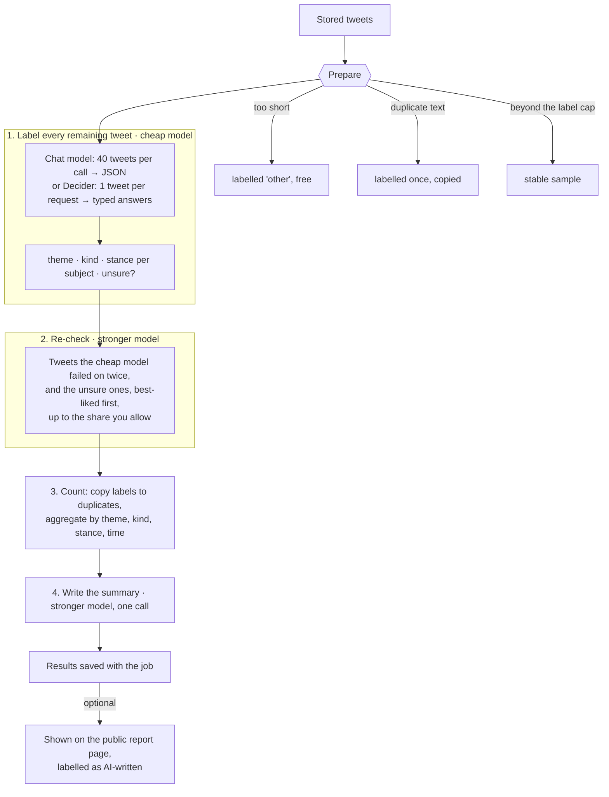
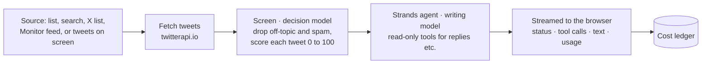
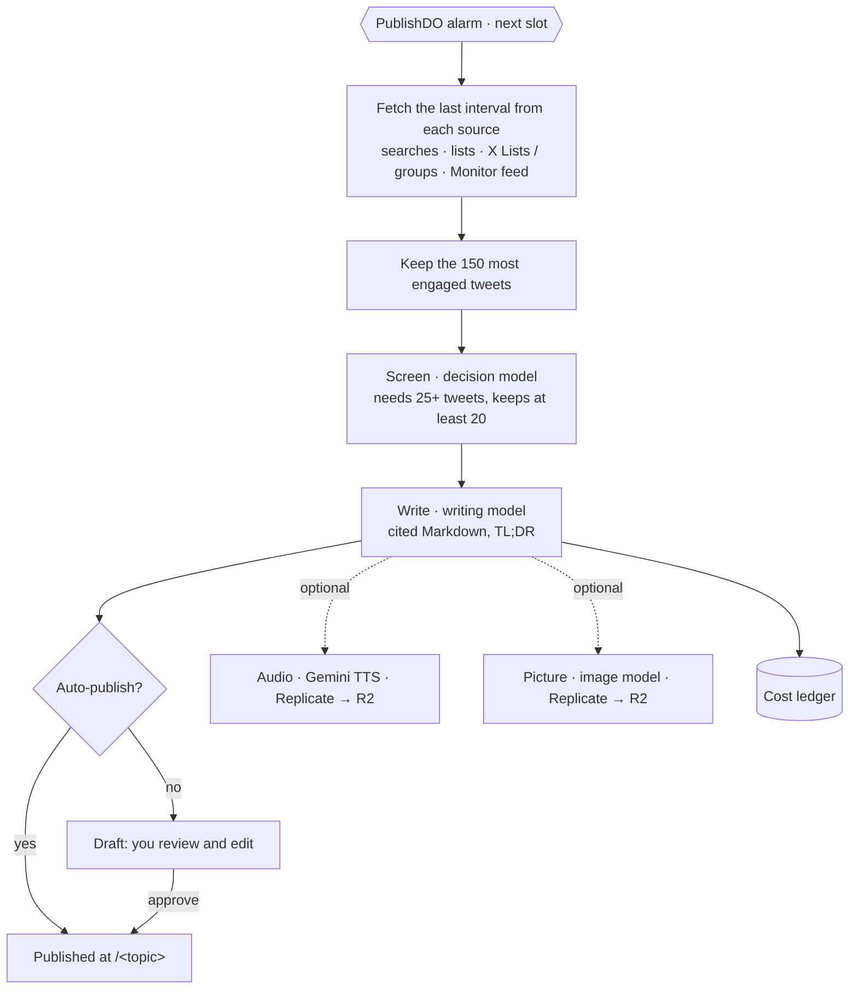

# Flows

How each feature turns tweets into a result, and which models do which step. See [architecture](architecture.md) for the pieces they run on.

## 1. Collecting History

A History job collects every tweet matching a search over a period. It is built to be cheap to resume and never buy a tweet twice.

- **Only these lists** limits the search to the accounts in your own lists (as `from:` groups). **Only these X lists** limits it to X Lists
  (each ticked list is a `list:ID` search). Groups and lists are separate searches whose results are merged; one collection can run at most 40.
- Shard progress is saved after every page, so a restart or deploy resumes without re-buying tweets. **Stop after ≈ tweets** bounds the cost.

## 2. AI analysis of a History job

Starts from a finished job. It uses the cheapest tool for each step and only calls a stronger model for what needs judgement.

- **Themes and subjects are yours** (`Name: description` lines), or press *Suggest themes and subjects with AI*: the stronger model reads about
  150 tweets (most liked plus random) and proposes them.
- **Cost control**: *Estimate cost* before running; the run stops at your **budget** (default $2, resumable) and labels at most N tweets.
  If the cheap model fails on more than 30% of the tweets the run stops with a message instead of paying the strong model to redo everything.
- **Decision model as the cheap model**: one request per tweet, so a slice stops after 700 requests (a Worker invocation may only make about 1000)
  and the next alarm carries on. It cannot be the stronger model, because it writes no text.
- It keeps running on the server if you close the page. Resuming a collection marks the analysis out of date; only new tweets are labelled next time.

## 3. History reports

*Save as report* on a finished job gives it a title and an address. *Publish* serves it at `/history/<address>`: the statistics and every
collected tweet (no profile pictures; the public pages load nothing from other sites), plus the AI analysis if you ticked it. Cost, API calls and tuning
settings are never shown. While a report is published, its job cannot be resumed or deleted.

## 4. Summarize tab

The tweets are fetched **before** the model runs, so a weak model cannot skip the fetch and invent tweets. The agent's tools are read-only and
are only for extra context (replies, another search). Every claim must link to its tweet.

## 5. Scheduled briefings

- A topic has an address, one or more **sources**, an **instruction**, a **length** (brief, standard, detailed), an optional **model**, a
  **schedule** (every 6, 12, 24 or 48 hours, or weekly, from a UTC hour) and an optional **data budget** that is shared out between the lists.
- Failures (no tweets, a model out of credit) are shown under the topic as *Last run* and still record what the data cost.
- Screening never fails a briefing: if it cannot run, the tweets go on unscreened.

## 6. Screening (decision models)

Before a summary or briefing is written, a decision model answers three yes/no questions per tweet: *is it relevant to the briefing?*, *does it
carry real information?* and *is it spam?*. Off-topic and spam tweets are dropped, and every tweet that stays gets a `signal` (0 to 100). The
writing model is told to prefer high-signal tweets for the themes and the *Notable posts*, and not to feature a tweet only because it has many
likes. Screening 150 tweets costs a few hundredths of a cent.

## 7. Explore, Lists and Monitor

- **Search, User, Trends** go through a read-only allowlisted proxy to twitterapi.io; the API key stays on the server and each call's cost is estimated into the ledger.
- **Lists** are groups of accounts you curate. **X Lists** are lists on x.com kept by reference (id, name, groups); they can be read as the
  period's top posts or their latest timeline, summarized, used in History, or made public as links.
- **Monitor** polls watches on a schedule, keeps a checkpoint and a seen-id set, and has a daily spend cap (default $2). A watch has a source: X (billed per tweet), or RSS/Atom and Hacker News (free, so they keep running when the cap is reached). Every source writes into one feed, tagged with its `source`; `/mon/feed?source=rss|hn|x` reads one source, no filter reads them combined. Non-X items are stored in the tweet shape (author, text, counts) plus `source`, `title` and `discussionUrl`. A new RSS or Hacker News watch shows the latest 10 items on its first check.

---

**Briefings and Summarize with RSS and Hacker News.** The "Monitor feed" source can be limited to one source (X, RSS or Hacker News) or read combined. Items that are not tweets reach the writer with `source` and, for Hacker News, a `discussion` link, and are cited by site or author name. An issue stores the article and discussion addresses it was given (`links`), and the public page links only those and x.com: a link the model made up is shown as plain text.

**Feed lists.** In Lists → *Feed lists* you curate named sets of feeds: YouTube channels and playlists, RSS/Atom feeds and Hacker News searches, in any mix. Paste links one per line; `/lists/f-resolve` works out what each is (a YouTube handle or link becomes the channel's feed address) and loads it once to check it and name it. A list is read on demand: `feedList` fetches every member now and keeps what was published in the period, de-duplicated by address (one story carried by two feeds counts once), so a summary does not depend on what Monitor captured. It is a source in the Summarize tab and in briefings (`{type:'flist'}`), is offered to the agent as `get_feed_list_items`, and *Watch in Monitor* turns each member into a watch. Lists live in `ListsDO` (`flists`); members are validated again on save. Code: `src/sources/feedlist.ts`.

**Feed lists in the other tabs.** *Search* has an "In feed lists" mode: pick one or more lists and a period, optionally words that must all appear in the title or text; `/lists/f-items` reads the feeds now and nothing is stored. *Lists* can show a list's latest items. *Monitor* can create the watches for a whole list (they remember the list, so the feed can be filtered per list, and a feed already watched is just tagged). *User*, *Trends* and *History* are about X data and have no feed equivalent.

**Sources of a summary.** A summary of RSS, YouTube or Hacker News items ends with a Sources card: each feed it read (linked to its site or channel, with its address and how many items it saw), how many of its items the text cited, and the cited items themselves. It is worked out from the links in the text, so it lists what was cited, not what the model claims (`sourceRefs` in `src/summarize/agent.ts`, the `sources` event). Tables in the text are rendered; the writer is asked for a bulleted list of notable items instead of a table.

**YouTube.** A YouTube channel or playlist is watched through its public Atom feed (free, no API key): paste a channel address, an @handle or a playlist and the Monitor resolves the feed address. New videos arrive as items with their description and view count. For what is said in a video the agent has `get_video_transcript` (see `docs/configuration.md` for the three ways to get it).

**Reading tools.** The Summarize agent also has `read_article` (the text of the page behind an RSS item or Hacker News story) and `get_hn_comments` (the top comments, two levels deep). They only accept addresses and ids from RSS or Hacker News items the agent was given or a tool returned, never one it makes up or finds inside a page; local, numeric and credentialed hosts are refused, every redirect is checked again, pages are cut at 2 MB and 20,000 characters, and a run can make at most 5 reads. They are free (no API), and the text they return is treated as untrusted. Code: `src/sources/read.ts`, wiring in `buildTools` (`src/summarize/agent.ts`).
