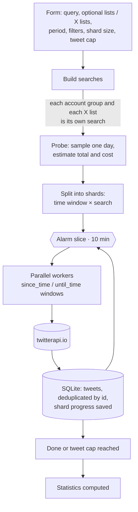
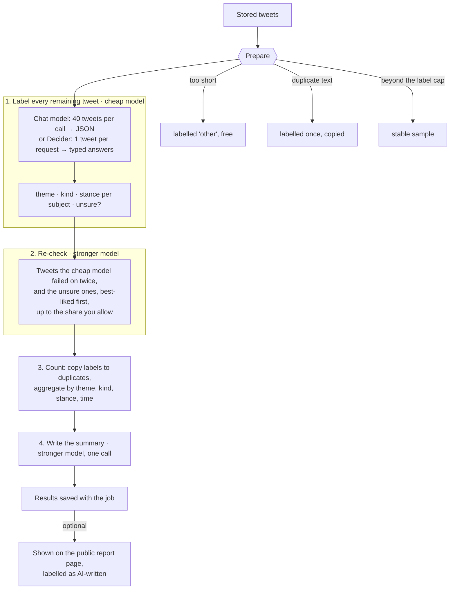
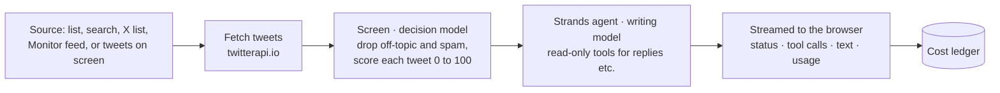
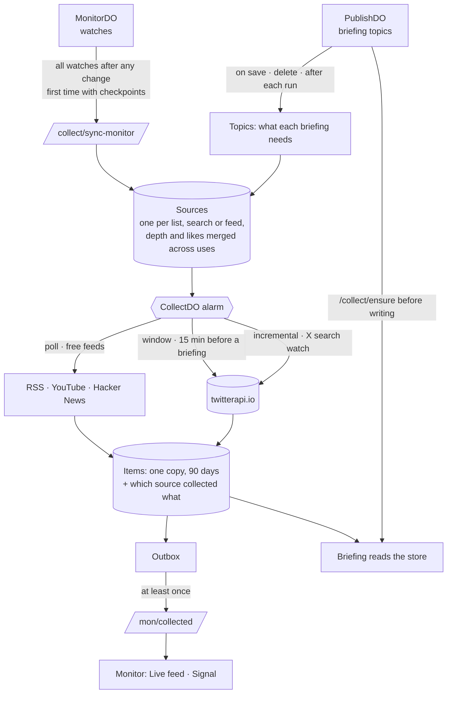

# Flows

How each feature turns tweets into a result, and which models do which step. See [architecture](architecture.md) for the pieces they run on.

## 1. Collecting History

A History job collects every tweet matching a search over a period. It is built to be cheap to resume and never buy a tweet twice.

- **Only these lists** limits the search to the accounts in your own lists (as `from:` groups). **Only these X lists** limits it to X Lists
  (each ticked list is a `list:ID` search). Groups and lists are separate searches whose results are merged; one collection can run at most 40.
- Shard progress is saved after every page, so a restart or deploy resumes without re-buying tweets. **Stop after ≈ tweets** bounds the cost.

## 2. AI analysis of a History job

Starts from a finished job. It uses the cheapest tool for each step and only calls a stronger model for what needs judgement.

- **Themes and subjects are yours** (`Name: description` lines), or press *Suggest themes and subjects with AI*: the stronger model reads about
  150 tweets (most liked plus random) and proposes them.
- **Cost control**: *Estimate cost* before running; the run stops at your **budget** (default $2, resumable) and labels at most N tweets.
  If the cheap model fails on more than 30% of the tweets the run stops with a message instead of paying the strong model to redo everything.
- **Decision model as the cheap model**: one request per tweet, so a slice stops after 700 requests (a Worker invocation may only make about 1000)
  and the next alarm carries on. It cannot be the stronger model, because it writes no text.
- It keeps running on the server if you close the page. Resuming a collection marks the analysis out of date; only new tweets are labelled next time.

## 3. History reports

*Save as report* on a finished job gives it a title and an address. *Publish* serves it at `/history/<address>`: the statistics and every
collected tweet (no profile pictures; the public pages load nothing from other sites), plus the AI analysis if you ticked it. Cost, API calls and tuning
settings are never shown. While a report is published, its job cannot be resumed or deleted.

## 4. Summarize tab

The tweets are fetched **before** the model runs, so a weak model cannot skip the fetch and invent tweets. The agent's tools are read-only and
are only for extra context (replies, another search). Every claim must link to its tweet.

## 5. Scheduled briefings

- A topic has an address, one or more **sources**, an **instruction**, a **length** (brief, standard, detailed), an optional **model**, a
  **schedule** (every 6, 12, 24 or 48 hours, or weekly, from a UTC hour) and an optional **data budget** that is shared out between the lists.
- Failures (no tweets, a model out of credit) are shown under the topic as *Last run*, and on Overview with **Run again**; they still record
  what the data cost. **Re-run and replace** writes an issue again at the same address (for example after changing the settings).
- The writer is asked for a bold TL;DR and one `## heading` per theme. The page builds "In brief" from the headings, gives each theme an anchor,
  marks it new or continuing (against the themes of the issue before), and lists the Signal topics and the accounts it cites. Older issues, written
  with a bold lead-in per theme instead of a heading, are shown the same way.
- With **Signal** ticked, the posts a run read are also counted in Signal (free), in one `brief:<slug>` feed per briefing, so scores do not depend on
  how many lists the briefing reads. In *Collected data* mode the posts are handed over when the briefing runs; in the other modes the briefing hands over what it fetched.
- Where the posts come from depends on the collection mode (section 8). In *Collected data* the briefing reads the store, and fetches live only if
  the layer does not answer. A briefing stopped by the daily cap is written from what it has and marked partial.
- Screening never fails a briefing: if it cannot run, the tweets go on unscreened.
- **Which posts are written from** (`pickPosts` in `src/durable-objects/publish.ts`). Every post is embedded once per run; posts that copy one another
  (a repost, a headline copied by many accounts) are folded into the most reacted of them, which carries `copies`, and the writer is told that is one
  report that spread, not many. If more than 150 are left, the 150 are picked for reactions (on a log scale) and for variety, so one story cannot fill
  the briefing. If the embedding model fails, the 150 most reacted are kept, as before. See *Meaning* below.

## 6. Screening (decision models)

Before a summary or briefing is written, a decision model answers three yes/no questions per tweet: *is it relevant to the briefing?*, *does it
carry real information?* and *is it spam?*. Off-topic and spam tweets are dropped, and every tweet that stays gets a `signal` (0 to 100). The
writing model is told to prefer high-signal tweets for the themes and the *Notable posts*, and not to feature a tweet only because it has many
likes. Screening 150 tweets costs a few hundredths of a cent.

## 7. Explore, Lists and Monitor

- **Search, User, Trends** go through a read-only allowlisted proxy to twitterapi.io; the API key stays on the server and each call's cost is estimated into the ledger.
- **Lists** are groups of accounts you curate. **X Lists** are lists on x.com kept by reference (id, name, groups); they can be read as the
  period's top posts or their latest timeline, summarized, used in History, or made public as links.
- **Monitor** keeps your watches, the Live feed and Signal's counts. It does not fetch: `CollectDO` collects for it (section 8) and hands the items back, and the Monitor keeps its seen-id set. The daily spend cap (default $2) now covers all recurring X collection. A watch has a source: X (billed per tweet), or RSS/Atom and Hacker News (free, so they keep running when the cap is reached). Every source writes into one feed, tagged with its `source`; `/mon/feed?source=rss|hn|x` reads one source, no filter reads them combined. Non-X items are stored in the tweet shape (author, text, counts) plus `source`, `title` and `discussionUrl`. A new RSS or Hacker News watch shows the latest 10 items on its first check.

## 8. Collection

One layer fetches and stores everything that is read on a schedule, so the same source is bought once and used by every briefing, watch and Signal that needs it. It lives in `CollectDO`; the decisions are in `src/collect/plan.ts`.

**Three strategies**
- **Poll** (free: RSS, YouTube, Hacker News). Backs off when a feed is quiet or failing, to at most 6 hours. An interval you pinned does not stretch when quiet, but it does back off on failure. A feed only a briefing reads is checked every 6 hours.
- **Window** (paid: X lists, account lists and searches that briefings read). Read once per period, 15 minutes before the briefing, because a likes filter only means something once posts have had time to collect them.
- **Incremental** (an X search watch). Read from its checkpoint.

**Reuse.** A window read is used again instead of bought again if it is at most a quarter of the period old (never more than 6 hours), and covers the period, the pages and the likes the briefing needs. A re-run or a retry the same morning therefore costs no X data and reads the same posts. A read cut short by the daily cap does not count as covering the period. *Collect now* on the Collection tab forces a fresh read.

**One cap.** One daily cap covers all recurring X collection. Briefing collection comes first: an X search watch waits when the cap, minus what briefings still need today, is used up. A briefing stopped by the cap is written from what it has and marked partial. History, Explore and Summarize are not under this cap.

**Sources and membership.**
- Two uses of the same list, search or feed share one source. A shared source is fetched with the most pages and the fewest likes of its uses.
- Sources nothing uses stop being collected and are listed as unused. They are never deleted by themselves.
- Group and list membership is followed at each run and once a day. Feed list members with no watch are shown with a one-click button to add them. They are not added automatically, so a watch you removed on purpose stays removed.

**Modes** (Collection tab)

| Mode | What happens |
| --- | --- |
| Comparing (`shadow`, the default after a deploy) | Briefings fetch live as before. Each run is also compared with the store. X data costs about double while this is on. |
| Collected data (`store`) | Briefings read the store, with a live fallback if the layer does not answer. |
| Live only (`off`) | The layer is bypassed. |

**Costs.** The ledger has a kind `collect`, per source. Issue costs and topic stats include the briefing's allocated share: a shared source's cost is split evenly between the briefings that read it. The share is not counted twice in the ledger totals.

**Trying it locally.** `SUMMARY_MOCK=1` also gives scripted X posts for briefings and collection, so the whole flow runs without spending anything.

**Local Node server.** `server/` has no collection layer. It keeps its own polling Monitor.

---

**Briefings and Summarize with RSS and Hacker News.** The "Monitor feed" source can be limited to one source (X, RSS or Hacker News) or read combined. Items that are not tweets reach the writer with `source` and, for Hacker News, a `discussion` link, and are cited by site or author name. An issue stores the article and discussion addresses it was given (`links`), and the public page links only those and x.com: a link the model made up is shown as plain text.

**arXiv.** A source of its own (`src/sources/arxiv.ts`): a watch's `query` is categories (`cs.CL, cs.LG`), words, or a fielded search (`au:"Hinton" AND cat:cs.LG`), turned into an `export.arxiv.org/api/query` request. A poll asks only for papers submitted after the last check (`submittedDate`), requests are paced three seconds apart as the API terms ask, and items carry the authors, categories and abstract, with `arxiv:<id>` ids and a PDF link. Free, polled like the other feeds. `arxiv:` lines in a feed list and pasted API addresses become arXiv members; the writer gets `get_arxiv_paper` for a paper's full abstract, and never its full text: arXiv's terms cover abstracts for public use, but full text only for personal or research use.

**Research pulse** (`src/signal/pulse.ts`, public at `/research`). arXiv papers have no reactions, so this measures volume: papers per topic in a 7-day window ending two days ago (the newest days are not all listed yet), as a share of all papers in `cs.AI`, `cs.CL`, `cs.LG` and `cs.MA`, compared with the 8 windows before it. The share matters: in raw counts, a week when the whole field doubled made every topic spike. The Monitor reads the counts in its alarm, with `max_results=1` (arXiv answers 500 to 0), a few at a time, and keeps them in its `pulse` table. It needs no watches. Topics are edited in Signal → Setup and publishing; changing a search starts its history again.

**Research topic pages** (`/research/<slug>`). The Monitor reads each topic's new papers every 6 hours (`research_papers`, kept 60 days; title, abstract, authors and categories only). These pages need no watches and do not touch the Live feed. *Getting attention* lifts the few papers with signals (`src/signal/attention.ts`): upvotes on Hugging Face Daily Papers, points on Hacker News, and posts in the collection store that link to the paper by exact address (`/collect/paper-mentions`). One account counts once, an author's own post and accounts that post papers for a living do not count, and everything else stays in date order. Each signal source is read on its own, so one that fails leaves what was known from it.

The first page also draws **the month as a sky** (`src/signal/constellation.ts`, `PubResearchPage.sky`): the topic's papers of the last 30 days that have a meaning vector (at most 240), projected to two dimensions by their first two principal components (deterministic, so the sky stays put), sized and lit by attention, glowing when discussed, with the minimum spanning tree's shorter edges as faint lines and the five most-attended named (skipping a name that would overlap another). Position says what a paper is about, not how good it is.

**arXiv's terms.** Its limit (one request every 3 seconds, one connection) covers everything you run together, so every request goes through one place: `CollectDO`'s `/collect/arxiv-get`, set up with `useArxivGate`. After a 429 or 503 it stops asking for five minutes. The statement arXiv asks for ("Thank you to arXiv for use of its open access interoperability.") is on every public page and in the admin. The project must not be branded with arXiv's name or look endorsed by it, which is why the page is called Research pulse. PDFs are linked to, never stored or served, and summaries are written from abstracts only.

**Why something is not showing.** The admin answers this itself, from data its tabs already load (`public/admin/health.js`, tested in `test/admin-health.test.mjs`). Every briefing has one panel at the top of both *Issues* and *Settings*: its sources, last run, newest issue, what is public and its Signal group, one sentence on why readers do or do not see it, and the button that fixes it (publish the draft, run again, open the settings). The list of briefings shows the same state as a pill. Each Signal group says whether it is on a published Signal, with an *Add to* button; a card under Sources says which Signal groups and briefings its watches reach. Overview lists the same problems with the same buttons. A run uses what is saved, so *Run now* saves unsaved changes first, and an empty X search cannot be saved. A briefing can be linked to directly: `#publish/<slug>` and `#pubsetup/<slug>`. In the sidebar, Briefings and Signal are one entry each, with their settings as tabs on the page.

**Feed lists.** In Lists → *Feed lists* you curate named sets of feeds: YouTube channels and playlists, RSS/Atom feeds and Hacker News searches, in any mix. Paste links one per line; `/lists/f-resolve` works out what each is (a YouTube handle or link becomes the channel's feed address) and loads it once to check it and name it. A list is read on demand: `feedList` fetches every member now and keeps what was published in the period, de-duplicated by address (one story carried by two feeds counts once), so a summary does not depend on what Monitor captured. It is a source in the Summarize tab and in briefings (`{type:'flist'}`), is offered to the agent as `get_feed_list_items`, and *Watch in Monitor* turns each member into a watch. Lists live in `ListsDO` (`flists`); members are validated again on save. Code: `src/sources/feedlist.ts`.

**Feed lists in the other tabs.** *Search* has an "In feed lists" mode: pick one or more lists and a period, optionally words that must all appear in the title or text; `/lists/f-items` reads the feeds now and nothing is stored. *Lists* can show a list's latest items. *Monitor* can create the watches for a whole list (they remember the list, so the feed can be filtered per list, and a feed already watched is just tagged). *User*, *Trends* and *History* are about X data and have no feed equivalent.

**Sources of a summary.** A summary of RSS, YouTube or Hacker News items ends with a Sources card: each feed it read (linked to its site or channel, with its address and how many items it saw), how many of its items the text cited, and the cited items themselves. It is worked out from the links in the text, so it lists what was cited, not what the model claims (`sourceRefs` in `src/summarize/agent.ts`, the `sources` event). Tables in the text are rendered; the writer is asked for a bulleted list of notable items instead of a table.

**YouTube.** A YouTube channel or playlist is watched through its public Atom feed (free, no API key): paste a channel address, an @handle or a playlist and the Monitor resolves the feed address. New videos arrive as items with their description and view count. For what is said in a video the agent has `get_video_transcript` (see `docs/configuration.md` for the three ways to get it).

**Reading tools.** The Summarize agent also has `read_article` (the text of the page behind an RSS item or Hacker News story) and `get_hn_comments` (the top comments, two levels deep). They only accept addresses and ids from RSS or Hacker News items the agent was given or a tool returned, never one it makes up or finds inside a page; local, numeric and credentialed hosts are refused, every redirect is checked again, pages are cut at 2 MB and 20,000 characters, and a run can make at most 5 reads. They are free (no API), and the text they return is treated as untrusted. Code: `src/sources/read.ts`, wiring in `buildTools` (`src/summarize/agent.ts`).

## Research map

`/research/map` shows what the papers of the research topics are about, grouped by subject, with sliders for the dates, the level of detail and the smallest cluster, plus topic, attention and search filters.

1. `MonitorDO.backfillStep` reads the last 31 days of each topic from arXiv in pages of 500, through the same gate as every other arXiv request, over as many wake-ups as it takes. Changing a topic's search reads its month again.
2. `mapStep` embeds titles and abstracts with Workers AI (`@cf/baai/bge-small-en-v1.5`), 50 at a time, into the `research_vectors` table. Full text is never read.
3. Once a day `buildMap` groups the papers (`src/signal/paperClusters.ts`: spherical k-means, up to 40 groups, then Ward joins for less detail) and asks a language model for each group's name and one-line description. If that fails, the group's telling words are its name, and the admin says so.
4. The view (`src/apps/map.ts`, in the sandboxed frame of `src/site/viz.ts`) does all its filtering and counting in the browser from one read of `/research/map.json`. An abstract is read when a reader opens it, from `/research/map/paper/<id>.json`.

Progress and errors show under **Signal setup → Research pulse** in the admin, and on the page itself while it is being built.

**Papers named without a link.** Besides links, attention counts collected posts that use a paper's own made-up name: one mixed-case word before the colon of its title, such as `nanoMuse` (`coinedName` in `src/signal/attention.ts`). A name is dropped if it was in use more than a day before its paper appeared, if more than 25 accounts use it, or if two papers share it, and an author naming their own paper does not count. This uses no embeddings: on 1,124 real posts they found papers on the same subject rather than the same paper, while all 5 mixed-case name matches were right. Papers without such a name, at least two thirds of them, can only be found by a link.

**Topics inside bigger topics.** In the Signal lists, a topic whose name holds all the words of a bigger topic's name sits straight under it, such as `trump lawsuit` under `trump` (`nestTopics` in `src/signal/topics.ts`). It keeps its own score and its own page, and its numbers are not added to the bigger topic. Nesting goes by names only, so topics that are related but named differently, such as `us election` and `voting id`, stay apart.

## Meaning (embeddings)

Besides the Research map, Signal and the briefings compare posts and topic names by meaning, with the same Workers AI model
(`@cf/baai/bge-small-en-v1.5`, 384 numbers per text). The pure parts are in `src/signal/vectors.ts` (tested in `test/vectors.test.mjs`), the model
call in `src/lib/embed.ts`. Vectors are rows in SQLite, compared one by one: at this size (hundreds of items a day) that takes milliseconds, so there
is no vector database.

1. **Every item the Signal topic model reads is embedded first**, in the same batch of 40 (`batchMeaning` in `src/durable-objects/monitor.ts`). The
   vector is kept in `item_vec` for 30 days, like the item log; a re-read uses the kept vector instead of embedding again. Links and feed boilerplate
   ("Continue reading on Medium »", "submitted by /u/…") are left out of the text compared.
2. **Copies count once.** An item at least 0.95 alike to an item of the last 3 days is a copy: it is not sent to the topic model, it is stored as
   read with no topics, and it is not counted in its day or under any topic, so it drops out of scores, evidence lists and the landscape. The same
   story told by different people (0.73 to 0.89 alike) still counts each time. Only Signal's counts change: the item stays in the live feed and the
   item log.
3. **Names in use, by meaning.** The topic model is told to reuse names already in use. It is shown the 25 most used names of the last two weeks,
   then the names closest in meaning to the batch's items (out of the 400 most used; topic names are embedded once, in `name_vec`), up to 60.
4. **Names that are probably one.** A new name at least 0.90 alike to a name in use is suggested in **Signal setup → Topic detection**, never merged
   on its own: names of different things can be as alike as names of one thing ("gpt-6 release" and "gpt-5 release" 0.88). Names that differ in a
   number ("kimi k2", "kimi k3") and a name inside another ("claude code cli" under "claude code", which is a part of its own) are never suggested.
   **Merge** adds the alias, as merging by hand does; **Not the same** keeps the pair from being suggested again.
5. **Briefings** fold copies and pick for variety (section 5).

The thresholds were set on the model itself, on hand-picked pairs (the numbers are in the head of `src/signal/vectors.ts`), not on measured traffic.
**Topic detection** in the admin shows how many posts were counted as copies in the last two weeks and the newest of them next to the post each
copies, to check that 0.95 folds only copies. If the embedding model fails, reading goes on without it (no copies, the most used names) and the
error shows there.

Not done with meaning (yet): lens membership and search still go by words, and a paper is matched to a post only by link or by its coined name
(see *Papers named without a link*), because meaning finds papers on the same subject, not the same paper.

## Topic pages

`/t/<slug>` is one page per Signal topic, and what the other public pages link to. The data is assembled by one function, `loadTopic` (`src/site/topicData.ts`), and served as the page and as JSON at `/t/<slug>.json`; later the MCP `get_topic` tool and the topic hub view read the same shape (`TopicData` in `src/signal/topicpage.ts`).

1. **Address.** `topicSlug(term)` makes the slug from the Signal term: plain names keep their words (`mcp auth bypass` gives `mcp-auth-bypass`), odd ones (`c++`, `#rust`, non-Latin) get an ASCII part and five letters of a hash. The Monitor finds the term by slug in each published Signal's last seven days (`boardView`, kept two minutes); if the topic is in several, the one with the highest score is the primary and the others are listed as "Also in". A name counted under a bigger topic answers with that topic's slug, and the Worker redirects (301).
2. **Data.** `/mon/topic-public` (`MonitorDO.topicData`) reads the logged items for the topic's names over 14 days (`item_log`, which now also keeps likes, replies and views as separate numbers; items logged before that show -1, "not recorded", and the page says less), builds the evidence strip (`evidenceSegments`), the sparkline series, the papers (`topicPapers`: the Research pulse papers of the last 30 days whose title, or for names of two words or more their abstract, holds the name, with `attentionOf` uptake) and the newest summary. The Worker adds the briefings that mention it (`/pub/mentions`).
3. **Summaries.** `MonitorDO.summaryStep` runs from the alarm, once a day, for the strongest topics of each published Signal (at most 24, 12 per Signal). It uses the Signal topic model (the same setting, the same daily cap, shown in Costs as "Topic summaries (AI)") and writes one paragraph per topic from up to 14 of its items (`src/signal/summary.ts`: prompt, parsing, tests). The text and the items it says it used are kept three days in `topic_summary` (slug, day). It stops at its time slice and carries on at the next wake-up; three failures in a row end the day's run. A page never calls a model: without a summary from the last two days it shows a line built from the numbers.
4. **Who said it first, timeline, watch** (`src/signal/topicview.ts`, data in `TopicData.first`, `.timeline`, `.watch`). `topicData` also keeps the topic's items of all 14 days (`wide`). `firstByKind` takes the *latest wave*: walk back from the newest item until a gap of three days (`QUIET_MS` of Who Said It First); the first item after it is the start; per kind of source the first item within seven days of the start gives the order (kinds within 30 minutes are first together). Dates without a time of day are left out. It says when the quiet before the start cannot be seen (`openEnded`: the history begins too close) and when there are too few mentions (`thin`), and always that the order is among the sources we follow and not where the story began. The ripple graphic compares groups across topics, not kinds within one, so the page links to `/signal/<board>/first` instead of embedding it. `timelineDots` cuts the 14 days into 42 slots and makes at most one dot per kind and slot (count, plus the most reacted item when sources are shown). `pickWatch` lists videos: the Signal's own YouTube items (only when it shows sources) and public feed page items whose title names the topic (whole words) and that link to a YouTube video, one per video, most viewed first. Titles and links of Signal items appear only with `proof`; feed pages are public anyway.
5. **Privacy.** Item titles, links, outlet and channel names appear only when the Signal shows its sources (`proof`); the evidence strip's counts and ranges never name a source.
6. **Old addresses.** `/signal/<address>/t/<term>` redirects (301) to `/t/<slug>`.

## Lenses

A lens (`src/signal/lens.ts`) is an area of interest: a key (`security`), a name, one line, one of six colours and a list of terms. It orders and highlights; it never hides.

1. **Defined in the admin** (Signal setup, "Lenses", under Topic rules). Stored in the Monitor's `meta` table as `lenses` = `{ ai: Lens[], politics: Lens[] }`; an area never saved gets its starting lenses once (AI: Security, Agentic engineering, Observability, Data, Models; politics: Elections, Economy, War and security, Law and rights, Climate and energy). At most six per area, each with its own colour (every shade is checked for 4.5:1 contrast on the page and cards in light and dark by `test/lens.test.mjs`). Both areas have the same card in the admin (an Area chooser). Routes: `GET /mon/lenses`, `POST /mon/lens-save`, `POST /mon/lens-delete`, `POST /mon/lens-suggest`.
2. **Matching.** A topic is in a lens when a lens term is, as whole words in a row, part of one of the topic's names (its term, label or the names counted under it); plural and singular are one word. `lensMatch(lens, topic)`, `lensesOfTopic(lenses, topic)`.
3. **Suggestions.** "Suggest topics" asks the Signal topic model which of the 60 strongest current Signal topics belong to which lens (`suggestSystem`, `suggestUser`, `parseSuggestions`). It is started only by that button, stays inside the day's AI spending cap, and is recorded in Costs as "Lens suggestions (AI)". Nothing is saved until the admin ticks topics and presses Add (they are added as terms).
4. **On the public pages.** `?lens=<key>` (a key that does not exist changes nothing) on `/topics` and `/signal/<address>`: `applyLens(topics, lens)` puts the lens topics first, marks them with the lens name (a tag, so colour is never the only cue) and the rest are dimmed below; one or two topics that are not in the lens but score at least 60% of the strongest (`BIG_SHARE`) are named in an "Outside your lens, big today" line. The lens chooser is a row of plain links. `/viz/lens.js` (served, not inline) stores the chosen key in `localStorage` when a lens link is followed and, on a page opened without `?lens=`, follows the stored one; it does nothing when storage is blocked. The topic page `/t/<slug>` lists the lenses its topic is in.

## The landing page

`/` is built in `landingPage` (`src/site/public.ts`) from independent reads, so any one failing only removes its block. It reads: the Signal of the first published board of the area for the chosen window (`signal-public`, 1, 3 or 7 days) and for 7 days (what In brief matches against); the lenses (`lenses-public`); the latest published briefing of each topic (headline themes and TL;DR, from the page context); and the Monitor's `landing-public`, which returns the latest written topic summaries by address, 14 days of mentions for the topics on the cards (public groups only), papers of the last week with their attention, the research topics that are rising, and the most reacted articles and Hacker News stories of the public feed pages. None of this starts a model call.

`/politics` is the same page for the politics area (see Areas above).

1. **In brief** (`inBrief`, `src/site/landing.ts`): each fresh briefing's theme headings (its TL;DR when it lists none) are matched to Signal topics by whole-word name; a line links to `/t/<slug>`. A line that matches no topic links to its briefing and says so; those come after the lines that have a topic.
2. **Landscape**: the ranked list (parts under their topic; with a lens its topics first, the others dimmed; the tooltip gives the mix of source groups) is the text form. Above it a frame draws the **landscape graphic** (`src/apps/landscape.ts`, the same view as the MCP App of `get_overview`): one bubble per topic (not a part of a bigger one; 24 at most), size = score, colour = lens (grey outside the chosen lens), a ring and a mark for new or rising, and a dashed circle with a name around topics that are talked about together. The page serves the viz policy (`PUBLIC_HEADERS_FOR(…, true)`); `/viz/host.js` loads the frame only after the page has loaded and not at all on screens up to 520px wide; without script the list stays. The data comes from `/overview.json` (see below), whose `landscape` part is built by `landscapeOf` in `src/site/landing.ts` from the layout and the Signal topics.

   **How the layout is made** (`src/signal/landscape.ts`, no model): the Monitor's `landscape-public` route (`landscapePublic`) takes the top topics of the Signal (the same `describeTopics` as `signal-public`), counts for each pair how many items mention both (`coCounts`, over the items of the window), and groups them (`clusterTopics`): pairs with the most shared items (shared over either's) join first, at least 2 shared items and 8% overlap, never more than 6 to a cluster; a topic with no partner stands alone. `layoutLandscape` then places the bubbles in a 1000 x 640 box with a small force and packing pass (partners pulled together, everything pushed apart, no overlaps; circles shrink together if there is no room). **Steady:** the pass starts from the previous layout, so topics that were there keep their place, a cluster keeps its id and place while it overlaps an earlier cluster, and keeps its name while its lead topic (its strongest) is still in it (else it takes the new lead's name); pairs that sat together get a bonus so a few items do not split a cluster. **Storage:** table `landscape (board, win, day, at, json)` in the Monitor's SQLite, one layout per Signal, window and day, kept 14 days; the layout of today is redrawn only when it is 3 hours old or the topics changed, and always starts from the latest one kept. The result is also cached for two minutes in memory like the other public reads. Shape: `{ w, h, clusters: [{ id, name, x, y, r, lead, members }], bubbles: [{ key, x, y, r, cluster }] }` (`key` is the topic address).
3. **Since your last visit**: the server writes "Today:" or "Last N days:" and the counts. `/viz/visit.js` keeps the last visit in `localStorage` and relabels to "Since <day>" only when the window is exactly as long as the time since then; otherwise it adds a link to the window that covers the gap. It never changes the numbers.
4. **Two weeks of talk**: the topics of the page (the lens's, with one chosen; at most `STREAM_TOPICS`, 10) as a streamgraph (`topicStream`, layout in `src/signal/stream.ts`: inside-out order, half wiggle and half centred baseline). The daily counts are the same `landing-public` series the cards use, asked for the first ten topics instead of six. Each band links to its topic and the list under it names them all.
   Under it, the same topics' mentions summed per day over 30 days as a heat calendar (`heat` in `landing-public`).
5. **Replay**: `/overview.json` (only) also carries the kept layouts of the days before today (`landscape-replay-public`, `replayFrames`), so the landscape frame can play the week back; layouts now store each bubble's name, and older ones fall back to the words of the address. No lens: lens pictures are made on the spot and not kept.
6. **Briefing cards** carry a small map of today's landscape with the topics the briefing covers lit (its TL;DR and themes matched to topic names with `topicFor`); it repeats the themes, so it is hidden from screen readers like the picture.
7. **The tiles** of "Today:" roll up from zero once on load (`/viz/visit.js`; not with reduced motion).
8. **A chosen lens colours the page** (`LENS_ACCENT_CSS`): the top bar carries `haslens lc-<colour>`, `body:has(>.topbar.lc-…)` sets `--lc`, and the line under the bar, the heading marks, the ranked bars, the heat calendar and link hovers take it. The same on every page whose top bar has a lens (`/topics`, `/signal/…`, the Research map).
9. **Research**: papers are listed a day or two late, so new papers are counted over at least three days. With a lens, papers whose title matches the lens terms.

## Areas: AI and Politics

The site has two areas with the same structure (`src/signal/area.ts`, pure and tested in `test/area.test.mjs`). Each published Signal (board) and each briefing topic has an `area`, `'ai'` or `'politics'` (set in the admin; **none stored means AI**, so nothing was migrated and nothing changes for what exists). Lenses have their own `area` too.

- **One board per area for the numbers.** Everything that used to take "the first published board" now takes the first published board *of the area* (`pickBoard`): the landing page, `get_overview`, the landscape layout, the cards' daily counts (`landing-public?board=`), the Signal strip on a briefing page. An area with no board shows "Nothing is published here yet" and never borrows the other area's.
- **Pages.** `/` is AI. `/politics` is the landing page of the politics area (`landingPage` with the politics context: its lenses, its landscape, In brief from politics briefings, cards and rising strip; **no Research or Watch and read blocks**, because papers and the feed pages are not tagged with an area and belong to AI). `/politics/briefings` is its briefings list. `/politics` answers 404 until something of the area is published. `render()` builds one `Ctx` per area (`ctxFor`): the menu, the top bar and the briefings lists of a page only hold that area's topics and boards. Which area a request is in comes from its address (`areaOfRequest`): `/politics...`, a Signal at `/signal/<slug>`, a briefing at `/<slug>`; `?area=politics` counts only on `/search`, `/topics` and `/signal` (the pages that exist once for both). `area` is in the page cache key.
- **The area chooser** in the top bar (`AI` / `Politics`, plain links) appears only when the second area has a published Signal or briefing; the brand and the search box stay in the area (`area=politics` is a hidden field).
- **Topic pages** stay at `/t/<slug>`; the slug resolves across all published Signals (`findTopic`), so a politics topic needs no new address. The page shows and uses the area of the Signal it was found in, with the matching menu, links and lenses, and a politics topic's links carry `?area=politics` (`topicHref`) so the area survives. If the same name is a topic in both areas, `?area=` picks (links from politics pages carry it), else the AI one wins, and the page says "The same name is also a topic in ..." with a link. Briefings that mention a topic (the Briefings angle) are only those of its own area.
- **Search** takes `area` (default AI): topics and items come only from that area's Signals, briefings only from that area's briefing topics; papers and the feed pages' items are AI's, so a politics search has none of them. Lens ordering uses the area's lenses.
- **Over MCP** every tool that picks a board takes `area` (`get_overview`, `search`, `get_who_said_first`), and the topic tools take an optional `area` hint for a name that exists in both; `get_topic` reports the topic's `area`. `list_lenses` lists both areas and says whether each has anything published. The landscape view keeps the area of its data and sends it back to `get_overview` (`ui://agent-cortex/landscape-v3.html`).

## Search

`/search` (page) and the public MCP tool `search` run the same function, `loadSearch` (`src/site/searchData.ts`), which asks two objects and merges the answers. Only public data is read, nothing starts a model call or a job.

1. **The words.** `cleanQuery` collapses white space and caps the query at 80 letters; `queryWords` takes at most six words (letters and digits, with `+`, `#` and inner `.` kept) and needs one of two letters or more, so a lone letter finds nothing. All words must match; the last may be the start of a word (so a search can be typed), the others must be whole.
2. **Topics, items, papers** (Monitor `search-public`, `searchPublic`; cached two minutes per query, 300 entries at most). *Topics*: every topic of each published Signal's last 7 days. The top topics are matched on name, then names counted under them, then the written summary; below the top only the term itself is matched. `topicQuality` gives 5 (the name is the search), 4 (a run of words in the name), 3 (all words in the name), 2 (a member name), 1 (the summary). They are ranked by that, then lens topics, then the Signal score. *Items*: `item_log` rows of the window (14 days at most) from the groups of Signals that show their sources and from public feed pages (a feed page only as far back as it shows), never briefing sources or papers; title or text LIKE each word, 400 rows at most, duplicates by address dropped; title matches first, then newest (reactions are in different units, so they never order a list). An item names its topic when a topic name appears in it as whole words (the longest wins; names under three letters are ignored). *Papers*: `research_papers` of the window (30 days at most) with every word in title or abstract, 300 rows at most; ranked by title fit, lens, uptake (`attentionOf`), then newest.
3. **Briefings** (Publish `/pub/search`): the published issues of listed topics in the window (40 per topic at most); a theme heading that has the words scores 3, the headline (TL;DR) 2, any theme text or the whole issue 1; newest first within a score. The link goes to the theme's anchor.
4. **The page.** With several kinds each group shows `PREVIEW` (5) results and "See all N"; with one kind it shows `PAGE_SIZE` (20) and a pager up to `MAX_PAGE` (5), and the other kinds are counted with one extra cheap call so the kind links show their counts. `lens` only reorders and tags. `/topics?q=` is unchanged (a name filter of the A to Z list); the top bar and the topics page search box go to `/search`.
5. **The tool.** `searchOut` (`src/site/agentText.ts`) writes the sections in the order topics, items, papers, briefings with links to the originals and topic pages, the counts, and a `Next:` line naming `get_topic`, `get_paper`, `get_briefing`, `get_topic_items`; the thank-you sentence for arXiv is added when papers are shown. The answer is cached two minutes like the other tools, and the per-address limit applies.

## Readers

Who is reading comes from the token the site's Access application puts on every request (`Cf-Access-Jwt-Assertion`), checked against
`SITE_POLICY_AUD` (`viewerOf` in `src/site/me.ts`). Nothing about readers is ever in the shared page cache:

1. **Every request** (not files, sound or pictures) asks `UsersDO.me(email)`: the reader's role, features, settings, own lenses and follows. A reader
   seen for the first time is added as a Reader. Any failure means "nobody", and the page is the one everyone gets.
2. **The front page** (`/`, no query): a reader arriving from outside (no Referer from this site) with a default lens or window is sent to
   `/?lens=…&window=…`. From a page of this site, a bare `/` is a choice ("All") and stays.
3. **A personal page**: a reader with own lenses, followed topics or a feature gets every page made for them (`render(env, url, viewer)`),
   `private, no-store`. Own lenses (`?lens=my-…`) join the area's lenses, so the lens chooser, the lists, the cards and the landscape treat them like
   the site's (`loadOverview(…, own)`). "Your topics" on the front page lists what they follow with its state in the window. Everyone else gets the
   cached page; its Follow button is a plain form, so it works without knowing who is reading.
4. **Changes** are HTML forms posted to `/me/<what>` (`mePost`): refused unless the `Origin` is this site, then a 303 back with a line saying
   what happened.
5. **Ask Claude** (`answerAsk`): the question takes one of the reader's questions for the day first (`startAsk`, so two quick ones cannot both
   pass the limit), then the stronger model answers from the topic's data as agents get it (`topicOut`, full). The answer keeps only links found in
   that data (`keepLinks`), and is stored with its model and cost; a question without an answer is given back (`dropAsk`).
6. **Saved lists**: **☆ Save** beside a post, video or paper on a topic page posts the topic and the item's address to `/me/save`. The item
   is looked up in the topic's own data (`itemOnTopic`, `findItem`), never taken from the form, and a copy is kept (title, source, author, date,
   topic), so a list keeps items after the site drops them and a public list can only hold what the site showed. Without a list named, it goes
   to the reader's most recently changed list, or a new private "Saved". With several lists the button opens a choice, the lists holding the
   item marked. Who may open a list is `mayView`: the owner always; others only while the owner still has **Publish lists**, then everyone for
   a public list and readers with that feature for an analysts' list. A reader without the feature can only make private lists. `/saved` and
   `/saved/<id>` are never in the page cache.

