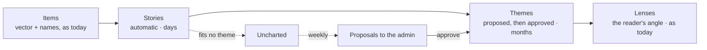

# Proposal: stories and themes

How Signal groups posts today, why the groups come out poorly, and a way to get two kinds of group without defining either upfront:
**stories** that are found on their own as they appear, and **themes** that last for weeks or months, which the system proposes and the
admin approves.

Status: steps 1 to 4 built (2026-11-13), without the measurement gates of steps 0 and 3: the thresholds are the guesses in `src/signal/stories.ts` and `src/signal/themes.ts`. Stories replace merged terms where an area has them; themes are proposed weekly, approved in the admin (Signal setup, Themes) and public at `/themes` and `/theme/<slug>` and in MCP (`get_theme`). The rest of this line is the original note: Written 2026-11-13 from the code. I could not look at the live topics while writing (the site asks for
a login and the MCP connector needs signing in again), so the diagnosis in section 1 is what the code must produce, not what I saw.
Step 0 of the plan checks it against real items before anything is built.

## 1. Why the groups are poor today

A Signal topic today is **a string**. Each item gets words and two-word phrases (`extractTerms`) plus one to three names from the topic
model (`topicSystem` in `src/signal/ai.ts`). All of them are counted per day, and names that turn up in mostly the same items are
merged (`mergeTopics`, Jaccard 0.5 or more). Everything else follows from that.

| What happens | Why |
| --- | --- |
| One story under several names | The model names each item on its own, in batches of 40. It only reuses a name if that name is among the 60 it is shown. Merging needs half the items to carry both names, which two names for the same story rarely do. The rest is aliases by hand. |
| Generic topics | Any word can lead a topic. The defence is lists of banned words (`GENERIC`, `VAGUE`, the admin's filter), which is a job that never ends. |
| Nothing between a story and a lens | The prompt asks for the story ("claude code backdoor") and bans the big name. Lenses are broad and typed in upfront (six per area, matched by words). The level in between, such as "agent security incidents", does not exist. |
| Nothing lasts | Counts are kept 30 days and compared over 14 at most. A subject that runs for three months shows up as twenty unrelated stories. |
| "New" means a new string | A new name for an old story looks new. A new story that the model gave an old name does not. |
| Meaning is not used for the grouping | Every item already has a vector (`item_vec`), but it is used only for copies, name hints and Prism inside one topic. |

The root cause is the first line: identity is the name. The proposal moves identity to **a group of items with an id**, and makes the
name a label on it that can change.

## 2. The idea in short

| Level | Example | Lives | Made by |
| --- | --- | --- | --- |
| Story | "claude code backdoor" | days to two weeks | the system, alone |
| Theme | "Agent security incidents" | weeks to months | the system proposes, the admin approves |
| Lens | "Security" | permanent | the admin, as today |

Two words on purpose: "topic" already means a briefing topic, a Signal topic and a research topic. Readers can keep seeing stories as
"topics"; the two words are for the code and the admin.

## 3. Stories: automatic, and the detector of what is new

A story is a row with an id, a centre (the mean vector of its items), the names its items carried, first and last seen, and daily counts
per source group.

**Assigning an item** (in `batchMeaning`, where the item is embedded anyway):

1. Compare the item with the centre of every live story. Join the closest one if it is alike enough.
2. Otherwise the item waits in a pool. When a few pooled items from at least two sources are alike within 48 hours, they become a new
   story. That birth is the new-topic signal.
3. A story with no items for three days is dormant (the `QUIET_MS` already used by Who said it first). An item that fits a dormant story
   wakes it, which is the "Back again" phase the lifecycle already has. After 14 quiet days it is closed and only its summary row stays.

**Alike enough** uses both things an item has, because neither is safe alone:

- The vector. Calibrated numbers already in `vectors.ts`: the same story in different words scores 0.73 to 0.89, unrelated posts on one
  subject 0.45 to 0.60. So the starting threshold is about 0.70, to be set on real items in step 0. The model's scores are compressed,
  so the comparison is done on centred vectors, as Prism does.
- The names. A shared name lowers the bar a little. A clash in a number is a veto (`versionClash`): "kimi k2" and "kimi k3" are 0.83
  alike and must never be one story.

**Naming.** The story is named once, by the model, from its most typical items, and renamed if it grows into something else. The id and
the address stay; old names redirect (the alias mechanism exists). Per-item naming stays (decided, section 9): the names are the evidence for the rule above, and the
story's name is chosen with them in view.

**What this fixes.** One story is one group whatever people call it. A bare word cannot be a topic, because a topic is no longer a
word: the banned-word lists stop mattering for grouping. Scoring does not change: the weighted share per source group in `score.ts`
counts items in a story instead of items with a term.

## 4. Themes: proposed by the system, approved by the admin

A theme is a group of stories over time: a name, one sentence, what is in and what is not, a centre, and optionally a lens it belongs
to. A story joins the theme whose centre it is closest to, if close enough; otherwise it is **uncharted**. One theme per story, so no
item is counted twice.

**Discovery, once a week** (from the alarm, like the research map):

1. Take the stories of the last eight weeks that are in no theme. Stories are small rows (a centre and counts), so they can be kept a
   year where items are kept 30 days.
2. Group their centres with what the research map already uses (`clusterPapers`: k-means, then Ward's joins), and keep only groups that
   come back when a sixth of the stories is left out (the stability test of `prism.ts`).
3. A group becomes a candidate only if it passes all of:
   - **Lasting**: at least five stories, active in at least three of the last six weeks.
   - **Broad in sources**: at least three source groups, so one account's hobby is not a theme.
   - **Not generic**: under about 15% of all items of the area, and its stories closer to each other than to the average story. A group
     that fails this is a lens, not a theme.
   - **Not a story**: no single story holds most of its items.
   - **Not seen before**: not close to an approved theme or to one the admin said no to.
4. The model names each candidate: two to five words, one sentence, and the neighbour it must not be confused with. A name on the
   `VAGUE` list is refused.

**In the admin** (Signal setup, a new "Themes" block, in the style of Topic detection): each proposal shows its name and sentence, the
stories it would hold with dates, its curve over eight weeks, the closest existing theme, and which test it passed by how much.

| Action | Effect |
| --- | --- |
| Approve | The theme exists from now on. Name, sentence and lens can be edited first. Past stories are attached. |
| Merge into… | The stories go to an existing theme, whose centre widens. |
| Not a theme | Remembered with its centre, so it is not proposed again. |
| Later | Proposed again in four weeks if it still passes. |

The same list carries proposals about themes that exist: **split** (its stories form two stable groups), **merge** (two themes have
grown together), **retire** (no story for six weeks; it stays findable but leaves the lists), and **drifted** (the centre has moved far
from where it was approved; the admin confirms or resets). A theme's centre follows its stories slowly and never moves past that limit
on its own.

The admin can also start a theme by hand from one or two stories ("more like these"). That is not defining it upfront: the examples
come from the data.

## 5. What "new" means after this

Three different things, shown as three different marks:

| Mark | Meaning | Where it comes from |
| --- | --- | --- |
| New story | A story born in the window, unlike any story of the last 30 days | Section 3, step 2 |
| New in *theme* | A new story inside an approved theme. What a follower of the theme wants to hear about | Story birth plus theme membership |
| Uncharted | A story that fits no theme. Several alike over weeks are exactly what gets proposed | Section 4 |

A story that is only a new name for an old one is no longer "new", and a new story hidden under an old name now is. The Depth chart's
breadth (how many kinds of source have it) applies to the pool as well, so something can be flagged before it is big enough to be a
story.

## 6. What changes where

| Part | Change |
| --- | --- |
| Storage (Monitor) | New tables: `story` (id, area, name, names, centre, first, last, state, theme), `story_item` (30 days), `story_day` (counts per group, kept a year), `theme`, `theme_proposal`. `terms` and `ai_terms` stay for search and for describing a story. |
| `/t/<slug>` | A story page. Slug from the story's name; earlier names redirect. Prism stays as it is, inside a story. |
| New: `/themes`, `/theme/<slug>` | The theme with its stories on a time line, its curve over months, what is new in it. Followable like a topic. |
| Landscape | The dashed circles become themes instead of shared-item clusters. |
| Lenses | A theme belongs to a lens (suggested on approval). This replaces matching lens words against names, listed as not done in flows.md. |
| MCP | `get_overview` and `get_rising` name themes; `get_topic` reports its theme; a new `get_theme`. |
| Cost | Embeddings: none added. Model: per-item naming as today, plus one naming call per story and one per week for themes. |

## 6b. Sources

Sources keep their definition: a watch, the group it votes in, the group's weight, and the Signals (boards) that include the group.
Nobody ties a source to a theme by hand. Four things follow from the proposal all the same.

1. **Stories are formed per area, not per Signal.** All items of an area's Signals go into one grouping, each item once even when two
   watches fetched it. A Signal then shows the stories with the counts of its own groups. Otherwise the same story would get a different
   id, name and address in each Signal.
2. **The tests lean on the groups.** "At least two sources" for a story and "at least three source groups" for a theme only mean
   something if groups are independent. A group that holds most of the watches, or two groups that follow the same accounts, weakens
   both tests. Step 0 reports how items spread over groups, and the groups are tidied before the thresholds are set if needed.
3. **The link from source to theme is measured, then shown.** Per theme: which sources and groups carry it, and who tends to be early
   (the early or late verdict of Who said it first, per theme instead of overall). Per source: which themes it feeds, and how much of
   it lands in no story at all. In the admin that gives two lists that do not exist today: themes carried by one or two sources (where
   to add sources) and sources that mostly add noise (candidates to drop). Suggestions only; the admin changes the sources.
4. **Weights stay per group, not per theme.** A weight per theme and group would be many numbers nobody can keep right. If one group
   dominates a theme, the theme page says so, as topic pages do with the mix of groups today.

One thing to check in step 0: a headline, a post and a video title are different kinds of text. If the same story does not land together
across kinds of source, the threshold is set per pair of kinds. Papers stay out of the stories; a theme can link to the research map's
clusters later (proposal B4, Bridges).

## 7. Steps

0. **Measure first.** An admin route exports two weeks of items with their vectors and today's topics. A Node script runs the story
   grouping on them (pure functions, with the local copy of the model for thresholds). Read fifty stories beside today's topics, set the
   thresholds. If the stories are not clearly better, stop here.
1. **Stories in shadow.** Built in the Monitor and shown in the admin next to today's topics. Nothing public changes.
2. **Stories replace merged terms** on the public pages and in MCP, with redirects.
3. **Theme proposals** in the admin. Run for about four weeks and see how many are worth approving.
4. **Themes in public**: pages, landscape, lenses, MCP.

Each step is usable alone, and steps 1 and 3 can be thrown away without touching what readers see.

## 8. Risks

- **The model blurs things.** bge-small puts everything on one subject close together. Centring, the number veto and step 0 are the
  answers; a larger embedding model is the fallback, at a re-embedding cost.
- **Stories that swallow others.** A centre that drifts can pull in neighbours. Guard: a story's centre is fixed after its first days,
  and a story that Prism can split into stable groups is split.
- **Too many or too few proposals.** The tests in section 4 are guesses until step 3 has run. They are constants in one file.
- **History is short.** There are 30 days of items today, so the first proposals come from four weeks, not eight.

## 9. Decided (2026-11-13)

1. **One theme per story.** Counts stay honest and pages stay simple.
2. **Proposed themes are not public before approval.** Uncharted stories are public, as stories.
3. **Themes are per area**, like lenses (AI and politics apart).
4. **Per-item naming by the model stays.**

## 10. First run on real items (2026-11-13)

Step 0 was skipped, so the grouping was read once on a local run instead: 49 public feeds (news, press, blogs, community, Hacker News), 446 items, mock topic names
(two-word phrases, since there is no model key locally). What it showed, and what was changed:

- **The threshold holds.** Against a story's centre, items of the story score 0.59 and up, items of other stories 0.55 and under (`STORY_SIM` 0.55 stays).
- **Sources, not groups, for a birth.** Section 3 says "at least two sources"; the code asked for two source groups, so a release covered by four blogs never became a
  story. Now two sources (on X: two accounts).
- **One story born twice.** The biggest story started from two sides and stayed two stories (centres 0.72 alike; the closest different pair 0.50). Stories whose centres
  are 0.62 alike are now joined, the smaller into the bigger, and its address redirects (`findMerges`).
- **Pair by pair, the vectors cannot tell takes on one subject from different launches by one company** (both 0.37 to 0.49). So a shared name now lowers the bar by
  0.15 (was 0.08), also between waiting items, and only a story's four leading names count.
- **Feed boilerplate glued unrelated posts.** A feed whose every description is "Comments" made a junk story; `embedText` drops that line.
- **Themes from one week.** With one week of history "five of the eleven stories" was proposed as a theme. A theme now always needs two active weeks.

Then the same items again with real names (the production topic prompt, applied by a small model batch by batch with earlier names as hints, as the Monitor does):

- **An item named for two stories glued them.** "Fable 5.2 retakes #1 as the IPO roadshow begins" carried both names, so the model release and the IPO were born
  as one story. Now only a story's leading name lowers the bar for a join, and at a birth an item let in only by a name must carry the group's leading name. With that,
  the release is one story of five items (it was not found at all with mock names) and the IPO another.
- **Labels can be wrong, and then a name lets a stray in.** Two of 444 items were tagged with the name of a big story they were not about and joined it (0.48 and 0.49
  alike, where true members of that story go down to 0.41). Accepted: the vectors cannot tell them apart.
- **Sub-stories stay apart.** The interim CEO and the chip smuggling around the biggest story became stories of their own (0.44 and 0.60 alike to it). That reads right.
- **The number veto never fired**: no two names in these items differ only in a number. It is covered by the tests (kimi k2 and k3), not by this data.

Still not checked: X posts, more than a week of items, and the theme tests on real history. They need production, or weeks of a local run.
