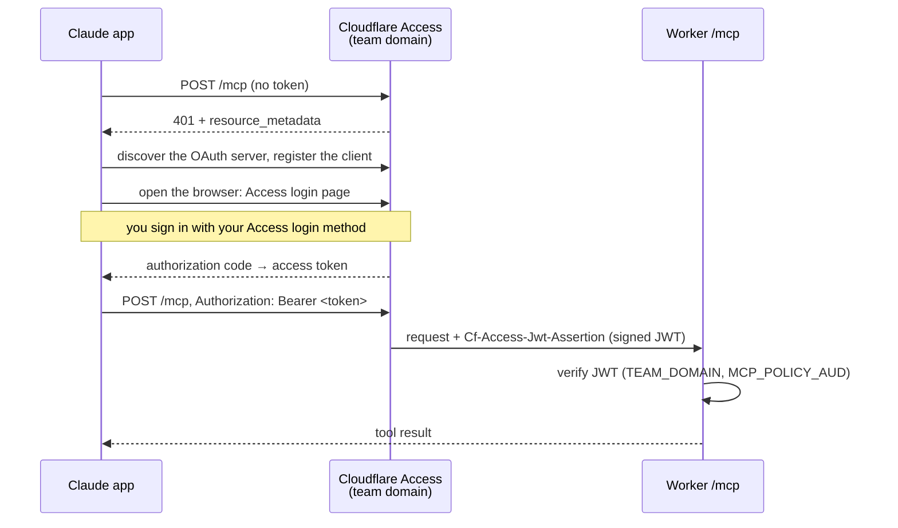
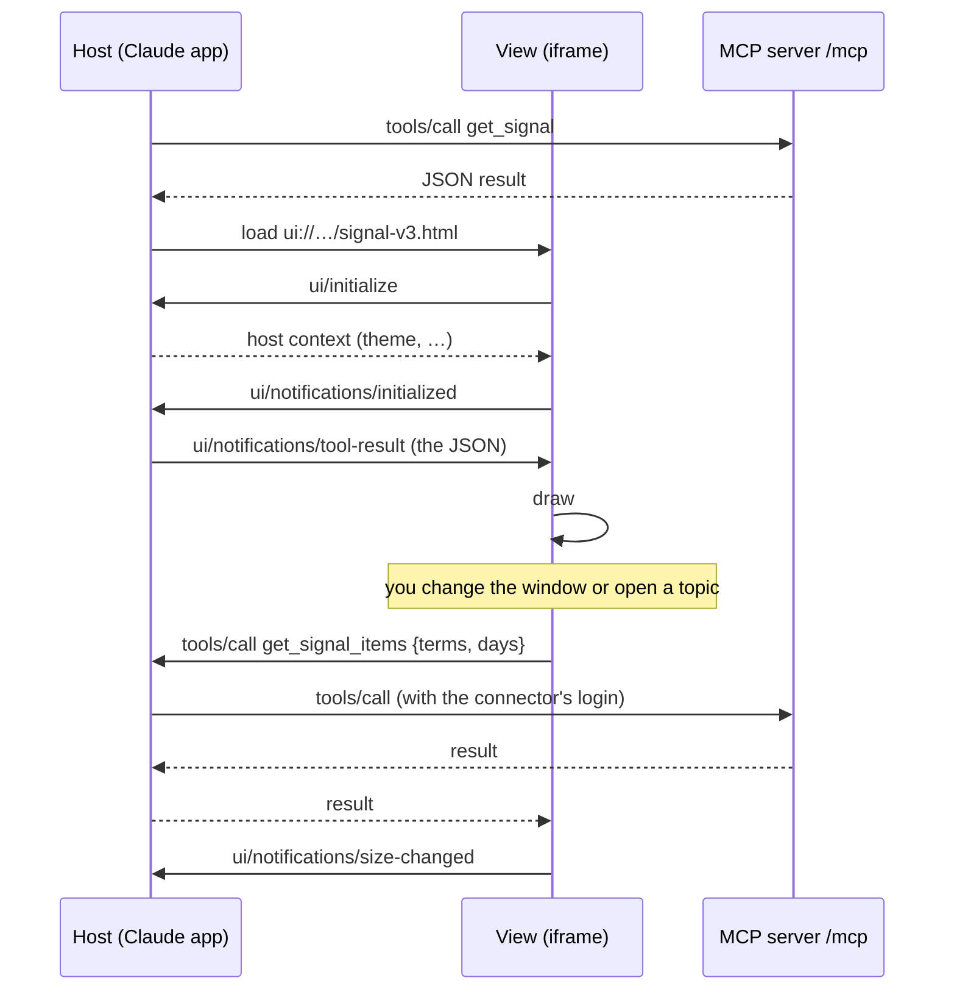

# MCP server

`https://tweets.example.com/mcp` is a [Model Context Protocol](https://modelcontextprotocol.io) server over the app's data, so Claude (the
Claude app, claude.ai, Claude Code, or any MCP client) can read your briefings, Signal, archives, lists, live feed and costs. Four of its tools
also come with **MCP Apps**: interactive views that the Claude app draws inline instead of showing JSON.

It only reads. Nothing that starts a job, changes a setting or spends money is exposed.

- Code: `src/mcp.ts` (the tools), `src/apps/` (the views), the `/mcp` route in `src/index.ts`, the token check in `src/access.ts`.
- Transport: Streamable HTTP, **stateless**. Every request builds a fresh server and answers with plain JSON (no event stream, no session).
  Only `POST` is accepted.

## The tools

| Tool | What it returns | View |
| --- | --- | --- |
| `list_briefing_topics` | Briefing topics with schedule, sources and the 30 most recent issues (drafts included) | |
| `get_briefing_issue` | The full text of one issue (`slug`, `id`) | |
| `get_research_pulse` | Research pulse: new arXiv papers per research topic, and whether a topic's share of AI papers is spiking | |
| `get_signal` | Signal: topics across all watched sources, one weighted score each; top, rising, shared and single-group terms | **Signal dashboard** |
| `get_signal_items` | The items behind a Signal topic (title, link, source, date), with counts per group and source | |
| `get_tweet_galaxy` | A History collection summarised by theme, kind and stance | **Tweet Galaxy** |
| `get_galaxy_points` | The compact rows the Tweet Galaxy draws. The view calls it; it is not meant for the model | |
| `get_who_said_first` | The order Signal's topics reached your source groups in, and which groups tend to be early | **Who Said It First** |
| `get_costs` | Spend by feature over the last N days | **Costs dashboard** |
| `list_history_jobs`, `get_history_job` | Archive collections and their progress | |
| `get_history_analysis` | The AI analysis of a collection: themes, stance, summary | |
| `get_history_tweets` | The tweets of a collection, 200 per call at most, paged with `offset` | |
| `list_user_lists`, `list_feed_lists`, `list_x_lists` | Your account lists, feed lists (RSS, YouTube, Hacker News) and X Lists | |
| `list_monitor_watches`, `get_monitor_feed` | What is watched, and the newest items it found | |
| `list_collection_sources` | The collection layer: every source, how often it is read, its health, limits hit, cost over 7 days, who uses it, the mode and how live fetches compare with the store | |
| `get_collected_items` | Items the layer has stored, newest first, 100 per call at most, paged with `offset`; filter by source, kind, consumer (`briefing:<slug>`), words or days (1 to 90) | |

Every tool is marked `readOnlyHint`. The tools ask the Durable Objects the same internal questions the admin app does.

## Signing in

`/mcp` has **its own Access application**, separate from the one for `/admin*`, so a credential for the MCP server opens nothing else.
Access stands in front of the Worker, and the Worker checks the result again itself:

1. Cloudflare Access lets the request through only with a valid login or service token, and adds a signed JWT
   (`Cf-Access-Jwt-Assertion`).
2. The Worker verifies that JWT (signature, issuer `TEAM_DOMAIN`, audience `MCP_POLICY_AUD`, expiry) before anything else runs. Without
   `MCP_POLICY_AUD` it refuses every request, so a misconfigured Access application cannot leave the server open.
3. Requests with an `Origin` header are refused: MCP clients are not web pages, so no website can call it with your cookies.

There are two ways to get through Access, and the server does not care which one was used:

| | Managed OAuth | Service token |
| --- | --- | --- |
| For | The Claude app and claude.ai (custom connector), and other clients that can sign in through a browser | Claude Code, scripts, CI: clients that send fixed headers |
| You sign in | Once, in the browser, with your Access login (e.g. a one-time code by email) | Never; the token is the credential |
| Access policy | **Allow**, including you (your email) | **Service Auth**, including the token |
| Revoke | Remove yourself from the policy, or revoke the session in Zero Trust | Delete or rotate the token |

### Managed OAuth (the Claude app)

With **Managed OAuth** turned on, Access acts as an OAuth 2.0 authorization server for the application. A client without a token gets a `401`
that tells it where to sign in, instead of a login page it cannot use:

```text
HTTP/2 401
www-authenticate: Bearer realm="OAuth", error="invalid_token", ...,
  resource_metadata="https://tweets.example.com/.well-known/cloudflare-access-protected-resource/mcp"
```

The metadata names the team domain (`https://<team>.cloudflareaccess.com`) as the authorization server. The flow:



The access token the client holds is opaque; only Access can read it. The Worker never sees it: it sees the JWT that Access adds after it has
checked the token and the policy. Access applies the same policy as a browser login, so who may connect is decided in one place.

**Set it up**

1. Zero Trust → Access controls → Applications → **Add** → Self-hosted. Destination `tweets.example.com/mcp`.
2. Add a policy with action **Allow** that includes your email (or your identity provider group). Add the **Service Auth** policy too if you
   also want a service token (below).
3. On the application, **Advanced settings** → turn on **Managed OAuth** → Save.
4. Copy the application's **AUD tag** and store it: `npx wrangler secret put MCP_POLICY_AUD --env=""`. `TEAM_DOMAIN` is shared with the admin
   application. No deploy is needed after setting a secret.
5. In the Claude app: Settings → Connectors → **Add custom connector**, URL `https://tweets.example.com/mcp`. It opens the Access login in the
   browser; sign in, and the connector shows its tools.

Check it from a terminal: `curl -si -X POST https://tweets.example.com/mcp` should answer `401` with the `www-authenticate` header above. A `302`
to a login page means Managed OAuth is off.

### Service token (Claude Code, scripts)

1. Zero Trust → Access controls → Service credentials → **Create service token**. Copy the Client ID and Secret (the secret is shown once).
2. On the `/mcp` application, add a policy with action **Service Auth** that includes the token.
3. Add the server to Claude Code with the token as headers:

   ```sh
   claude mcp add --transport http tweet-explorer https://tweets.example.com/mcp \
     --header "CF-Access-Client-Id: <id>" --header "CF-Access-Client-Secret: <secret>"
   ```

Locally (`npm run dev`, with `DEV_BYPASS_ACCESS=1` in `.dev.vars`) there is no Access in front: use `http://localhost:8787/mcp` with no headers.
The bypass is ignored for any request that came through Cloudflare's edge.

## MCP Apps: interactive views

An [MCP App](https://modelcontextprotocol.io/extensions/apps) is a small web page that a tool result comes with. Hosts that support them (the
Claude app, claude.ai) draw the page inline in the conversation; every other client still gets the tool's JSON text, so nothing depends on it.

| Tool | View | What you can do in it |
| --- | --- | --- |
| `get_costs` | `ui://tweet-explorer/costs-v7.html` (`src/apps/costs.ts`) | Totals and a per-day chart; switch between 7, 30 and 90 days |
| `get_signal` | `ui://tweet-explorer/signal-v3.html` (`src/apps/signal.ts`) | Pick the window and which published Signal; switch between strength and where it shows up; show background topics; open a topic to see the items behind it |
| `get_tweet_galaxy` | `ui://tweet-explorer/galaxy-v2.html` (`src/apps/galaxy.ts`) | Every tweet of a History collection is a particle: move them between spirals per theme or kind, a timeline, and for and against a subject; replay the collection day by day; isolate a theme; select tweets and ask Claude about them |
| `get_who_said_first` | `ui://tweet-explorer/first-v1.html` (`src/apps/first.ts`) | Each topic is a ripple from the group that had it first; distance from the centre is how late the others were. Pick a topic, a window and a Signal; compare every group's firsts with what chance predicts |

Both pictures can also be opened on the public site (`/history/<slug>/galaxy`, `/signal/<slug>/first`), for published reports and Signals only. See [architecture.md](architecture.md).

### How Who Said It First judges

The order is by publication time, so how often a source is polled does not change it. It is the order among your own sources, and does not say where a story began.

- **Only a real start counts.** A topic is judged when it starts after three quiet days and reaches at least two groups, with three mentions or more. A topic that is always talked about has no start.
- **Chance is the yardstick.** If a wave's mentions were shuffled in time, a group would come first as often as its share of them. A group is called early or late only after 8 topics and two standard deviations from that. Arrivals within 30 minutes tie and share the credit.
- **Left out:** briefing posts (written from the other sources), dates with no time of day, muted groups, and a group for any wave that began before its first source was added.
- **Too little overlap** shows as few judged topics: `skipped` says how many never had a clear start and how many stayed in one group.
- **Known limits:** a feed item with no date at all gets the time it was fetched, so such a feed can look later than it was. With Signal's model topics off it compares plain words, so a "wave" can be the same word by coincidence (`ai: false` in the answer, and the view says so).

### How it fits together

1. **The tool points to the view.** `registerAppTool` gives the tool `_meta.ui.resourceUri` (a `ui://` address).
2. **The server serves the view.** `registerAppResource` answers a read of that address with the HTML (MIME type `text/html;profile=mcp-app`).
   The page is one self-contained string in `src/apps/`: inline CSS and script, nothing loaded from elsewhere.
3. **The host runs the tool, then shows the page** in a sandboxed iframe and talks to it with JSON-RPC over `postMessage`:



The messages the views use:

| Message | Direction | Meaning |
| --- | --- | --- |
| `ui/initialize` | view → host | The handshake; the answer carries the host's theme |
| `ui/notifications/initialized` | view → host | Ready to receive the result |
| `ui/notifications/tool-result` | host → view | The tool's result, the same JSON a text client gets |
| `tools/call` | view → host | Call a tool of this server again (another window, the items behind a topic). The host makes the call with the connector's own login, so the page holds no credential |
| `ui/notifications/size-changed` | view → host | The page's height, so the host sizes the frame (sent again when the content changes) |
| `ui/notifications/host-context-changed` | host → view | The theme changed (light or dark), or the display mode |
| `ui/request-display-mode` | view → host | Tweet Galaxy: go fullscreen and back |
| `ui/update-model-context` | view → host | Tweet Galaxy: tell Claude which tweets are selected, for the next turn |
| `ui/message` | view → host | Tweet Galaxy: the "Ask Claude about these" button sends a chat message |

The view can only reach this server's tools, through the host, and the tools are read-only, so a view cannot change or spend anything either.

### Rules for the views

- **Hand-written, no SDK, no bundler.** Each view is a plain page with a classic inline script that speaks the `ui/*` messages directly. The
  first Costs view bundled the `@modelcontextprotocol/ext-apps` client (about 520 KB) and hung at "rendering widget" in the Claude app. A
  hand-written page rendered at once. The server side still uses `@modelcontextprotocol/ext-apps/server` to register tools and resources.
- **Bump the address when a view changes** (`costs-v6` → `costs-v7`, in `src/mcp.ts`). The Claude app caches the tool list and the page.
- **After a deploy that changes a view**: in the Claude app, Settings → Connectors → disconnect and reconnect the connector, then start a
  **new chat**. A new chat alone can still show the old view.
- **Test in the Claude app**, not in Claude Code: Claude Code only shows the JSON text.
- Keep the result JSON useful on its own: clients without MCP Apps, and the model itself, read the same data.
- Keep large data out of that result. The Tweet Galaxy's tool returns a summary, and the page reads its thousands of points through `tools/call` (`get_galaxy_points`, at most 6,000 tweets, most liked first).

### The shell

`src/apps/shell.ts` is one hand-written file that every public view includes (the Landscape, the Depth chart, the Topic hub and the Research map; not the owner's views). It exports two strings, `SHELL_CSS` and `SHELL_JS`, which a view puts in its page at its two placeholders, `${SHELL_CSS}` in the style and `${SHELL_JS}` in the script. It adds one global, `UC`, and keeps its own message ids (from 100000) so they never meet the view's. It gives a view:

- **A bar** with `← Back`, a trail line (`Landscape › MCP auth bypass › A post`) and *Open on the site*.
- **Panels**: a topic, an item or a paper opens in place over the view, from any view. Back returns to the view as it was; Esc closes a panel.
- **Picking**: ticks in panels and in the Topic hub, and one foot bar: *3 picked · Ask Claude about these · Save to a list · Clear*.
- **Telling the model**: after every change one short text goes to the model with `ui/update-model-context` (where the reader is, the lens and window, what is picked), after 600 ms of quiet and only when it changed.
- **Suggested questions**: up to three buttons under the view, from `questions` in the answer; a click sends a chat message.

| Call | Does |
| --- | --- |
| `UC.init(opts)` | Once, in the view's handshake branch. Builds the bar, the panel box, the question box and the foot bar inside `opts.root` |
| `UC.open(kind, args)` | Opens a panel: `'topic'` `{ topic, area }`, `'item'` `{ topic, item, area }`, `'paper'` `{ id }`. Returns `false` and does nothing where panels are off (the site), so the caller can fall back to a link |
| `UC.swap(kind, args)` | Replaces the top panel (the next item in time), so Back still goes to the list |
| `UC.step(title, undo)` | Records a move the view drew itself (the Topic hub going to a related topic). Back calls `undo` |
| `UC.back()`, `UC.reset()`, `UC.depth()` | Back one, drop the whole stack, how deep it is |
| `UC.pick(key, desc)`, `UC.picked(key)`, `UC.chosen()` | Selection. `desc` is `{ k: 'item' \| 'paper' \| 'topic', label, url, id?, slug?, meta?, t? }`; `null` unpicks |
| `UC.tell()` | Tells the model, after 600 ms of quiet, and only when the text changed |
| `UC.ask(text)` | Sends a chat message |
| `UC.suggest(list)` | Draws up to three question buttons under the view |
| `UC.link(url)` | Opens a link through the host |
| `UC.refresh()` | Redraws the bar and the foot (call it after the view has new data) |
| `UC.call(tool, args, done)`, `UC.rpc`, `UC.read`, `UC.can` | The transport, for a view that wants it |

`opts` is `title`, `host` (`hostCapabilities`), `root`, `size`, `note`, `site` (the view's address on the site with its filters), `context` (what the view wants the model to know), `state` (`{ area, lens, window }`), `redraw`, `cleared`, `question` and `saveBase`; the fields are described at the top of `shell.ts`.

**The site's host gets no panels.** `/viz/host.js` lists only `openLinks`, so `UC.open` returns `false` there and a click opens the page, as before. The bar and *Open on the site* are not shown on the site either.

Test file: `test/shell.test.mjs` (the logic, with no DOM) and `test/hubviews.test.mjs` (that each view includes the shell and keeps its address).

### Adding a view

1. Write `src/apps/<name>.ts`: `export default` a complete HTML page. Copy the handshake from `costs.ts`: send `ui/initialize`, then
   `ui/notifications/initialized`, draw on `ui/notifications/tool-result`, report the size, follow the theme. For a public view, include the shell
   (`${SHELL_CSS}`, `${SHELL_JS}`) and call `UC.init` in the handshake branch.
2. In `src/mcp.ts`, register the tool with `registerAppTool(..., { _meta: { ui: { resourceUri } } })` and the page with
   `registerAppResource(server, '<Name>', resourceUri, { mimeType: RESOURCE_MIME_TYPE }, …)`.
3. Deploy, reconnect the connector, open a new chat, and ask for something that calls the tool.

## The public server: `/agent/mcp`

A second, **public** MCP server gives an agent the same three zoom levels as the site: overview, topic, source. It is separate from `/mcp` above (which stays owner-only
behind Access). The site explains it at [`/agent`](../src/site/public.ts) with the lines to copy:

```
claude mcp add --transport http undercurrent https://<site>/agent/mcp
```

and, for the Claude app or claude.ai, a custom connector with the same address (no sign-in).

- Code: `src/agentMcp.ts` (the endpoint, the tools and prompts), `src/site/agentText.ts` (the Markdown and JSON of each answer; pure, tested in `test/agenttext.test.mjs`),
  `src/site/overview.ts` (`loadOverview`, shared with the landing page), `src/site/topicData.ts` (`loadTopic`, shared with `/t/<slug>`), and three read-only Monitor routes:
  `topic-items-public`, `papers-public`, `paper-public`.
- Route: `POST /agent/mcp` in `src/index.ts`, handled before and outside `/mcp` (its address does not start with `/mcp`, so the Access application does not cover it).
  Streamable HTTP, stateless, plain JSON answers; other methods get `405`.
- **What it shows:** exactly what the public site shows (published briefings, published Signals, public research). No `/adm/` or other private route is read, and a Signal
  that does not show its sources gives no item list here either. **What it never does:** call a model, start a job or spend money. Topic summaries are written ahead of
  time by the Monitor's alarm; the server only reads them (it asks for `topic-public` with `quiet=1`, so it does not even wake the summary writer).
- **Rate limit:** 60 requests a minute per client address (`cf-connecting-ip`), with the Workers Rate Limiting binding `AGENT_LIMIT` in `wrangler.jsonc` (production and
  staging each have their own namespace). Over it: `429`, a JSON-RPC error and `Retry-After: 60`. The binding counts per Cloudflare location, so the limit is approximate.
  Without the binding (an old deployment) there is no limit. Answers are also kept in the edge cache for two minutes (key: tool, arguments and the deployed version).
- **Browsers:** unlike the private server, `Origin` is not refused. The server holds nothing private, sets no cookies and takes no credentials, so any web page may call it
  (`Access-Control-Allow-Origin: *`, `OPTIONS` answers `204`); there is no login for a page to ride on.
- **Text answers:** Markdown that leads with the answer in two to four lines, then short sections, about 1,500 tokens (`detail: "brief"`, 6,000 characters) or four times that
  (`detail: "full"`). Sections that do not fit are dropped from the end, with a line saying so; the closing **Next:** line is always kept. Every claim links to the original and to
  the topic page (absolute addresses, from the request's origin). Evidence is per kind of source in its own unit (X in ranges with distinct accounts, Hacker News points and
  comments, YouTube views, blogs by outlet, papers by uptake), never one blended number. Titles and quotes are third-party text and the answers say so. The same data is in
  `structuredContent`; no `outputSchema` is declared.
- Papers are abstracts only, with the link to the original abstract page (never a PDF), and every paper answer carries the thank-you sentence.

| Tool | Arguments | Answer |
| --- | --- | --- |
| `list_lenses` | | Both areas (AI, Politics) and their lenses, and whether each has anything published |
| `get_overview` (MCP App: Landscape) | `area` (`ai` or `politics`; AI by default, and an AI answer never includes politics topics), `lens` (of the same area), `window` (1, 3 or 7 days; other numbers use the next window up), `detail` | In brief, new and rising topics, the top topics (one line, score and where it comes from), research, what is big outside the lens |
| `get_rising` (MCP App: Depth chart) | `area`, `lens` (of the same area) | The steepest climbs, then every topic at the surface, mid-water and in the deep, each with its breadth and its reach in words (kinds of source, groups, sources). Breadth is reach, never reactions |
| `get_topic` (MCP App: Topic hub) | `topic` (address or name), `area` (hint, only for a name that is a topic in both areas), `window` (days for the count of mentions), `from` (where you came from: `lens:<key>[@3|@7]`, `lens:all`, `search:<words>` or `briefing:<slug>/<id>`, as on the site; unknown values are ignored), `lens` (the lens you are reading in; it changes nothing in the answer, the Topic hub view keeps it), `detail` | Summary, state, evidence per kind, top items, papers, briefings, related topics; `area` in `structuredContent` and in the text for a politics topic With `from`, the answer's `list` (also in the JSON) gives the topic's place in that list and the topic before and after, and the closing `Next:` line names the next one with the same `from`, so an agent can walk the day's topics as a reader does. Related topics carry their state and one line, and the `Next:` line names the first as a neighbour. `structuredContent` also has `lens` (as given, or null) and `questions` (see below). |
| `get_topic_items` | `topic`, `kind` (`x`, `hn`, `youtube`, `rss`), `day` (`YYYY-MM-DD`, one of the last 7 days; another day is ignored and the answer says so), `sort` (`newest` by default, `reacted`, `earliest`; `new` and `top` still work), `area` (hint), `cursor`, `detail` | 25 items a page with author, time, reactions and links; `nextCursor` for the next page. The same day, kind and order as the topic page's `?day=`, `?kind=` and `?sort=`. `reacted` is ordered within each kind of source, one kind after the other (give a `kind` for one list), since likes, points and views are never ranked against each other; `earliest` is oldest first, to see who was early in the wave (not who started it) |
| `get_item` | `topic`, `item` (the id at the end of each `get_topic_items` line, also `id` in the talk lists of `get_topic`), `area` (hint), `detail` | One item in context, the text of the source card `/t/<slug>/i/<id>`: author, time, reactions in the source's unit, why the topic has it (names matched), its place in the wave, copies folded into it, the item before and after (each with its id, to step through a story), other topics it is in, the link to the original. An item that has left the topic answers with the link to the original (an error answer, not cached). The topic hub view does not open items as panels yet |
| `search` | `query` (2 to 80 letters, up to six words), `kinds` (`topics`, `items`, `papers`, `briefings`; all when left out), `area` (`ai` or `politics`; the areas are searched apart, and a politics search has no papers), `lens`, `window` (1, 3, 7, 14 or 30 days; other numbers use 14), `detail` | Results grouped by kind, topics first, best match first, with the links to the originals and (items) to their topic page; counts per kind; a `Next:` line naming `get_topic`, `get_paper` or `get_briefing`. A lens puts its topics and papers first among equally good matches and hides nothing. Same search as the site's `/search`; 5 results per kind (`brief`) or 10 (`full`) |
| `get_briefing` | `topic` (the briefing topic's address), `day` (an issue id), `detail` | A briefing with themes and sources; an unknown topic answers with the list of briefing topics |
| `get_papers` (MCP App: Research map) | `topic`, `cluster`, `query`, `discussed_only`, `detail` | Papers of the last 30 days with abstract and uptake; the clusters of the Research map when no filter is given |
| `get_paper` | `id` | Abstract, links, every post that names it |

**Areas.** `area: "politics"` on `get_overview` gives the politics landing page's data (first published politics Signal, politics briefings, politics lenses; `research` and `read` are `null`: papers and feed pages are AI's). `structuredContent.area` says which area an answer is from, and a politics topic's `url` ends in `?area=politics`. The `catch_up` prompt takes `area` too. The Landscape view keeps the area of its data and sends it back to `get_overview`, so its lens list is the area's own.

**Suggested questions.** `get_overview`, `get_rising`, `get_topic` and `get_papers` carry `questions` in `structuredContent`: up to three questions written by rule from the data (`src/site/questions.ts`, no model), such as "Why did this peak on Tuesday?". The views draw them as buttons under the picture; a click asks Claude. The text answers are unchanged.

**The Landscape view** (`src/apps/landscape.ts`, `ui://undercurrent/landscape-v7.html`, bump the suffix when the page changes): `get_overview` carries `_meta.ui.resourceUri`, on both `/agent/mcp` and the private `/mcp` (it is registered by `registerAgentTools`). Hosts without MCP Apps get the same text and `structuredContent` as before. The view reads `structuredContent.landscape`:

```
landscape: { w, h,                                      // the box the coordinates are in (1000 x 640)
  clusters: [{ id, name, x, y, r, members: [slug] }],   // named groups of topics talked about together (two or more topics)
  bubbles:  [{ slug, label, url, x, y, r, cluster,      // cluster is '' for a topic with no partner
              state: 'new'|'rising'|'falling'|null, change, score,
              lensColor: 'orange'|…|null, inLens: bool|null, mix: 'X 50%, Hacker News 33%'|null }],
  lens: { key, name } | null, lenses: [{ key, name, color, light, dark }] } | null
replay: { today, frames: [{ day, bubbles: [{ k, x, y, r, l }] }] }   // only in /overview.json (the site's frame), never from the tool
```

With `replay` (and no lens) the view shows a **Replay** button: the kept layouts of up to seven days before today play one after another, bubbles moving, growing and fading between days, and the replay ends on today's picture. Nothing moves until it is pressed; with reduced motion the days are shown one by one without the moves. The MCP tool does not send `replay`, so in the Claude app the button never shows. On the site, `/viz/host.js` also passes `hostContext.lastVisit` (the reader's previous visit, which the page keeps in the browser): the view rings the bubbles that are not in the kept layout of that day and tags them ("Since Wed 4 Nov: 3 new topics"). Nothing about it is stored or sent anywhere.

The view draws it as SVG (hover or focus gives label, state, score, source mix and the topics it goes with; Tab moves between bubbles, Enter opens the topic page). It follows `hostContext.theme` and has a fullscreen button (`ui/request-display-mode`). Its **lens** and **window** controls call `tools/call get_overview` with `{ window, lens? }` through the host and redraw from the reply (`structuredContent`, or the JSON text when a host gives only text; on the site `/viz/host.js` answers from `/overview.json`). A click on a bubble depends on the host (`act` in the view): where the host can run this server's tools it opens the topic in place, as a panel of the shell (see *The shell*), and Back returns to the map as it was; where it cannot (the site's host.js lists only `openLinks`) it calls `ui/open-link` with the bubble's `url`, the topic page. *Pick topics* switches clicks to selecting bubbles; the picks go to Claude's context with `ui/update-model-context` and *Ask Claude about these* sends `ui/message`. These two are shown unless the host lists its capabilities without `message` and `updateModelContext` (the site's host does, so the site has neither buttons); on the site host.js answers both harmlessly anyway. The shell adds the bar with *Open on the site*, what the model is told after a change of lens or window, and the suggested questions.

**The Ladder** is a second picture in the Landscape view (the *Ladder* button, shown when `structuredContent.ladder` is there): the rank of the biggest topics on each of the last 14 days, one line per topic. `ladder` is `{ days, top, span, window, lens, topics: [{ slug, label, url, state, lensColor, inLens, rank[], score[], best, first, move }] }`: `rank` is 1 first and null on a day the topic was not among the `top`, `move` says in words how today compares with `span` days ago. The rank is by the Signal score worked out per day over `window` days (`src/signal/ladder.ts`, the Monitor's `/mon/ladder-public`): order, not volume. Hovering lights a line, a click keeps it lit (up to three, and they are what *Ask Claude about these* sends), a click on a name opens the topic, *Draw it* draws the fortnight from left to right (not with reduced motion). The text answer of `get_overview` names the first five and how they moved in a section of its own. The same picture is on the landing page under *Two weeks of talk*, as the *Rank* choice next to *Volume*, drawn by the server with no script.

**The Depth chart view** (`src/apps/depth.ts`, `ui://undercurrent/depth-v2.html`, the same page the site shows at `/rising`): `get_rising` carries `_meta.ui.resourceUri`. It draws `structuredContent` (`RisingData` in `src/site/rising.ts`): for each topic and each of 14 days, breadth `b` (0 to 1), a place `x`, `y` in a box of `w` by `h` (null on a day no source had it), and the reach behind it (`k`: a bit per kind of source in the order of `kinds`, `g` groups, `s` sources, `m` mentions, over the `window` days ending that day); `rising` names the steepest climbs (breadth today against `span` days ago). How high a bubble floats is its breadth, its size is its share of the week's items, the trail is where it was. The slider and Play go through the days (nothing moves until Play; with reduced motion the days step). Choosing a lens calls `get_rising` again. A click on a bubble stops the animation and opens the topic in place as a panel, and Back returns to the same day; on the site (`/rising`) it opens the page. *Pick topics* and *Ask Claude* work as in the Landscape; the shell adds the bar, what the model is told and the suggested questions. The rules are in `src/signal/depth.ts`: breadth is the mean of the share of kinds, of groups and (on a log scale) of sources, among the sources of the Signal's groups that had anything in those days, briefing posts left out.

**The Topic hub view** (`src/apps/topichub.ts`, `ui://undercurrent/topic-v4.html`): `get_topic` carries `_meta.ui.resourceUri`; its text answer is unchanged. The view reads `structuredContent` of `get_topic` (header: label, state with a symbol and word, written summary, evidence strip with each source kind in its own unit, a sparkline of `series`; `structuredContent.lifecycle` is `{ phase: 'emerging'|'peaking'|'fading'|'returning'|'steady', label, words, peakDay, level }` or null, from `src/signal/lifecycle.ts`, and the text answer adds its sentence). Tabs (the list `TABS` and the map `PANES` in the view): **Who said it first** (`first`: the sentence, the order with when and how long after, the first item per kind, the caveat; no ripple, which compares groups across topics) and **Watch** (`watch`: videos as text and links, no pictures, because a host decides what images a view may load), **Talk** pages through `tools/call get_topic_items` (`topic`, `kind` filter, `sort`, `cursor`; "Show more" follows `nextCursor`; the unit of reactions comes from each item's `reactionsText`), **Briefings** and **Papers** (with `papers.thanks`, the arXiv thank-you line) read the `get_topic` data. A title opens its original with `ui/open-link`; an item opens in context and a paper's abstract opens in place, as panels of the shell. *Open on the site* opens `url`. Related topics switch the view with `tools/call get_topic`; the shell records the move, so Back returns, and the bar shows the trail. Items, papers and related topics have a tick: the ticks go to Claude's context with `ui/update-model-context`, and a foot bar shows *n picked · Ask Claude about these · Save to a list · Clear* (hidden where the host lists its capabilities without `message` and `updateModelContext`). *Save to a list* opens `/me/save` on the site. The view keeps the `lens` it was given and passes it back to `get_topic`. What the model is told after every change, and the suggested questions, come from the shell. Without a Signal that shows its sources the Talk tab says so. `get_topic_items` data items also carry `reactionsText`, and `get_topic` `talk` items too.

**The Research map view** (`src/apps/map.ts`, `ui://undercurrent/research-map-v4.html`, the same page the site shows at `/research/map`): `get_papers` carries `_meta.ui.resourceUri`. It uses the shell for the bar (*Open on the site*), what the model is told after every filter change and the suggested questions; it has no panels and no ticks, since it already opens an abstract in place. In an MCP host the first result is the answer of `get_papers` (a few papers), so the view asks for the whole month with `tools/call get_research_map` and starts with the call's scope applied: `query` fills the search box, `discussed_only` switches on *Getting attention only*, `topic` keeps only that research topic (`cluster` is not applied). **`get_research_map`** is a view-only tool (`_meta.ui.visibility: ["app"]`, no arguments, read only): the JSON of `/research/map.json` plus `thanks` (the arXiv line the view prints under the list); it reads the same public data, never starts a job. Abstracts come from `tools/call get_paper` (`structuredContent`, or JSON text on the site). v2 adds a **lens filter** (buttons from `lenses`; each paper row carries a bit mask of the lenses whose words are in its title or abstract, `paperLensMask` in `src/signal/lens.ts`; `lens` in the JSON preselects one, set by `/research/map.json?lens=<key>`), **uptake marks** (a diamond and "Being discussed" with the counts of posts, Hacker News points and upvotes on a paper named by any of them, a neutral "not discussed yet" otherwise; a count per cluster; a *Being discussed* filter, which is what `discussed_only` switches on), and **light and dark** by `hostContext.theme` and `host-context-changed` (the site passes its own theme through `host.js`). On the site `/research/map?lens=<key>` starts the map on that lens (the frame gets `data-lens`; `lens` is in the page cache key). On the site `/viz/host.js` still hands over `/research/map.json` as the first result (that has `state`, so no tool call is made) and answers `get_paper` from `/research/map/paper/<id>.json`.

`search` (step 8) is not there yet. **`get_who_said_first`** (public): `topic` (optional), `area` (which area's Signals to compare without a topic; the area to prefer with one), `window` (1 to 14 days, default 7), `detail`. With a topic, the order the kinds of source had it in, in words ("First seen on Hacker News (6 Nov 09:12 UTC), then X from 10:40, ..."), the first item per kind when the Signal shows sources, whether the latest wave began inside the window, and the caveat; `structuredContent` has `order`, `sentence`, `caveat`, `openEnded`, `thin`. Without a topic, which groups of the first published Signal with two or more groups tend to be early across all topics (`/mon/first-public`) and the latest topic starts. Text and JSON only: the ripple view draws waves across groups, which is not the shape of the per-topic answer (the topic hub's tab draws it). `get_topic` also carries `first`, `timeline` and `watch` (with thumbnail addresses) in `structuredContent` and a "Who had it first" and a "Watch" section in the text. **Name on the two servers:** the private server (`/mcp`) keeps its own owner-only `get_who_said_first` (`days`, `board`, all groups, the `ui://tweet-explorer/first-v1.html` ripple view); `registerAgentTools(..., { owner: true })` does not register the public one there, so there is no clash and the owner's tool is unchanged. Prompts: `catch_up` (`lens`, `since`) and `dig_into` (`topic`) return a message that tells the agent
which tools to call, in which order. Every tool is marked `readOnlyHint` and `openWorldHint: false`.

**On the private server too.** `registerAgentTools` in `src/agentMcp.ts` registers the same tools and prompts on `/mcp`, so one connector is enough for the owner. The names do not
clash with the private tools (`get_briefing_issue`, `get_research_papers`...). After a deploy, reconnect the connector to see them.

## Troubleshooting

| Symptom | Cause |
| --- | --- |
| The connector cannot connect, or `/mcp` answers `503 Access is not configured` | `MCP_POLICY_AUD` (or `TEAM_DOMAIN`) is not set |
| `403 Wrong audience` | `MCP_POLICY_AUD` holds the AUD tag of another application (for example the admin one) |
| The Claude app gets a login page instead of the OAuth sign-in | Managed OAuth is off on the `/mcp` application |
| Signed in, but Access says you are not allowed | The application's Allow policy does not include your email |
| `403 browsers are not accepted here` | The request to the private `/mcp` had an `Origin` header: it came from a web page, not an MCP client (`/agent/mcp` accepts browsers) |
| `429` from `/agent/mcp` | More than 60 requests in a minute from one address; wait and retry (`Retry-After`) |
| The view stays at "rendering widget", or shows an old version | Reconnect the connector and use a new chat; bump the `ui://` address if the page changed |
| A view shows "no reply from the host" | The host did not answer a `tools/call` within 15–20 seconds; try again |
