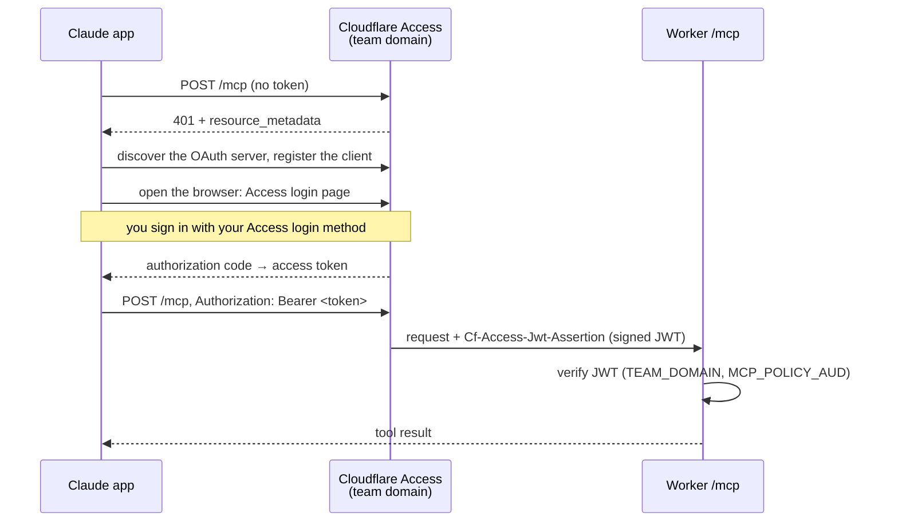
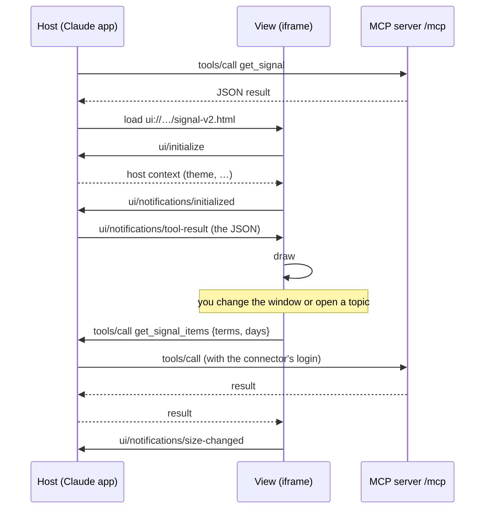

# MCP server

`https://tweets.example.com/mcp` is a [Model Context Protocol](https://modelcontextprotocol.io) server over the app's data, so Claude (the
Claude app, claude.ai, Claude Code, or any MCP client) can read your briefings, Signal, archives, lists, live feed and costs. Two of its tools
also come with **MCP Apps**: interactive views that the Claude app draws inline instead of showing JSON.

It only reads. Nothing that starts a job, changes a setting or spends money is exposed.

- Code: `src/mcp.ts` (the tools), `src/apps/` (the views), the `/mcp` route in `src/index.ts`, the token check in `src/access.ts`.
- Transport: Streamable HTTP, **stateless**. Every request builds a fresh server and answers with plain JSON (no event stream, no session).
  Only `POST` is accepted.

## The tools

| Tool | What it returns | View |
| --- | --- | --- |
| `list_briefing_topics` | Briefing topics with schedule, sources and the 30 most recent issues (drafts included) | |
| `get_briefing_issue` | The full text of one issue (`slug`, `id`) | |
| `get_signal` | Signal: topics across all watched sources, one weighted score each; top, rising, shared and single-group terms | **Signal dashboard** |
| `get_signal_items` | The items behind a Signal topic (title, link, source, date), with counts per group and source | |
| `get_costs` | Spend by feature over the last N days | **Costs dashboard** |
| `list_history_jobs`, `get_history_job` | Archive collections and their progress | |
| `get_history_analysis` | The AI analysis of a collection: themes, stance, summary | |
| `get_history_tweets` | The tweets of a collection, 200 per call at most, paged with `offset` | |
| `list_user_lists`, `list_feed_lists`, `list_x_lists` | Your account lists, feed lists (RSS, YouTube, Hacker News) and X Lists | |
| `list_monitor_watches`, `get_monitor_feed` | What is watched, and the newest items it found | |

Every tool is marked `readOnlyHint`. The tools ask the Durable Objects the same internal questions the admin app does.

## Signing in

`/mcp` has **its own Access application**, separate from the one for `/admin*`, so a credential for the MCP server opens nothing else.
Access stands in front of the Worker, and the Worker checks the result again itself:

1. Cloudflare Access lets the request through only with a valid login or service token, and adds a signed JWT
   (`Cf-Access-Jwt-Assertion`).
2. The Worker verifies that JWT (signature, issuer `TEAM_DOMAIN`, audience `MCP_POLICY_AUD`, expiry) before anything else runs. Without
   `MCP_POLICY_AUD` it refuses every request, so a misconfigured Access application cannot leave the server open.
3. Requests with an `Origin` header are refused: MCP clients are not web pages, so no website can call it with your cookies.

There are two ways to get through Access, and the server does not care which one was used:

| | Managed OAuth | Service token |
| --- | --- | --- |
| For | The Claude app and claude.ai (custom connector), and other clients that can sign in through a browser | Claude Code, scripts, CI: clients that send fixed headers |
| You sign in | Once, in the browser, with your Access login (e.g. a one-time code by email) | Never; the token is the credential |
| Access policy | **Allow**, including you (your email) | **Service Auth**, including the token |
| Revoke | Remove yourself from the policy, or revoke the session in Zero Trust | Delete or rotate the token |

### Managed OAuth (the Claude app)

With **Managed OAuth** turned on, Access acts as an OAuth 2.0 authorization server for the application. A client without a token gets a `401`
that tells it where to sign in, instead of a login page it cannot use:

```text
HTTP/2 401
www-authenticate: Bearer realm="OAuth", error="invalid_token", ...,
  resource_metadata="https://tweets.example.com/.well-known/cloudflare-access-protected-resource/mcp"
```

The metadata names the team domain (`https://<team>.cloudflareaccess.com`) as the authorization server. The flow:



The access token the client holds is opaque; only Access can read it. The Worker never sees it: it sees the JWT that Access adds after it has
checked the token and the policy. Access applies the same policy as a browser login, so who may connect is decided in one place.

**Set it up**

1. Zero Trust → Access controls → Applications → **Add** → Self-hosted. Destination `tweets.example.com/mcp`.
2. Add a policy with action **Allow** that includes your email (or your identity provider group). Add the **Service Auth** policy too if you
   also want a service token (below).
3. On the application, **Advanced settings** → turn on **Managed OAuth** → Save.
4. Copy the application's **AUD tag** and store it: `npx wrangler secret put MCP_POLICY_AUD --env=""`. `TEAM_DOMAIN` is shared with the admin
   application. No deploy is needed after setting a secret.
5. In the Claude app: Settings → Connectors → **Add custom connector**, URL `https://tweets.example.com/mcp`. It opens the Access login in the
   browser; sign in, and the connector shows its tools.

Check it from a terminal: `curl -si -X POST https://tweets.example.com/mcp` should answer `401` with the `www-authenticate` header above. A `302`
to a login page means Managed OAuth is off.

### Service token (Claude Code, scripts)

1. Zero Trust → Access controls → Service credentials → **Create service token**. Copy the Client ID and Secret (the secret is shown once).
2. On the `/mcp` application, add a policy with action **Service Auth** that includes the token.
3. Add the server to Claude Code with the token as headers:

   ```sh
   claude mcp add --transport http tweet-explorer https://tweets.example.com/mcp \
     --header "CF-Access-Client-Id: <id>" --header "CF-Access-Client-Secret: <secret>"
   ```

Locally (`npm run dev`, with `DEV_BYPASS_ACCESS=1` in `.dev.vars`) there is no Access in front: use `http://localhost:8787/mcp` with no headers.
The bypass is ignored for any request that came through Cloudflare's edge.

## MCP Apps: interactive views

An [MCP App](https://modelcontextprotocol.io/extensions/apps) is a small web page that a tool result comes with. Hosts that support them (the
Claude app, claude.ai) draw the page inline in the conversation; every other client still gets the tool's JSON text, so nothing depends on it.

| Tool | View | What you can do in it |
| --- | --- | --- |
| `get_costs` | `ui://tweet-explorer/costs-v6.html` (`src/apps/costs.ts`) | Totals and a per-day chart; switch between 7, 30 and 90 days |
| `get_signal` | `ui://tweet-explorer/signal-v2.html` (`src/apps/signal.ts`) | Pick the window and which published Signal; switch between strength and where it shows up; show background topics; open a topic to see the items behind it |

### How it fits together

1. **The tool points to the view.** `registerAppTool` gives the tool `_meta.ui.resourceUri` (a `ui://` address).
2. **The server serves the view.** `registerAppResource` answers a read of that address with the HTML (MIME type `text/html;profile=mcp-app`).
   The page is one self-contained string in `src/apps/`: inline CSS and script, nothing loaded from elsewhere.
3. **The host runs the tool, then shows the page** in a sandboxed iframe and talks to it with JSON-RPC over `postMessage`:



The messages the views use:

| Message | Direction | Meaning |
| --- | --- | --- |
| `ui/initialize` | view → host | The handshake; the answer carries the host's theme |
| `ui/notifications/initialized` | view → host | Ready to receive the result |
| `ui/notifications/tool-result` | host → view | The tool's result, the same JSON a text client gets |
| `tools/call` | view → host | Call a tool of this server again (another window, the items behind a topic). The host makes the call with the connector's own login, so the page holds no credential |
| `ui/notifications/size-changed` | view → host | The page's height, so the host sizes the frame (sent again when the content changes) |
| `ui/notifications/host-context-changed` | host → view | The theme changed (light or dark) |

The view can only reach this server's tools, through the host, and the tools are read-only, so a view cannot change or spend anything either.

### Rules for the views

- **Hand-written, no SDK, no bundler.** Each view is a plain page with a classic inline script that speaks the `ui/*` messages directly. The
  first Costs view bundled the `@modelcontextprotocol/ext-apps` client (about 520 KB) and hung at "rendering widget" in the Claude app. A
  hand-written page rendered at once. The server side still uses `@modelcontextprotocol/ext-apps/server` to register tools and resources.
- **Bump the address when a view changes** (`costs-v6` → `costs-v7`, in `src/mcp.ts`). The Claude app caches the tool list and the page.
- **After a deploy that changes a view**: in the Claude app, Settings → Connectors → disconnect and reconnect the connector, then start a
  **new chat**. A new chat alone can still show the old view.
- **Test in the Claude app**, not in Claude Code: Claude Code only shows the JSON text.
- Keep the result JSON useful on its own: clients without MCP Apps, and the model itself, read the same data.

### Adding a view

1. Write `src/apps/<name>.ts`: `export default` a complete HTML page. Copy the handshake from `costs.ts`: send `ui/initialize`, then
   `ui/notifications/initialized`, draw on `ui/notifications/tool-result`, report the size, follow the theme.
2. In `src/mcp.ts`, register the tool with `registerAppTool(..., { _meta: { ui: { resourceUri } } })` and the page with
   `registerAppResource(server, '<Name>', resourceUri, { mimeType: RESOURCE_MIME_TYPE }, …)`.
3. Deploy, reconnect the connector, open a new chat, and ask for something that calls the tool.

## Troubleshooting

| Symptom | Cause |
| --- | --- |
| The connector cannot connect, or `/mcp` answers `503 Access is not configured` | `MCP_POLICY_AUD` (or `TEAM_DOMAIN`) is not set |
| `403 Wrong audience` | `MCP_POLICY_AUD` holds the AUD tag of another application (for example the admin one) |
| The Claude app gets a login page instead of the OAuth sign-in | Managed OAuth is off on the `/mcp` application |
| Signed in, but Access says you are not allowed | The application's Allow policy does not include your email |
| `403 browsers are not accepted here` | The request had an `Origin` header: it came from a web page, not an MCP client |
| The view stays at "rendering widget", or shows an old version | Reconnect the connector and use a new chat; bump the `ui://` address if the page changed |
| A view shows "no reply from the host" | The host did not answer a `tools/call` within 15–20 seconds; try again |
